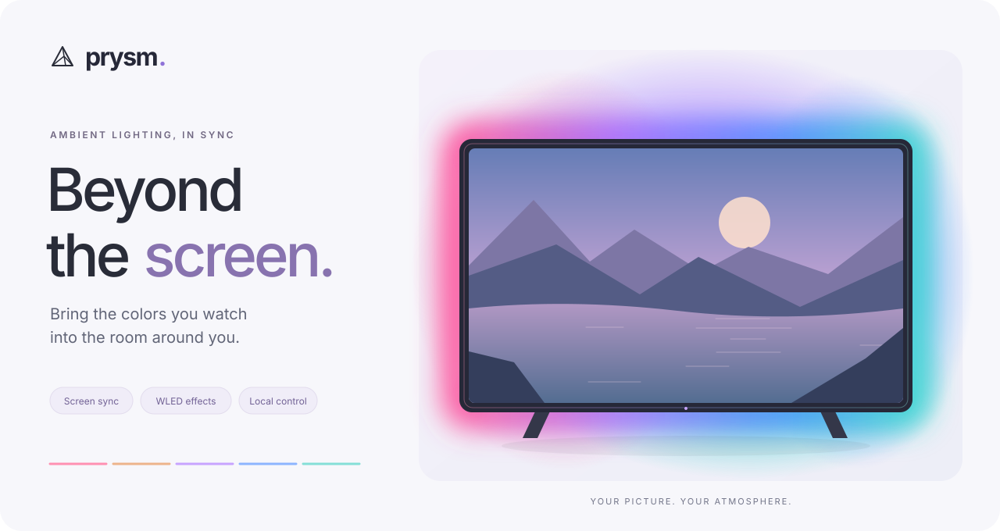
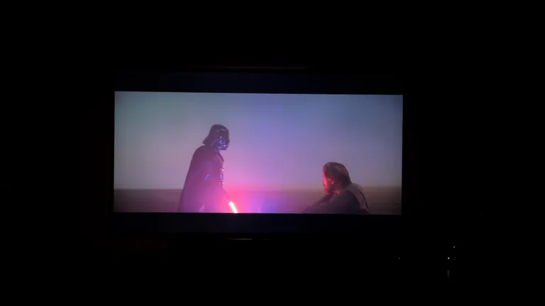
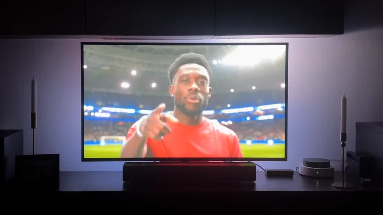

<p align="center">
  
</p>

<p align="center">
  <strong>LED strips that follow your screen.</strong><br>
  Prysm reads the picture, works out a colour for each LED around the screen
  and sends those colours to WLED.
</p>

## What you need

- **A picture source:** an HDMI capture card, or a rooted LG webOS TV.
- **WLED** with LED strips around the screen.
- **For a capture card:** a Linux or macOS computer, such as a Raspberry Pi.

```text
HDMI → capture card → computer running Prysm → WLED → LEDs
LG TV running Prysm (full package) → WLED → LEDs
LG TV (slim package) → computer running Prysm → WLED → LEDs
```

## Install

| Where Prysm runs | Package | Guide |
| --- | --- | --- |
| Raspberry Pi OS, Debian, Ubuntu | `prysm-headless` `.deb` (arm64, amd64) | [Debian](docs/users/debian.md) |
| Any Linux with Docker | `ghcr.io/ericschaal/prysm-headless` | [Docker](docs/users/docker.md) |
| TrueNAS SCALE | the same image | [TrueNAS](docs/users/truenas.md) |
| A rooted LG TV | `io.prysm.tv`, full or slim | [LG TV](docs/users/webos.md) |
| macOS, or Linux from source | build `prysm-headless` | [Build](docs/developers/README.md#build-and-run) |

Packages are attached to the [GitHub releases](https://github.com/ericschaal/prysm/releases).
Then connect the picture ([capture card](docs/users/quickstart.md) or
[LG TV](docs/users/webos.md)) and run the setup wizard in the web portal
([set up your lights](docs/users/configuration.md)). Start at
[Set up Prysm](docs/users/README.md) if you are unsure which setup fits.

The web portal has no password: keep Prysm on a trusted home network.

> **Status.** Prysm 1.x has not yet been verified end to end on real hardware
> (capture cards, WLED devices and both TV packages).

## What runs where

| Program | Runs on | Does |
| --- | --- | --- |
| `prysm-headless` | Linux or macOS | The service: capture card or slim TV in, WLED out, web portal. Shipped as the `.deb` and the Docker image. |
| `prysm-tui` | Linux or macOS | The same, plus a terminal preview of what the LEDs show; for local testing. |
| Full TV package | the TV | Captures, works out the colours, drives WLED and serves the web portal. |
| Slim TV package | the TV | Captures and sends the picture to `prysm-headless` on a computer. |

## In action

<p align="center">
  
</p>

<p align="center">
  
</p>

In the web portal you turn the lights on or off, switch between Screen sync
and WLED's own effects, watch a [live preview](docs/users/preview.md) of the
picture and the LED colours, and change settings.

## Develop Prysm

[Build and check](docs/developers/README.md) · [Architecture](docs/developers/architecture.md) ·
[Debugging](docs/developers/debugging.md) · [Contributing](docs/developers/guidelines.md)

[All documentation](docs/README.md) · [Research](research/README.md) ·
[Apache 2.0 license](LICENSE)
