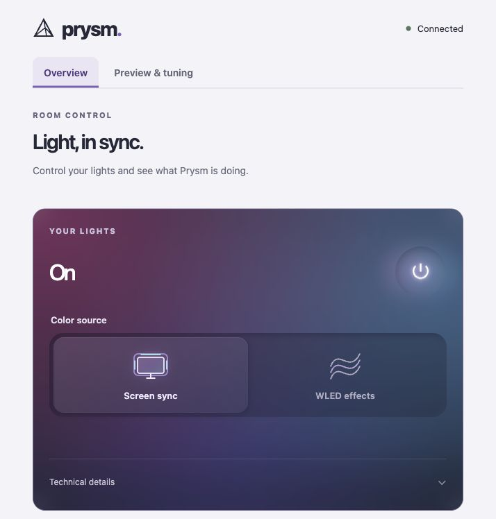

<p align="center">
  
</p>

<p align="center">
  <strong>An Ambilight system for your screen.</strong><br>
  Prysm syncs LED strips behind your screen with the colors in your video.<br>
  Send colors to WLED and control the lights from your phone.
</p>

<p align="center">
  <a href="#in-action">In action</a> ·
  <a href="#what-it-does">What it does</a> ·
  <a href="#get-started">Get started</a> ·
  <a href="#set-the-mood">Control panel</a> ·
  <a href="#develop-prysm">Develop Prysm</a>
</p>

## In action

<p align="center">
  
  <br><sub>Red and blue light follows the action across the screen.</sub>
</p>

<p align="center">
  
  <br><sub>Cool stadium light shifts to warm colors with the music video.</sub>
</p>

## What it does

Prysm captures your live video feed, reads the colors along each edge, and sends them to LED strips driven by WLED. The LEDs light the wall behind your screen with colors that follow the picture as it changes.

| | |
| :--- | :--- |
| **Colors matched to each edge** | Each section of the LED strip follows the corresponding part of the picture. |
| **Smooth transitions** | Color changes are softened over time to reduce flicker. |
| **Black-bar detection** | Follows the picture inside top/bottom and left/right bars, including thin and combined bars. |
| **Screen sync or WLED effects** | Use the phone panel to switch sources or turn the lights off. |
| **Local control** | The panel runs on your Pi and works over your local network without a cloud account. |

## Set the mood

<p align="center">
  
</p>

<p align="center"><sub>The actual control interface, shown with demo connection state.</sub></p>

One power button. Two color sources. A quiet status indicator.

- **Screen sync** lets Prysm supply live colors from your video.
- **WLED effects** returns control to WLED's effects and presets.
- **Customize in WLED** opens WLED's own interface for the finer details.

The panel remembers your selected source while the lights are off. It stays available when capture stops, and shows connection problems with retry controls. Keyboard navigation, visible focus, generous touch targets, and reduced-motion support are built in.

Prysm runs on macOS and Linux with the panel built in. One application handles
capture, colors, and control. See [settings and daily use](docs/users/configuration.md).

## How it connects

```text
USB capture device / video file / rooted LG TV → Prysm → WLED → LED strips
                                                  ↑
                                            Phone control panel
```

Bring a Linux or macOS host, a video source, and a WLED controller with LED strips.
A Raspberry Pi with 64-bit Raspberry Pi OS works for the packaged setup. On a
compatible rooted LG TV, the experimental TV sender replaces the capture card.
You can also try a video file in a desktop preview before setting up any LEDs.

## Get started


Choose one setup guide:

- **[Raspberry Pi / Debian arm64](docs/users/debian.md)** — install the package and run it as a service.
- **[Linux or macOS with a capture device](docs/users/quickstart.md)** — configure capture and WLED, then start Prysm.
- **[Rooted LG TV](docs/users/webos.md)** — install the TV sender and connect it to Prysm.
- **[Try it without LEDs](docs/users/preview.md)** — preview a video file in a desktop window.

Prysm starts idle. Open the panel, select **Screen sync**, and turn the lights on.
See [settings and daily use](docs/users/configuration.md) or [troubleshooting](docs/users/troubleshooting.md).

## Develop Prysm

[Build and test](docs/developers/README.md), understand the
[architecture](docs/developers/architecture.md), or read the
[technical decisions](docs/developers/decisions/README.md) and
[contribution guidelines](docs/developers/guidelines.md).

## Dive deeper

[Research and experiments](research/README.md) explain what was investigated,
what was measured, and which approaches were superseded. For all three audiences,
start at the [documentation index](docs/README.md).

## License

[Apache License, Version 2.0](LICENSE).
