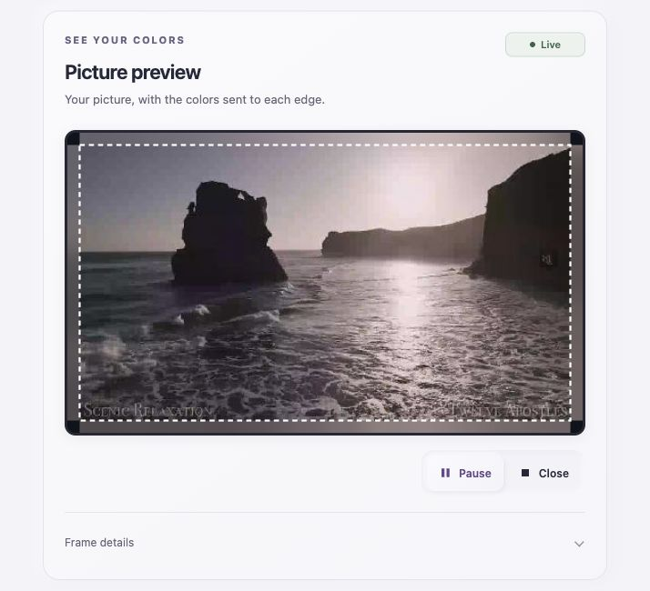

<p align="center">
  
</p>

<p align="center">
  <strong>LED strips that follow your screen.</strong><br>
  Prysm captures video, calculates edge colors, and sends them to WLED.
</p>

## What you need

- **Capture device:** an HDMI capture card or the webOS capturer on a rooted LG TV.
- **Prysm application:** runs on Linux or macOS, including a Raspberry Pi.
- **LED renderer:** WLED with LED strips.

```text
HDMI → capture card → Prysm → WLED → LEDs
Rooted LG TV → webOS capturer → Prysm → WLED → LEDs
```

Both setups need a separate computer running Prysm.

## Get started

1. [Install Prysm](docs/users/README.md#1-install-the-prysm-application).
2. Connect a [capture card](docs/users/quickstart.md) or [webOS capturer](docs/users/webos.md).
3. [Configure WLED and start Screen sync](docs/users/configuration.md).

Download packages from [Releases](https://github.com/ericschaal/prysm/releases),
or pull the Docker image from `ghcr.io/ericschaal/prysm`.

## In action

<p align="center">
  
</p>

<p align="center">
  
</p>

## Control panel

Open the panel to turn lights on or off, switch between Screen sync and WLED
effects, and change settings.

<p align="center">
  
</p>

[Preview](docs/users/preview.md) shows the captured picture and LED colors.

<p align="center">
  
</p>

## Develop Prysm

[Build](docs/developers/README.md) · [Architecture](docs/developers/architecture.md) ·
[Debugging](docs/developers/debugging.md) · [Contributing](docs/developers/guidelines.md)

[All documentation](docs/README.md) · [Research](research/README.md) ·
[Apache 2.0 license](LICENSE)
