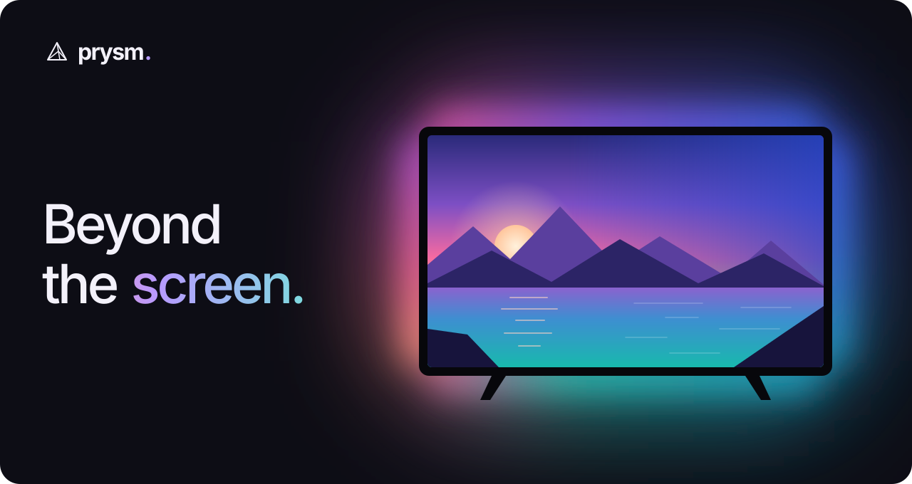
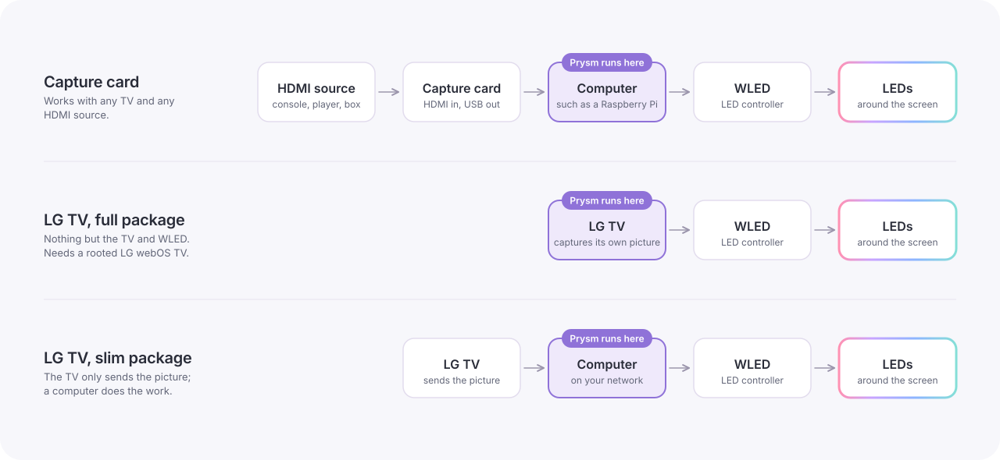
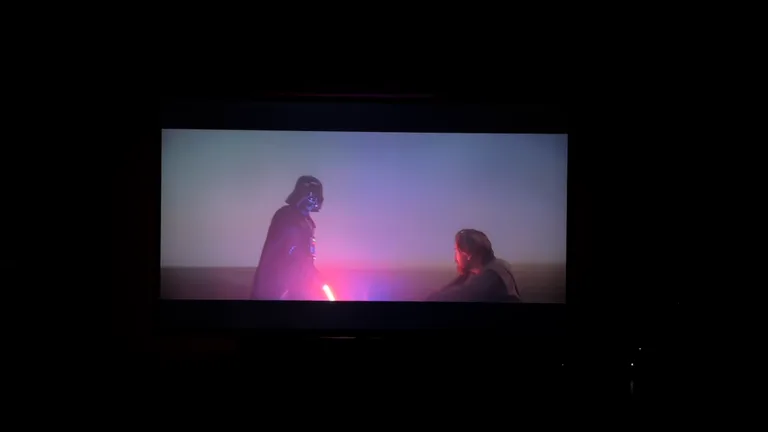
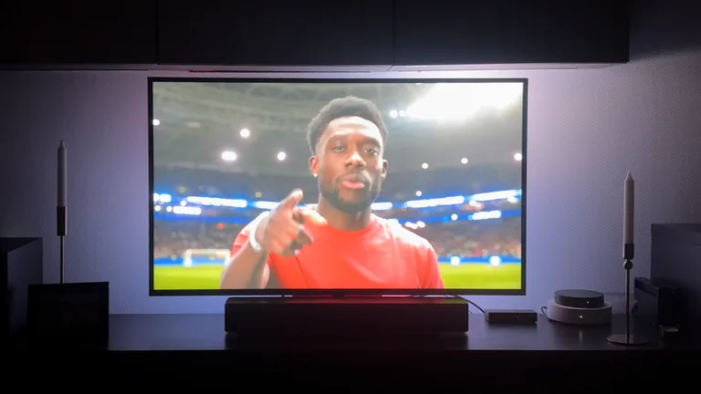
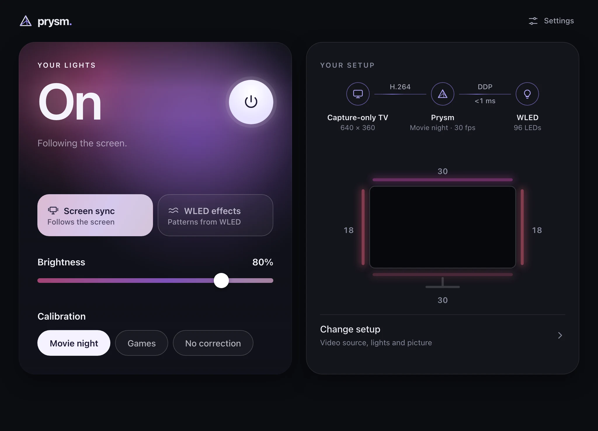

  

  Prysm reads the picture, works out a colour for each LED around the screen
  and sends those colours to WLED.

## Three ways to run Prysm

<picture>
  <source media="(prefers-color-scheme: dark)" srcset="docs/images/setups-dark.svg">
  
</picture>

| Setup | Choose it when | You need |
| --- | --- | --- |
| **Capture card** | You want it to work with any TV and any HDMI source. | HDMI capture card, a Linux or macOS computer (a Raspberry Pi will do), WLED |
| **LG TV, full package** | You have a rooted LG webOS TV and want no extra computer. | Rooted LG webOS TV, WLED |
| **LG TV, slim package** | You have a rooted LG webOS TV and would rather a computer did the work. | Rooted LG webOS TV, a computer on your network, WLED |

Every setup needs [WLED](https://kno.wled.ge/) driving LED strips around the
screen. The TV setups also light up for the TV's own apps, which a capture
card cannot see.

## Install

| Where Prysm runs | Package | Guide |
| --- | --- | --- |
| Raspberry Pi OS, Debian, Ubuntu | `prysm-headless` `.deb` (arm64, amd64) | [Debian](docs/users/debian.md) |
| Any Linux with Docker | `ghcr.io/ericschaal/prysm-headless` | [Docker](docs/users/docker.md) |
| TrueNAS SCALE | the same image | [TrueNAS](docs/users/truenas.md) |
| A rooted LG TV | `io.github.ericschaal.prysm`, full or slim | [LG TV](docs/users/webos.md) |
| macOS, or Linux from source | build `prysm-headless` | [Build](docs/developers/README.md#build-and-run) |

Packages are attached to the [GitHub releases](https://github.com/ericschaal/prysm/releases).
Then connect the picture ([capture card](docs/users/quickstart.md) or
[LG TV](docs/users/webos.md)) and run the setup wizard in the web portal
([set up your lights](docs/users/configuration.md)). Start at
[Set up Prysm](docs/users/README.md) if you are unsure which setup fits.

The web portal has no password: keep Prysm on a trusted home network.

> **Status.** Prysm 1.x has not yet been verified end to end on real hardware
> (capture cards, WLED devices and both TV packages).

## What runs where

| Program | Runs on | Does |
| --- | --- | --- |
| `prysm-headless` | Linux or macOS | The service: capture card or slim TV in, WLED out, web portal. Shipped as the `.deb` and the Docker image. |
| `prysm-tui` | Linux or macOS | The same, plus a terminal preview of what the LEDs show; for local testing. |
| Full TV package | the TV | Captures, works out the colours, drives WLED and serves the web portal. |
| Slim TV package | the TV | Captures and sends the picture to `prysm-headless` on a computer. |

## In action

  

  

In the web portal you turn the lights on or off, switch between Screen sync
and WLED's own effects, watch a [live preview](docs/users/preview.md) of the
picture and the LED colours, and change settings.

  

## Help wanted

Prysm is young, and these are the places where help would count most:

- **More TVs.** Today only rooted LG webOS TVs can capture their own picture.
  Other LG models, and other makers' TVs, need someone with the hardware.
- **Voice assistants and home automation.** Turning the lights on and off or
  changing the style from Home Assistant, Alexa or Google Home.
- **Other LED controllers.** Prysm sends colours to WLED only. An output is a
  small adapter, so other controllers and protocols can be added.

Open an [issue](https://github.com/ericschaal/prysm/issues) to talk an idea
through before you start; [Contributing](docs/developers/guidelines.md) has
the rest.

## Standing on shoulders

Prysm owes a lot to projects that came first:

- [WLED](https://github.com/wled/WLED) drives the LEDs. Prysm only tells it
  what colours to show.
- [Hyperion](https://github.com/hyperion-project/hyperion.ng) and
  [HyperHDR](https://github.com/awawa-dev/HyperHDR) are the established
  open-source ambient lighting systems. Prysm's [research](research/README.md)
  measures its sampling and black-bar detection against theirs.
- [hyperion-webos](https://github.com/webosbrew/hyperion-webos) and
  [PicCap](https://github.com/TBSniller/piccap) showed how to capture the
  picture on an LG TV. Prysm's TV capture bindings are ported from
  hyperion-webos.
- [webOS Homebrew](https://www.webosbrew.org/) makes it possible to root an
  LG TV and install apps like this one, and its
  [tv-native-apis](https://github.com/webosbrew/tv-native-apis) documents
  the TV's capture interfaces.

## Develop Prysm

[Build and check](docs/developers/README.md) · [Architecture](docs/developers/architecture.md) ·
[Debugging](docs/developers/debugging.md) · [Contributing](docs/developers/guidelines.md)

[All documentation](docs/README.md) · [Research](research/README.md) ·
[Apache 2.0 license](LICENSE)
