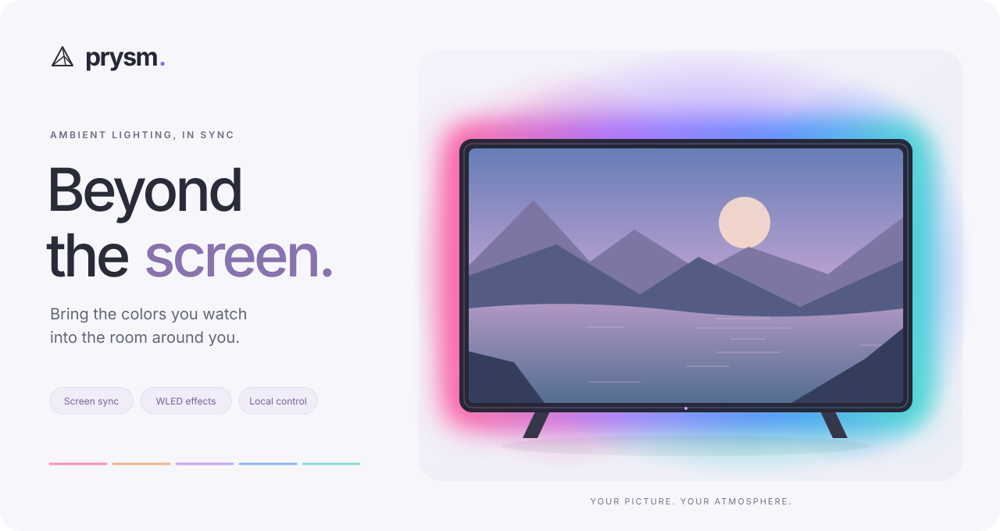
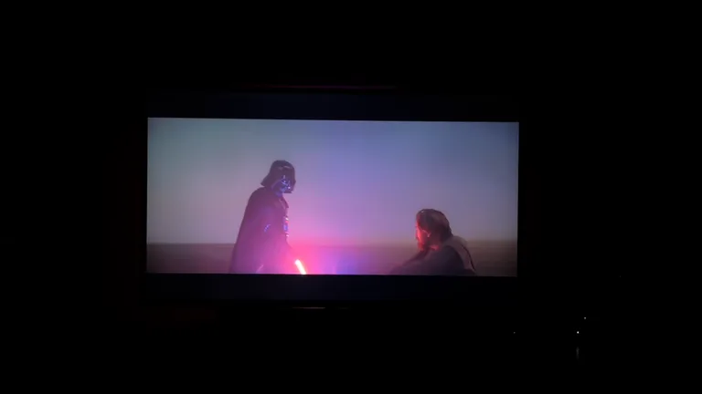
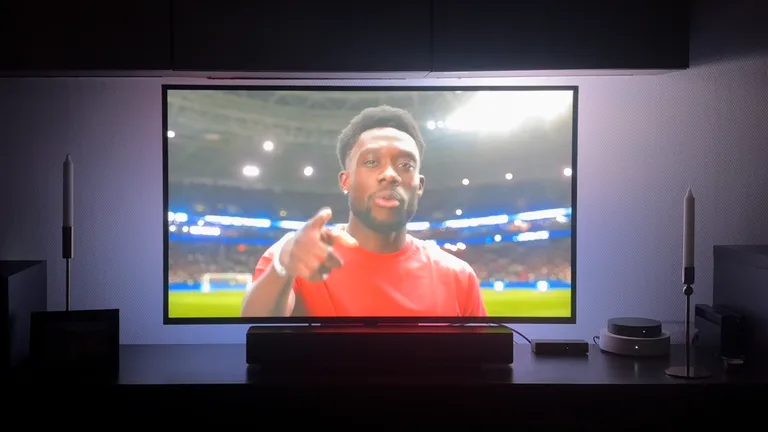
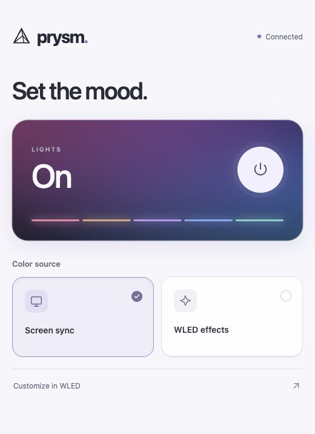

<p align="center">
  
</p>

<p align="center">
  <strong>An Ambilight system for your screen.</strong><br>
  Prysm syncs LED strips behind your screen with the colors in your video.<br>
  Send colors to WLED and control the lights from your phone.
</p>

<p align="center">
  <a href="#in-action">In action</a> ·
  <a href="#what-it-does">What it does</a> ·
  <a href="#get-started">Get started</a> ·
  <a href="#set-the-mood">Control panel</a> ·
  <a href="#under-the-hood">Under the hood</a>
</p>

## In action

<p align="center">
  
  <br><sub>Red and blue light follows the action across the screen.</sub>
</p>

<p align="center">
  
  <br><sub>Cool stadium light shifts to warm colors with the music video.</sub>
</p>

## What it does

Prysm captures your live video feed, reads the colors along each edge, and sends them to LED strips driven by WLED. The LEDs light the wall behind your screen with colors that follow the picture as it changes.

| | |
| :--- | :--- |
| **Colors matched to each edge** | Each section of the LED strip follows the corresponding part of the picture. |
| **Smooth transitions** | Color changes are softened over time to reduce flicker. |
| **Black-bar detection** | Follows the picture inside top/bottom and left/right bars, including thin and combined bars. |
| **Screen sync or WLED effects** | Use the phone panel to switch sources or turn the lights off. |
| **Local control** | The panel runs on your Pi and works over your local network without a cloud account. |

## Set the mood

<p align="center">
  
</p>

<p align="center"><sub>The actual control interface, shown with demo connection state.</sub></p>

One power button. Two color sources. A quiet status indicator.

- **Screen sync** lets Prysm supply live colors from your video.
- **WLED effects** returns control to WLED's effects and presets.
- **Customize in WLED** opens WLED's own interface for the finer details.

The panel remembers your selected source while the lights are off. It stays available when capture stops, and shows connection problems with retry controls. Keyboard navigation, visible focus, generous touch targets, and reduced-motion support are built in.

Prysm and its independent web UI run on macOS and Linux. Debian uses systemd to start the two services. See the [control-panel guide](docs/control-panel.md) for behavior and configuration.

## How it connects

```text
Capture device → Prysm → DDP over your LAN → WLED → LED strips
                   ↑
            Phone control panel
```

Prysm handles capture and color processing. WLED drives the physical LEDs. The phone panel switches the capture service and WLED's power/source state.

### What you need

- A Linux or macOS machine for capture and processing; a Raspberry Pi with 64-bit Raspberry Pi OS works for the packaged setup.
- A compatible video capture device, such as a USB capture card exposing your video feed.
- A WLED controller, addressable LED strips, a suitable power supply, and a local network connection.
- For building: a Rust toolchain supporting edition 2024.

Capture uses V4L2 on Linux and AVFoundation on macOS. It reads from a video capture device; it does not capture your desktop directly. The web UI runs natively on both platforms.

For a rooted LG TV, the experimental [minimal webOS sender](crates/capture/webos-capture/README.md)
captures on the TV and streams RGB frames directly to Prysm's `webos` input.
The initial webOS 25 target still requires hardware validation.

## Get started

Prysm owns capture, processing, rendering, its TOML configuration, and its REST
API. `prysm-web` is an independent web UI that calls that API.

Edit [prysm.toml](prysm.toml) for your hardware, then start Prysm:

```sh
cargo run -p prysm -- --config prysm.toml
```

The API listens on port 8787. Startup leaves capture stopped. Start it through
`PUT /api/state` or the web UI; processing and configuration work
without a browser connected.

For frontend development, run this in another terminal:

```sh
cd apps/prysm-web/control-ui
npm ci
npm run dev
```

Open http://localhost:5173. Vite forwards API requests to Prysm. Its Host must
appear in Prysm's `[web].allowed_hosts` (the sample accepts all hosts).

To use the standalone web UI (requires Node.js 24 and npm at build time):

```sh
cargo run -p prysm-web -- --backend http://127.0.0.1:8787
```

`prysm-web` automatically installs locked npm dependencies, builds the frontend,
and embeds it. Open http://localhost:8788. The web UI can run on another machine; set
`--backend` to Prysm's URL, `--listen` to the web UI's bind address, and
repeat `--allowed-host host:port` for accepted browser hosts. Prysm must allow
the backend URL's Host. Stopping or restarting the web UI leaves Prysm and
its configuration intact. Only Prysm reads and writes the configuration file.

Validate configuration without starting capture:

```sh
cargo run -p prysm -- --config prysm.toml check
```

## Inputs and outputs

Input and output are independent:

| Input | egui output | WLED DDP output |
| :--- | :---: | :---: |
| Local video file (`file`) | ✓ | ✓ |
| Local capture device (`device`, AVFoundation on macOS / V4L2 on Linux) | ✓ | ✓ |
| Remote TV capture (`webos`) | ✓ | ✓ |

Set `[input]` to `type = "file"` with `path`, `type = "device"` with `device`,
or `type = "webos"` with a TCP `listen` address. Files require FFmpeg 9+ on PATH.
Capture devices provide video feeds; this does not directly record the desktop.
See [webOS capture](crates/capture/webos-capture/README.md) for the remote TV sender.

Set `[output]` to `type = "wled"` with a DDP address, refresh rate, and
`[output.leds]` layout, or `type = "egui"` with a refresh rate. egui is a renderer
and requires `--features desktop`:

```sh
# Edit the file path in prysm-egui.toml first.
cargo run -p prysm --features desktop -- --config prysm-egui.toml
```

The egui window displays video, detected crop, and edge colors. Start/stop and
processing settings use the same REST API for every input/output pair. egui uses
the typed `prysm-api` client and `prysm-contract` types, polling state in the background.
It starts idle with a preview prompt; click **Start capture** to begin capture or
file playback and **Stop capture** to stop it, or press **Space** to toggle.
The toolbar shows playback status and errors, and stays in sync with the web panel.
You can also use **Start output** in the web panel or run:

```sh
curl -X PUT http://127.0.0.1:8787/api/state \
  -H 'Content-Type: application/json' -d '{"power":true,"source":"prysm"}'
```

At EOF, the last egui frame stays visible and the API remains available. **Start capture**
replays the file. Closing the window stops Prysm; the independent
web UI remains available and reports a lost connection.

## Configuration

Prysm owns one TOML file with `[web]` (REST listen address and allowed hosts),
`[input]`, `[output]`, `[processing]`, `capture_resolution`, source, and revision.
The optional `[wled]` HTTP endpoint enables WLED power/effect management for WLED
output. Without it, start/stop controls the pipeline directly, for either renderer.
`source = "prysm"` selects captured colors; `source = "wled"` selects WLED's
own effects and requires WLED output with an HTTP endpoint.

REST configuration updates save this file atomically with revision checks.
Processing changes apply live; input, resolution, and DDP settings recreate an
active session. Changing output kind, egui refresh rate, or REST listen/access
policy requires restarting Prysm. Output configuration requires an explicit `type`. No web UI preferences or duplicate pipeline config are stored.

LED counts are viewed from the front. Wiring starts at bottom-left, then runs
up the left, across the top, down the right, and back along the bottom. An absent
edge has count zero. Enable DDP input in WLED and configure its physical LED count.
See the [WLED renderer guide](crates/rendering/prysm-renderer-wled/README.md) for color handling.
File input requires FFmpeg 9+ on PATH.

The panel has no login: use a trusted LAN/private VPN and configure allowed hosts.
See the [web UI guide](docs/control-panel.md) for HTTP/configuration behavior.

## Architecture

`prysm-web` serves the UI and forwards same-origin REST requests to a configured
Prysm URL. It has no dependency on the engine crate and owns no configuration or
pipeline. `prysm` exposes REST handlers through typed actor messages and owns
configuration persistence, operations, and the capture lifecycle.

Each pipeline session runs on a dedicated Arbiter thread. Capture, processing,
and rendering use bounded mailboxes; incoming frames are dropped when busy.
Shutdown stops capture, drains accepted output, and joins the thread. egui stays
on the OS main thread, as required on macOS.

The workspace groups applications and reusable libraries by responsibility. Keep
platform capture code under capture, output backends under rendering, and shared
data types and HTTP contracts under common. Crate names are independent of paths;
run Cargo commands from the repository root with `-p <crate-name>`.

| Directory | Crates / components | Responsibility |
| :--- | :--- | :--- |
| `apps/` | `prysm`, `prysm-web` | Engine/REST service and independent web UI |
| `crates/capture/` | `prysm-capture`, `webos-capture` | Frame streams and the standalone C webOS sender |
| `crates/processing/` | `prysm-processor` | Sampling, black-bar detection, smoothing, brightness |
| `crates/rendering/` | `prysm-renderer-wled`, `prysm-renderer-desktop` | WLED DDP and optional native egui output |
| `crates/common/` | `prysm-core`, `prysm-contract`, `prysm-api` | Shared color/config types, validated REST DTOs, handlers and OpenAPI |

`prysm-contract` owns configuration data and validation. The engine’s
`apps/prysm/src/config.rs` owns file loading and pipeline restart decisions.

See [actor runtime](docs/actor-runtime.md) for lifecycle and delivery policies.

## Development

```sh
cargo test --workspace --locked
cargo fmt --all -- --check
cargo clippy --workspace --all-targets --locked
cargo run --locked -p prysm-api --bin export-openapi # print the router’s OpenAPI schema
```

From `apps/prysm-web/control-ui`, run `npm run generate-api` after API changes. It runs
the `prysm-api` schema exporter and regenerates TypeScript. `npm test` verifies both
against Rust, then checks types, bundling, and UI behavior.
See [frontend tooling](apps/prysm-web/control-ui/README.md).

GitHub Actions runs these checks on every push and pull request:

- Rust formatting, ShellCheck, and workflow validation with actionlint.
- Headless and desktop workspace tests (including doctests) on Linux and macOS,
  Clippy across all targets/examples, and API documentation link checks.
  Clippy correctness and suspicious lints fail CI; existing style and metadata warnings remain advisory.
- Generated API freshness, TypeScript checks, production bundling, and UI/proxy tests.
- C webOS transport tests on Linux and macOS, with no TV SDK required.
- Real FFmpeg playback/controller tests on macOS and ARM64 Debian package build,
  installation, and installed configuration validation.

Capture-device recovery requires a dedicated V4L2 device (for example, an HDMI/USB
capture adapter), the egui smoke test requires a native desktop session, and
webOS capture requires the TV SDK and hardware. These
remain manual; the headless transport, renderer logic, and controller tests run in CI.

## Debian deployment

Build with `./scripts/build-deb.sh`. The package contains `prysm`, `prysm-web` with its bundled UI,
and separate systemd services. Installation seeds a writable configuration under
`/etc/prysm/prysm.toml`; the service is disabled until configured.
See the [Debian guide](packaging/debian/README.md).
