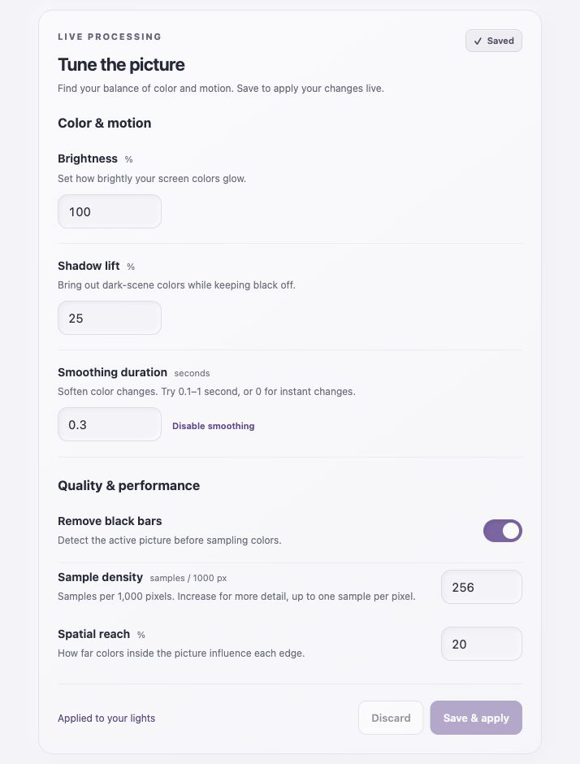

<p align="center">
  
</p>

<p align="center">
  <strong>An Ambilight system for your screen.</strong><br>
  Prysm syncs LED strips behind your screen with the colors in your video.<br>
  Send colors to WLED and control the lights from your phone.
</p>

<p align="center">
  <a href="#in-action">In action</a> ·
  <a href="#what-it-does">What it does</a> ·
  <a href="#get-started">Get started</a> ·
  <a href="#set-the-mood">Control panel</a> ·
  <a href="#develop-prysm">Develop Prysm</a>
</p>

## In action

<p align="center">
  
  <br><sub>Red and blue light follows the action across the screen.</sub>
</p>

<p align="center">
  
  <br><sub>Cool stadium light shifts to warm colors with the music video.</sub>
</p>

## What it does

Prysm captures your live video feed, reads the colors along each edge, and sends them to LED strips driven by WLED. The LEDs light the wall behind your screen with colors that follow the picture as it changes.

| | |
| :--- | :--- |
| **Colors matched to each edge** | Each section of the LED strip follows the corresponding part of the picture. |
| **Smooth transitions** | Color changes are softened over time to reduce flicker. |
| **Black-bar detection** | Follows the picture inside top/bottom and left/right bars, including thin and combined bars. |
| **Screen sync or WLED effects** | Use the phone panel to switch sources or turn the lights off. |
| **Local control** | The panel runs on your Pi and works over your local network without a cloud account. |

## Set the mood

<p align="center">
  
  <br><sub>Overview — power and color source at a glance.</sub>
</p>

<p align="center">
  
  <br><sub>Picture preview — see the active picture and computed edge colors.</sub>
</p>

<p align="center">
  
  <br><sub>Live tuning — adjust color, motion, and sampling, then save to apply.</sub>
</p>

<p align="center"><sub>Captured from the running Prysm web app with LG webOS screen sync and WLED lights.</sub></p>

Overview controls power and color source. Settings configures the full installation
in the browser, including video input, WLED, LEDs, processing and color source.
Allow phone access when starting the service or container.
Preview shows the source image, detected crop and colors sent to each edge.

- **Screen sync** lets Prysm supply live colors from your video.
- **WLED effects** returns control to WLED's effects and presets.
- **Open WLED** opens WLED's own interface for the finer details when WLED effects is selected.

The panel remembers your selected source while the lights are off. It stays available when capture stops, and shows connection problems with retry controls. Keyboard navigation, visible focus, generous touch targets, and reduced-motion support are built in.

Prysm runs on macOS and Linux with the panel built in. One application handles
capture, colors, and control. See [settings and daily use](docs/users/configuration.md).

## How it connects

Prysm has three parts:

- **Capture device:** an HDMI capture card, or the Prysm webOS capturer on a
  rooted LG TV running the **webOS capturer**.
- **Prysm application:** runs on a Linux or macOS computer, the **Prysm host**.
  It captures through V4L2 on Linux or AVFoundation on macOS, or receives video
  from the webOS capturer, then calculates the LED colors. Its browser panel controls
  the setup from your computer or phone.
- **LED renderer:** WLED receives the colors and drives the strips. It is the
  only supported renderer.

```text
HDMI video → capture card → Prysm host → WLED → LED strips
Rooted LG TV → webOS capturer → Prysm host → WLED → LED strips
```

A Raspberry Pi can be the Prysm host. The webOS capturer replaces the capture card;
you still need the Prysm host and WLED.

## Get started

1. **[Install Prysm on your host](docs/users/README.md#1-install-the-prysm-application)**
   using the Debian package, Docker, TrueNAS, or a local build.
2. **Connect your capture device:** [HDMI capture card](docs/users/quickstart.md)
   or [rooted LG TV](docs/users/webos.md).
3. **[Set up WLED and start Screen sync](docs/users/configuration.md)** in the
   browser wizard. No configuration file needs to be written by hand.

There is no official release yet; the installation guides use current CI
artifacts or local builds. After setup, [preview and tune](docs/users/preview.md)
the picture or use [troubleshooting](docs/users/troubleshooting.md).

## Develop Prysm

[Build and test](docs/developers/README.md), understand the
[architecture](docs/developers/architecture.md), or read the
[technical decisions](docs/developers/decisions/README.md) and
[contribution guidelines](docs/developers/guidelines.md).

## Dive deeper

[Research and experiments](research/README.md) cover capture behavior, performance,
and color measurements. Find all guides in the [documentation index](docs/README.md).

## License

[Apache License, Version 2.0](LICENSE).
