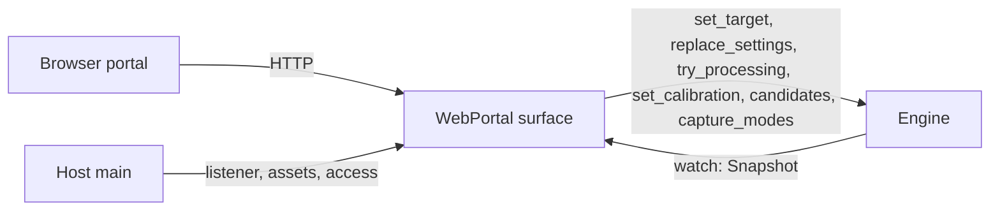

# Portal HTTP contract

The web portal is a [`Surface`](../../engine/runtime/src/surface.rs) of the
runtime ([architecture](../../../docs/developers/architecture.md)). It
serves the host's frontend bundle and a small JSON API over plain HTTP/1.1 on
any address, typically the LAN, without authentication.
Every API call maps to one `EngineHandle` call; the portal keeps no state of its
own beyond connection limits.



## Host wiring

```rust,ignore
let portal = WebPortal::from_listener(listener, ASSETS, Access::SameOrigin)?;
Prysm::builder(store).source(..).output(..).surface(portal).run(shutdown).await
```

- `WebPortal::from_listener(std::net::TcpListener, &'static [FrontendAsset], Access)`
  takes a bound listener, so bind errors surface before the host starts and the
  port is known.
- `lan_url(SocketAddr)` is the URL a browser elsewhere on the LAN opens; for a
  wildcard address, the address of the interface with the default route.
- `Access` says which browser pages besides the portal's own may use the API:
  `SameOrigin` (the default), `Origins(vec!["http://192.168.1.30:3000".into()])`
  or `AnyOrigin`. See [Access](#access).
- `.metrics(true)` also serves [`GET /metrics`](#metrics); hosts set it
  from `--metrics`. Off by default.
- `.capture_stream(remote.incoming())` serves the [capture stream](#capture-stream)
  and hands its connections to that `remote` source through its
  [`Handoff`](../../engine/ports/src/handoff.rs). Without it the path is `404`.
- Construction validates and returns `Error::Invalid` with field
  `portal.access` (an entry that is neither `scheme://host[:port]` nor exactly
  `null`; `*` needs `AnyOrigin`) or `portal.assets` (not absolute, under
  `/api/`, `.`/`..` segments, `?#%\`, duplicates, an invalid content type
  or a page, `/index.html`, that is not `Caching::Never`).
  A listener on any address is accepted.
- `FrontendAsset { path, content_type, bytes, gzip, caching }` (`caching`:
  `Caching::Never` for the page, else `Caching::Revalidate` or
  `Caching::Immutable`) lists are generated by
  `npm run bundle` as `dist/<host>/web-portal/assets.rs`, which
  [`prysm_host::assets`](../../hosts/common/src/assets.rs) embeds.

## The page

`/` and `/index.html` serve the page with the current `State` in it, as an
inert data block just before `</head>`, so the portal draws that state on its
first render; the state stream then connects as usual:

```html
<script type="application/json" id="prysm-state">{"version":"1.0.0",…}</script>
```

- The block is `State` as `GET /api/v1/state` sends it, with `<`, `>`, `&`,
  U+2028 and U+2029 written as `\uXXXX`, so no string in it can end the
  element (`</script>`) or open a comment (`<!--`).
- A browser never runs a data block, so the content security policy below
  needs no exception for it.
- A page without `</head>` (the "not built" page) is sent as it is. So is the
  page a dev server serves; without the block the portal waits for the
  stream in the page's own frame.
- The page carries no CORS headers: another site's script cannot read it.
- The page is never stored (`no-store`), so going back to the portal loads it
  again with the state of then: browsers keep no such page in their
  back/forward cache.

## Routes

API routes need no credentials; the origin policy in [Access](#access) applies
to every `/api/` request. Revisions are JSON numbers. Wire types are generated from [prysm-protocol](../../engine/protocol/src/lib.rs)
into `@prysm/contracts/application`.

| Method and path | Body | Success |
| --- | --- | --- |
| `GET` or `HEAD` `/` and exact asset paths | — | `200` asset; `/` serves `/index.html`. Unknown paths `404`; API paths never fall back to HTML. Scripts and styles (named by their content) carry `Cache-Control: public, max-age=31536000, immutable` and `Vary: accept-encoding`, and are sent with `Content-Encoding: gzip` when `Accept-Encoding` allows it; other files (`theme.js`) carry `Cache-Control: no-cache`. The page carries the current state (see [The page](#the-page)) and is never stored (`no-store`). |
| `GET /api/v1/state` | — | `200 State` |
| `GET /api/v1/state/stream` | — | `200 text/event-stream`: `data: <State>` now, then after every change |
| `GET /api/v1/preview/stream` | — | `200 text/event-stream`: `data: <PreviewEvent>` now, then at most 8 per second; see [Preview](#preview) |
| `GET /api/v1/colors/stream` | — | `200 text/event-stream`: `data: <ColorsEvent>` now, then at most 10 per second, only on change; see [Colors](#colors) |
| `PUT /api/v1/target` | `TargetRequest { target }` | `204` once the engine has applied the target |
| `PUT /api/v1/settings` | `SettingsRequest { expected, settings }` | `200 SettingsReplaced { revision }` once saved |
| `PUT /api/v1/processing/trial` | `Processing` | `204` once the lights use it, unsaved; see [Trying processing](#trying-processing) |
| `PUT /api/v1/calibration` | `Calibration { pattern, uncorrected }` | `204` once shown in the state; see [Calibration](#calibration) |
| `DELETE /api/v1/calibration` | — | `204` once cleared (also when none was set) |
| `GET /api/v1/candidates/{section}/{kind}` | — | `200 Candidate[]`: what the adapter finds to choose from; see [Candidates](#candidates) |
| `POST /api/v1/capture/modes` | `CaptureSettings` (a capture section, `{ kind, ... }`) | `200 Modes`: the sizes and rates that capture delivers; see [Capture modes](#capture-modes) |
| `GET /metrics` (only when enabled) | — | `200` Prometheus text; see [Metrics](#metrics). Disabled: `404` like any unknown path |
| `GET /api/v1/capture/stream` (only with a capture handoff) | WebSocket upgrade, subprotocol `prysm-capture.v6` | `101`: a capture-only TV's frame stream; see [Capture stream](#capture-stream) |

`State` is `{ version, target, session, input?, device, calibration?, settings, revision, surface_failures }`.
`version` is the Prysm product version (`1.0.0`, `1.0.0-rc.1`); `revision` only counts settings replacements.
`target` is what the lights were asked to do: `off`, `screen_sync` or `effects`
(the lights' own effects). `session` is what Prysm is doing, tagged by `state`;
the target is reached when `session.state` equals it (`off` is reached by
`stopped`):

| `session` | Meaning |
| --- | --- |
| `{ "state": "stopped", "failure"?: LightingFailure }` | No session; Prysm does not drive the lights. After an output failure they may not be off. |
| `{ "state": "screen_sync" }` | A session runs. It never carries a failure: it runs on valid settings and has reached its target. |
| `{ "state": "effects", "failure"?: LightingFailure }` | The lights show their own effects; no session. |
| `{ "state": "faulted", "message" }` | A session did not stop in time, or did not confirm its source's release; only a restart recovers. `message` says what did not finish, in words (not covered by the contract); the step itself is only logged. |

A `failure` is present only while it explains the present: why the target is
not reached, why `off` may not be off, or that the saved settings do not
validate (then with any target). A failure of what a command replaced (the
old output of a restart, a session that ended as the lights' own effects were
asked for) is logged, never published nor the reply. `LightingFailure` is
tagged by `kind`: `invalid { message, field? }` (`field` absent when the
settings as a whole are at fault), `adapter { message, section? }` or
`internal { message }`.
`settings` is the settings file without its `format` number, which belongs to the file alone: a `settings` body carrying `format` is refused as an unknown setting (`422 invalid`, `field` `format`). Shape: `{ capture?: { kind, ... }, output?: { kind, ... }, processing: { ..., style: { kind }, custom_style?, calibrations?: [{ id, name, correction }], active_calibration? } }`.
`processing.style.kind` is `natural`, `calm`, `vivid`, `game` or `custom`; a built-in style is stored by name only, and `custom` applies `processing.custom_style` (all seven knobs, required with `custom`, kept while another style is chosen). The built-in styles' values are not sent: the portal is built with them (`@prysm/contracts/constants`), and the [settings file](../../adapters/settings-file/README.md) describes the fields.
A calibration's `correction` is `{ warmth, tint, midtones, red, green, blue }`, each primary `{ hue, strength }`, every control -100 to 100 and 0 when omitted ([settings file](../../adapters/settings-file/README.md)).
On input, `processing`, each of its fields, a calibration's `correction` and each of its controls may be omitted and take their defaults; a `custom_style` lists all seven values. Settings sections and the objects in them (the style, a custom style, a calibration, its correction and each primary) are JSON objects, never arrays: an array inside `settings` is `422 invalid` with its `field`, such as `processing.custom_style`. The generated schema describes the response shape.
Calibrations are part of `processing`: changing them, or which one is active, while lighting runs is applied at the next frame without reopening capture or output.
Setting the target to `screen_sync` opens the capture (a failure is the
reply); the output is opened at the first frame, so an output that cannot
open ends the session and appears only in `session.failure`. While no frames arrive, `input.picture` is `quiet` or
`refused` (waiting for video) and after a few seconds the output is returned to its own
state until frames return.

`device` is what the lights say about themselves,
`{ "issue"?: …, "brightness_percent"?: …, "led_count"?: … }`, each part absent
while the output cannot tell. It is `{}` while no session holds the output:
no session, a session before its first frame, or one that returned the output
after 3 s without video. Read `session.state` and `input.picture` for which;
`{}` alone does not mean lighting stopped. `issue` (absent
when all is well) says why the lights are not showing its colours: `off`
(switched off on the device), `overridden` (WLED's live override), `not_live`
(the device is not taking realtime colours), `other_sender` or `unreachable`.
It is not a failure: lighting keeps sending, nothing is switched back, and the
field clears once the device shows the colours again. `brightness_percent`
(0-100) is the device's own brightness while it scales the colours, and
`led_count` how many LEDs the device itself says it has (WLED's LED count);
Prysm keeps sending `settings.output.leds` either way and changes none of them.

`input`, while a session runs, is measured about once a second: `fps`
(frames from the source per second), `picture`, `sent_fps` (frames whose
colours were written to the output per second) and `latency`. `latency` is
`{ "capture_ms"?: …, "output_ms": … }`, each the mean per frame over the
window: `output_ms` from Prysm receiving a frame from its source to the output
write for its colours returning; `capture_ms` from the source capturing the
frame to Prysm receiving it, present only when every frame in the window
carried a capture time (video devices on macOS and on Linux with monotonic
V4L2 timestamps). Both are measured by Prysm (not from the screen, and not
including the lights' own delay); `latency` is absent when no frame reached
the output in the window. `behind` names the step that keeps Prysm from
keeping up with its source: `processing` (turning frames into colours) or
`output` (writing them to the lights). It is set when the frame loop had no
idle time between frames (busy at least 85% of each second) for 3 seconds in
a row, and cleared after 3 seconds with slack; a source that just sends fewer
frames leaves idle time and never sets it. Absent while Prysm keeps up.
`picture` is `arriving` (at least one frame in the window), `quiet` (none,
and no reason given: no signal, no sender; also right after the session
starts) or `refused` (none, because the source's device refuses to share the
video it shows, as an LG TV does for video it does not allow to be captured;
frames come again once it allows it). Neither `quiet` nor `refused` is a failure: screen sync keeps
running, and the output is returned alike.
`/metrics` has
the received-to-flushed spans as the `prysm_frame_flush_seconds` summary.

Settings replacement is whole-document and optimistic: send the `revision` you
edited from as `expected`. The engine validates, persists, then applies. A
successful reply means saved; an apply failure afterwards appears in
`State.session.failure`. A conflict is never retried automatically.
Revisions start from a random value each time the process starts (below
2^52, so they stay exact JSON numbers) and count up by one per replacement, so a
page holding a revision from before a restart gets `409` instead of
overwriting newer settings.

The stream sends whole states, not deltas, so there are no cursors, gaps or
resynchronization: a slow reader skips intermediate states, and a reconnecting
client simply takes the first event. Idle streams carry a `:` comment every 15
seconds. Streams end when the portal shuts down or the engine stops.

## Trying processing

`PUT /api/v1/processing/trial` lights with the given processing section
(validated like `settings.processing`) while a control is dragged, without
saving it: no revision change, no state event, nothing written. The portal's
brightness slider sends it at most every 100 ms with one request in flight
and saves the final value with `PUT /api/v1/settings` on release. Any settings
save ends the trial (even one that leaves processing unchanged), and so does
30 seconds without another trial; the lights then follow the saved settings.
It applies whatever the target, so a session started meanwhile uses it.

## Calibration

A calibration pattern is engine state like the target: never saved, not
part of `settings`, and setting it changes no revision. Calibrations are
edited as usual through `PUT /api/v1/settings` (`processing.calibrations`,
`active_calibration`) and apply at the next frame; the pattern only says what the
TV shows, so the TV app and the portal follow the same `State.calibration`
on the state stream.

- `PUT /api/v1/calibration` with `{ "pattern": "gray_192", "uncorrected": false }`
  shows or switches the pattern. Both fields are required; unknown fields and
  patterns are `400`. It needs `target` `screen_sync` and does not start
  lighting: otherwise `409 needs_screen_sync`.
- While a pattern is set, the processor runs without smoothing, so a
  calibration change shows at once, and with `uncorrected: true` without any
  calibration, to compare. Brightness, colour boost, dark-scene glow, black bars and the saved
  settings are unchanged; both return to the settings when it clears.
- It clears on `DELETE`, when the target leaves `screen_sync` (`off`,
  `effects`, or a file source ending), at shutdown, and 10 minutes
  after the last `PUT` (each `PUT`, even unchanged, restarts that time), so
  a client that vanished does not leave lighting unsmoothed.

| `pattern` | TV shows |
| --- | --- |
| `gray_192` | Light gray |
| `red`, `yellow`, `green`, `cyan`, `blue`, `magenta` | That color, full screen |
| `blue_pair`, `red_pair`, `green_pair` | Moderate (left) and vivid (right) blue, red, green |
| `coast`, `garden`, `dusk` | Peach/teal, rose/sage, amber/violet |
| `review_grid` | A grid of colors |

## Candidates

`GET /api/v1/candidates/capture/device` or `.../output/wled` asks the adapter
registered for that kind what a person could pick instead of typing: the
video devices present, the WLED lights answering on the network. The video
device form and the lights form call it when they open and on "Look again";
Home's setup card and each Settings row ask it once as they show a saved
device, to name it (`useDeviceName` in the portal's `device-name.ts`);
nothing polls it.

- `section` is `capture` or `output`; anything else, an empty or extra path
  segment is `404`. A kind the host does not register in that section is
  `422 invalid` with `field` `capture.kind` or `output.kind`. Other methods
  are `405`. The origin policy applies as to every API call.
- The reply is a JSON array of `Candidate { label, detail?, led_count?, fields }`:
  `label` is what a person recognises (a device's name), `detail` where it is
  (`/dev/video2`, `192.168.1.40`), `led_count` how many LEDs a found light
  says it has (`120`), and `fields` the
  part of the kind's settings picking it fills (`{ "device": "/dev/video2" }`,
  `{ "address": "192.168.1.40" }`). Nothing found, or a kind that cannot
  look, is `[]`: the typed fields stay the way to configure it.
- It is a lookup, not state: it is not in `State`, changes no revision and
  does not pass through the engine's command queue. The adapter's
  `candidates` runs off the async runtime (the engine's blocking pool),
  opens nothing for capture or output and keeps nothing; the adapter bounds
  it to about two seconds. One lookup per section and kind runs at a time:
  who asks while it runs, also after its first asker has gone, waits for it
  and gets its answer.

What each adapter finds:

| Kind | Finds | How |
| --- | --- | --- |
| `device` | Video capture devices, filling `device` | Linux: each `/dev/video*` node that reports V4L2 video capture (asked for its capabilities, not started), named by its card name. macOS: AVFoundation's video devices, by localized name, filling the unique ID. Elsewhere nothing. |
| `wled` | WLED lights, filling `address` (the IPv4 address that answered) | One multicast DNS question for `_wled._tcp.local` from an ephemeral port (a one-shot legacy unicast query, so nothing binds port 5353), answers collected for 1.2 s, then one `GET /json/info` per answer (at most 16, in parallel, 350 ms per step) for its name and LED count. Nothing else is sent to WLED. |

Others (`file`, `remote`, `webos`, `null`) find nothing.

WLED discovery only reaches lights on the same network segment as Prysm:
across VLANs or subnets without an mDNS reflector nothing answers, and in
Docker only host networking (`network_mode: host`) lets the question out; on a
bridge network the reply is `[]`. The LED count is shown, not split over the
edges: the person enters the per-edge counts.

## Capture modes

`POST /api/v1/capture/modes` with a capture section as the settings file
holds it (`{ "kind": "device", "device": "/dev/video0", "width": 640 }`) asks
that capture's adapter what its hardware delivers. Only the fields that
select hardware count (`device`, `encoding`); the size and rate in the body
need not be valid. A form can ask before saving.

- The reply is `Modes`: `{ "status": "unknown" }` when the adapter cannot
  reach its hardware, or `{ "status": "known", "modes": [Mode, ...] }`, each
  `Mode` `{ width, height, fps }` of spans `{ min, max, step }` (every
  combination of `min`, `min + step`, … `max`). No modes: nothing with
  these settings. A span where the hardware takes any value in it, fixed
  values where it offers fixed ones.
- An unregistered kind is `422 invalid` (`capture.kind`); a field the kind
  does not decode `422 invalid` on that field (`capture.width`); a body
  without `kind` or not JSON `400`;
  other methods `405`. The origin policy applies.
- Like candidates it is a lookup, not state: off the async runtime, no
  revision, not through the command queue; the adapter keeps it brief. One
  runs at a time for the same body; who asks the same while it runs waits
  for it and gets its answer.
- Starting lighting with a size or rate a known answer excludes fails with
  `422 invalid` on that field (`capture.width`, `capture.height`,
  `capture.fps`, for `remote` also `capture.encoding`), saying what is
  delivered.

| Kind | Answers |
| --- | --- |
| `device` | Linux: the device's YUYV (even widths), RGB3 and BGR3 sizes (fixed, or ranges for stepwise and continuous sizes) and their whole-number rates (rates of a range of sizes: those at both ends); none when it cannot set its frame interval. macOS: AVFoundation's formats, each size with the whole-number rates of its ranges. Unknown when the device cannot be opened or cannot list its sizes and rates; elsewhere unknown. |
| `file` | Any size up to 3840 × 2160 at any rate: FFmpeg scales. |
| `webos` | Even sizes 2 to 1920 × 2 to 1080 at 1 to 60 fps: LG's driver scales. |
| `remote` | The newest offer a capture-only TV sent with a connection attempt (also while lighting is off, see [Capture stream](#capture-stream)), for the requested `encoding`; unknown before a TV tried. |

## Preview

`GET /api/v1/preview/stream` shows the captured picture and the area sampled
for the LEDs; their colors are in the [colors stream](#colors). Server-sent
events whose `data:` is a `PreviewEvent`, tagged by `type`:

| `type` | Fields | When |
| --- | --- | --- |
| `frame` | `sequence, source_width, source_height, width, height, viewport, jpeg` | A frame the stream has not sent yet |
| `idle` | — | No session runs (lighting `off`, `effects`, stopped after a failure, faulted) or it has not processed a frame yet |
| `unavailable` | `message` | The latest frame cannot be shown (an empty frame) |

- `jpeg` is a base64 baseline JPEG (quality 75) of the whole captured frame,
  scaled (nearest pixel) to at most 480 pixels on its longer side, never
  enlarged, keeping the aspect ratio: `width`×`height`.
- `viewport` `{ x, y, width, height }` is the part of the frame that was sampled
  after black-bar removal, in source pixels (`source_width`×`source_height`);
  the whole frame when nothing was removed. Scale by `width / source_width` to
  draw it on the image.
- `sequence` increases with every new frame, across sessions.

Cadence and demand: the stream wakes when the session publishes a frame or
the preview ends, and sends only when there is something new (a new frame,
or a change to or from `idle`), at most one event per 125 ms (the first
`idle` waits that long, so a stream opened while lighting runs starts with a
frame). So a stream sends at most 8 events per second, nothing wakes it
while nothing changes, and a slow reader gets fewer frames rather than a
queue. Each open stream
registers a preview viewer with the engine; with none, the session publishes
no preview and nothing is encoded. Encoding runs off the async runtime, once
per frame for all viewers. Lighting turning off or failing mid-stream sends
`idle` and keeps the stream open; it ends when the portal shuts down or the
client leaves. `idle` only means there is no image: why (off, effects, failed,
waiting for frames) is in the state stream. Streams with nothing new carry a `:` comment every 15 seconds.

The portal's CSP blocks `data:` and `blob:` images, so a portal page decodes
`jpeg` to bytes and draws it with `createImageBitmap(new Blob([bytes], { type:
'image/jpeg' }))` on a canvas.

## Colors

`GET /api/v1/colors/stream` carries only the colors the LEDs show, for a page
that tints with them (Home, whose preview, when played, adds only the picture).
Server-sent events whose `data:` is a `ColorsEvent`, tagged by `type`:

| `type` | Fields | When |
| --- | --- | --- |
| `colors` | `top, right, bottom, left` | The LEDs show Prysm's colors and they differ from the last ones sent |
| `idle` | — | They do not: no session runs (`off`, `effects`, stopped after a failure, faulted), it has not processed a frame yet, or its output was released after 3 s without frames |

- Each edge is `LedColors`' `[r, g, b]` sRGB bytes in screen orientation (`top`
  and `bottom` left to right, `left` and `right` top to bottom; the output's
  wiring order is not exposed), at most 16 entries (`COLOR_SEGMENTS`): each
  the average, in linear light, of an equal stretch of the edge; an edge with
  fewer samples keeps them.
- There is no `unavailable`: colors exist for every processed frame, also one
  the preview cannot show.

Cadence and demand: the stream wakes when the session publishes colors or
they end, and sends only when the summary changed, at most one event per
100 ms (the first `idle` waits that long, like the preview), so at most 10
events per second and none while the picture is still. Each open stream
registers a colors listener with the engine, independent of preview viewers:
with listeners, the session copies the colors it wrote (never the frame) once
per frame; with none, it costs one atomic load per frame. Nothing is encoded
but the JSON line. At most 8 streams; idle streams carry a `:` comment every
15 seconds.

## Metrics

`GET /metrics` is opt-in: the host enables it with `--metrics` (headless and
TUI; the TV worker has no switch). Disabled, the path is an unknown asset:
`404` for every method. Enabled, it follows the API's [origin policy](#access)
(no credentials; a foreign `Origin` is `403`), other methods are `405`, and it
answers `200` with `Content-Type: text/plain; version=0.0.4; charset=utf-8`,
the Prometheus text format, rendered by hand with `# HELP` and `# TYPE` lines.
Prometheus, or an OpenTelemetry collector with a Prometheus receiver, can
scrape it directly.

The values are a read-only view of what the engine already knows: totals
the session thread adds to (atomics, no locks or allocation per frame) and a
few fields of the state. Totals start at 0 when the process starts and only
grow, across sessions, so `rate()` and `_sum / _count` averages work. They
are not in `State`, so the state stream is not woken per frame. There are no
system metrics (CPU, memory, network: node_exporter's job), no per-adapter
metrics and no histograms.

| Name | Type | Meaning |
| --- | --- | --- |
| `prysm_build_info{version}` | gauge | Always 1; `version` is the product version, as `State.version` |
| `prysm_target{target}` | gauge | 1 for the current target (`off`, `screen_sync`, `effects`), 0 for the others |
| `prysm_session_state{state}` | gauge | 1 for the current session state (`stopped`, `screen_sync`, `effects`, `faulted`), 0 for the others |
| `prysm_settings_revision` | gauge | `State.revision` (random start per process) |
| `prysm_input_fps` | gauge | `State.input.fps`; 0 while no session runs |
| `prysm_frames_received_total` | counter | Frames taken from the capture source (frames from a remote TV included) |
| `prysm_frames_sent_total` | counter | Frames whose colors were written to the output |
| `prysm_processing_seconds_sum`, `_count` | summary | Time turning frames into colors, and how many frames |
| `prysm_frame_flush_seconds_sum`, `_count` | summary | Per frame, from Prysm receiving it from the source to its output write returning, and how many frames |
| `prysm_output_write_seconds_sum`, `_count` | summary | Time in output writes, and how many: frames and keep-alive rewrites, failed ones included |
| `prysm_output_write_failures_total` | counter | Output writes that failed; each ends lighting with a failure |
| `prysm_source_opens_total` | counter | Capture sources opened by starting lighting (also each restart after a capture or output change) |
| `prysm_output_opens_total` | counter | Outputs opened to show colors: at a session's first frame and at the first frame after a release |

Frames dropped inside a source (a newer frame replacing an untaken one) are
not counted: adapters keep no metrics. Received minus sent is what the session
did not deliver.

## Capture stream

`GET /api/v1/capture/stream` is the WebSocket a capture-only TV (the slim
webOS worker) streams its picture on, on the portal's own listener: the TV
needs one address, and the stream passes an HTTPS reverse proxy as `wss://`.
The wire protocol is the
[capture-remote adapter's](../../adapters/capture-remote/README.md#wire-protocol);
the portal only answers the upgrade and hands the connection, as a plain
blocking socket, to the `remote` source:

- For a sender of this version, its `prysm-capture-offer` header (what the
  TV can stream, at most 4096 ASCII bytes) is passed to the `remote` source
  before the portal answers `101` or `503`, so `POST /api/v1/capture/modes`
  knows a TV that is waiting for lighting. A sender of another version gets
  `426` and its header is ignored.
- `101 Switching Protocols` with `Sec-WebSocket-Protocol: prysm-capture.v6`
  when the request is a version-13 WebSocket upgrade offering that
  subprotocol and the `remote` source runs (lighting on with that capture).
  The newest connection replaces the one the source reads, which is closed
  with the *replaced* code.
- `426 Upgrade Required` (`upgrade_required`), listing the versions the portal
  speaks in `Sec-WebSocket-Protocol` (`prysm-capture.v6`), when
  the sender offers none of them.
- `503 unavailable` while no `remote` source runs: lighting is off or another
  capture is set. The TV retries every second.
- `400 bad_request` for a request that is not an upgrade; `405` for other
  methods.

The [origin policy](#access) applies as to every `/api/` path: the TV's
worker sends no `Origin`, so it needs no `--allow-origin`; a browser page of
another site is refused (`403`). Like the rest of the API there is no
password: anyone on the LAN can stream frames while the remote source runs.

Behind a reverse proxy, the proxy must pass WebSocket upgrades on this path,
including `Sec-WebSocket-Protocol` and the `prysm-capture-offer` header (standard proxies such as Caddy, nginx
with `proxy_set_header Upgrade/Connection` and Traefik do), and it must not
put this path behind a login page, since the TV cannot sign in. The TV's
picture then travels encrypted to the proxy (`https://` address on the TV).
Giving the TV Prysm's LAN address (`http://host:8787`) is the lowest-delay
option.

## Failures

Every non-2xx API response has a `Failure` body, tagged by `kind`: each kind
carries `message` and what it needs to act on, `invalid { message, field? }`,
`stale_revision { message, current }` and `adapter { message, section? }`;
every other kind is `{ kind, message }`. `message` is what the user can act
on; for `adapter` it is the whole cause chain (`context: cause: cause`),
since the cause names the problem: a device's error, a remote sender's
reason, an operating system error with a path (such as the settings file's).
It reaches every client of the portal, in command replies and, for a
lighting failure, in `State.session.failure`.

| Status | `kind` | When |
| --- | --- | --- |
| 400 | `bad_request` | A body that is not JSON or not a JSON object (also a number JSON cannot hold, such as `1e999`, wherever it is), or a problem outside the settings it carries: a top-level field unknown, missing or of the wrong type (`expected`, `settings` itself, `target`, a calibration pattern's fields, a `processing` or capture body of the wrong type as a whole) |
| 403 | `forbidden` | An `Origin` that is neither the portal's own nor allowed (`origin denied`) |
| 404 | `not_found` | Unknown route or asset (and `/metrics` when disabled), a candidates path without `capture/<kind>` or `output/<kind>` |
| 405 | `method_not_allowed` | Known API path (or enabled `/metrics`), wrong method |
| 408 | `request_timeout` | Body not received within 5 s |
| 409 | `stale_revision` | `expected` is not current; `current` is the revision to reload |
| 409 | `needs_screen_sync` | A calibration pattern while the target is not `screen_sync` |
| 413 | `payload_too_large` | Body over 1 MiB |
| 415 | `unsupported_media_type` | `PUT`, or `POST /api/v1/capture/modes`, without `Content-Type: application/json` |
| 426 | `upgrade_required` | A capture stream sender that offers none of the versions spoken here; see [Capture stream](#capture-stream) |
| 422 | `invalid` | Every problem inside `settings`, a `processing` body or a capture section, with its `field` relative to the settings (e.g. `output.address`, `processing.calibrations[1].name`, `processing.style.kind`, `format`): a value refused by processing or adapter validation, an unknown, missing or mistyped field (a section as a whole, such as one without `kind`, is named by its section, `capture`), an unknown adapter `kind` (`capture.kind`, also for candidates), or `screen_sync` without capture/output configured; also, with no `field`, a settings file that could not be loaded at start (its whole cause chain in `message`), in `State.session.failure` and for lighting asked before a save |
| 429 | `busy` | More than 8 open state streams, more than 4 preview streams, or more than 8 colors streams |
| 500 | `internal` | A panic or unexpected runtime failure |
| 502 | `adapter` | A device or adapter failed to open, write or idle; `section` (`capture` or `output`) says which side, when the engine knows |
| 503 | `faulted` | The engine is faulted; only a restart recovers |
| 503 | `unavailable` | The engine has stopped |

The portal sets no deadline on a command: every one ends, since the engine
bounds a session's stop and every adapter bounds its own calls. A client
sets its own limit above the longest
command, `prysm_runtime::COMMAND_LIMIT`: a desktop host's default stop
deadline plus `prysm_ports::SOURCE_OPEN_LIMIT`, which every capture
adapter's open fits (the portal's client waits 30 s). That is one command's
time: a command queued behind others in the engine's mailbox waits for
them too.

An `adapter` failure in the state carries the same `section`: `capture` when
opening or reading the source failed, `output` when opening, writing or
idling the lights failed. It is absent when the side is unknown.

A client that loses a command reply cannot know whether it ran; it reads the
state rather than resubmitting blindly. The engine finishes a received command
even if the client disconnects.

## Values that may grow

Enum values that Prysm sends (responses, events and the state) are open: a
minor release may add a value. A client accepts a value it does not know,
reads it as stated below (never as off or stopped), and sends a value it
read back unchanged. Values Prysm receives (request bodies) are closed: one
it does not know is refused (`400`, or `422` with `field`). The schemas list
the values this version sends.

| Field | Reading of an unknown value |
| --- | --- |
| `target` | The lights do something this client cannot name; no mode is selected. Choosing a known one still works. |
| `session.state` | As `target`; a `failure` or `message` in it is still shown. |
| `session.failure.kind`, `Failure.kind` | The general line from `section` or `field`, else "Something went wrong"; for a reply, its status class says refused (4xx) or failed (5xx); `message` is shown. |
| `…failure.section` | Absent: the side is not known. |
| `device.issue` | The lights are not showing screen sync. |
| `input.behind` | Prysm cannot keep up, without naming the step. |
| `calibration.pattern` | A calibration pattern is shown. |
| `settings` kinds and adapter values | Kept as sent and sent back unchanged. |
| `Modes.status` | `unknown`. |
| Event `type`s of the preview and colors streams | Skipped. |

## Access

Anyone who can reach the listen address can read the state and control the
lights, the full TV package's portal included. There is no token, password
or TLS. What the portal does refuse is a *web page from another site* using the
visitor's browser to reach it.

The policy applies to every `/api/` request (commands, state and the stream)
and to an enabled `/metrics`; assets are served to anyone. `Host` is not checked and forwarded headers are
ignored.

| Request | `Access` | Result |
| --- | --- | --- |
| No `Origin` header (curl, native apps, same-origin `GET` in most browsers) | any | Served |
| `Origin` is `http://` or `https://` + `Host` (the portal's own pages, by IP or name, also through a reverse proxy that serves them over HTTPS; the scheme's default port, `:80` or `:443`, may be omitted) | any | Served, no CORS headers |
| `Origin` in the list (exact, case-insensitive; the entry `null` matches `Origin: null`) | `Origins(..)` | Served with CORS; `OPTIONS` is a preflight |
| Any other `Origin`, including `null` | `AnyOrigin` | Served with CORS; `OPTIONS` is a preflight |
| Any other `Origin`, a repeated or non-ASCII `Origin` | otherwise | `403 forbidden`, `origin denied`, the engine is not called |

The portal serves plain HTTP, so it cannot check an `https://` scheme: a
reverse proxy that terminates TLS and forwards the browser's `Host` (Caddy,
nginx with `proxy_set_header Host $host`, Traefik) makes the portal's pages
same-origin. A proxy that rewrites `Host` to the portal's own address needs
the public origin allowed: `--allow-origin https://prysm.example.com`. This
adds nothing beyond what `Host` already allows.

CORS responses echo the request's `Origin` in `Access-Control-Allow-Origin`. A
preflight (`OPTIONS` from an allowed cross origin) answers `204` with
`Access-Control-Allow-Methods: GET, POST, PUT, DELETE`, `Access-Control-Allow-Headers:
content-type`, `Access-Control-Max-Age: 600` and, when asked by Chromium's
Private Network Access, `Access-Control-Allow-Private-Network: true`. No
credentials are involved, so `Access-Control-Allow-Credentials` is never sent.
Every API response carries `Vary: origin`.

Extra origins exist for a TV UI that drives a remote headless portal (the
capture-only webOS composition). A packaged webOS app loads from `file://`,
which browsers send as `Origin: null`, so the slim setup starts the desktop
host with `--allow-origin null` (`Origins(vec!["null".into()])`). That entry
admits exactly `Origin: null`, nothing else, but `null` is also what any
sandboxed frame on any site sends: allowing it lets any web page the user
opens on that network drive the lights, which is why it is never the
default.

What this protects against:

- A foreign web page sending commands through the user's browser (CSRF):
  browsers attach `Origin` to cross-site `PUT`, CORS and preflight requests, and
  JSON bodies with `Content-Type: application/json` cannot be sent cross-site
  without a preflight.
- A foreign page reading state: without CORS headers the browser withholds the
  response, and a foreign `Origin` is refused before the engine runs.

What it does not protect against:

- Anyone on the network (or anything that can route to the address) with a
  non-browser client: there is no authentication. Bind to `127.0.0.1` to keep
  the portal on the machine.
- DNS rebinding: a page on `evil.example` whose name is re-pointed at the
  portal's address becomes same-origin with it (`Origin` and `Host` both read
  `evil.example:PORT`), so it can drive the lights while the page stays open.
  Refusing it would need a `Host` allowlist, which needs configuration for every
  LAN name and address, so the portal does not check `Host`.
- Eavesdropping or tampering on the network: HTTP is plaintext.

## Limits

- Every response (assets, API, failures, preflights, the stream) carries
  `Cache-Control: no-store` (assets other than the page say their own, see
  [Routes](#routes)),
  `X-Content-Type-Options: nosniff`,
  `Referrer-Policy: no-referrer` and
  `Content-Security-Policy: default-src 'self'; frame-ancestors 'none'`: pages
  load only the bundle's own scripts, styles, images and API (no inline code,
  `data:` or `blob:` URLs, so a bundle that needs them must change the policy
  here first; the page's state block is data, never run), and no other site
  may frame the portal (clickjacking). A cross-origin TV UI is unaffected: CSP
  applies to the documents the portal serves, not to pages that call its API.
- 64 concurrent connections (the listener stops accepting at the limit), 8 state
  streams, 4 preview streams (8 events per second each), 8 colors streams (10
  events per second each), 1 MiB bodies, 5 s to read headers and bodies, 5 s per stalled socket
  write (a reader that stops reading is disconnected once the socket's send
  buffer is full).
- Every accepted connection has `TCP_NODELAY`, so an event goes out whole
  without waiting for the peer to acknowledge the one before it.
- Every accepted connection has TCP keepalive (first probe after 10 s idle,
  then every 5 s, ended after 4 unanswered), and on Linux a 30 s
  `TCP_USER_TIMEOUT`: a peer that vanishes without closing loses its
  connection, and any stream slot it held, 30 s after the first write it
  leaves unacknowledged (at most about 45 s on a stream with nothing new,
  whose next keepalive comment is up to 15 s away). Elsewhere such a
  stream's peer is dropped only after TCP's retransmission timeout.
- When `accept` finds the process out of file descriptors or memory
  (`EMFILE`, `ENFILE`, `ENOBUFS`, `ENOMEM`), the portal stops accepting
  until one of its own connections ends, with no timer; with no connection
  open nothing would wake it, so the listener then fails. Only its own
  connections ending wakes it: descriptors freed elsewhere in the process
  do not, so while its open connections are long-lived (event streams) it
  accepts nothing until one of them ends.

## Lifetime

| State | Event | Action |
| --- | --- | --- |
| Constructed | Surface starts | Adopt the listener the host bound; a listener that cannot be used ends the surface with `Error::Adapter` (`cannot use the portal listener`). |
| Serving | Request fails validation | Respond without calling the engine. |
| Serving | Client disconnects | Drop its connection; a command already sent to the engine still completes. |
| Serving | `accept` out of descriptors or memory, a connection open | Stop accepting until one of the portal's connections ends (only that wakes it; see [Limits](#limits)). |
| Serving | Listener fails (not a per-connection error, nor out of resources with a connection open) | Stop serving; the runtime records a surface failure; lighting continues. |
| Serving | Host shutdown | Close the listener at once, end streams, let open requests finish for up to 5 s, then abort the rest. |

Connection tasks are owned by the surface and joined or aborted before `run`
returns; nothing is detached.

## Tests

[`tests/http/`](tests/http/main.rs), one file per subject, runs the portal on loopback against an engine
with `prysm-runtime`'s fake adapters: construction validation, foreign origins
refused before the engine runs (commands, stream, preflight), same-origin and
origin-less requests, CORS for listed and any origins, asset serving, the page's state block (the same as `GET /api/v1/state`, never stored, unreadable cross-origin), security headers on every kind of response, state read, set target, calibration (refused unless screen sync, set/switch/clear without a revision change, closed pattern set, origin policy, cleared by `off`), processing trial (applied without saving or a revision change, validated, exact fields, origin policy), adapter failure (502),
missing settings (422), settings replace success/stale/invalid/undecodable
(each problem inside `settings` `422` with its `field`, the envelope and
bodies that are not JSON `400`),
media type and size limits, stream delivery, the stream limit, a faulted engine
(503), prompt listener shutdown, and the preview: `idle` while off and after the
session ends, frames while running, no viewer registered without a stream, the
viewer limit, the 8 per second cap, the origin policy and streams ending at
shutdown, the colors stream: `idle` while off and in `effects`, an
edge summary while running, nothing more while the colors stay the same, no
preview viewer registered for it, the 10 per second cap, its own limit, the
origin policy and `405`, and `/metrics`: `404` when disabled; content type, counted frames,
`405` and the origin policy when enabled; candidates: the fake output's
list, the default empty list, an unknown kind (422), malformed paths (404),
`405`, the origin policy, and no revision change; capture modes: the fake
source's answer for a section with an invalid size, an unknown kind (422),
undecodable fields (422 on the field), a body without `kind` (400), `405`, the origin policy
and no revision change. `tests/capture.rs` checks that a refused upgrade
(lighting off) still delivers the sender's offer. Unit tests in `src/metrics.rs` check
the exact text; unit tests in `src/preview.rs` decode the JPEG and check its size,
the sRGB colors and the strip bound; in `src/colors.rs` the averaged segments; in
`src/page.rs` the block's place and escaping (markup in a string stays a string).
