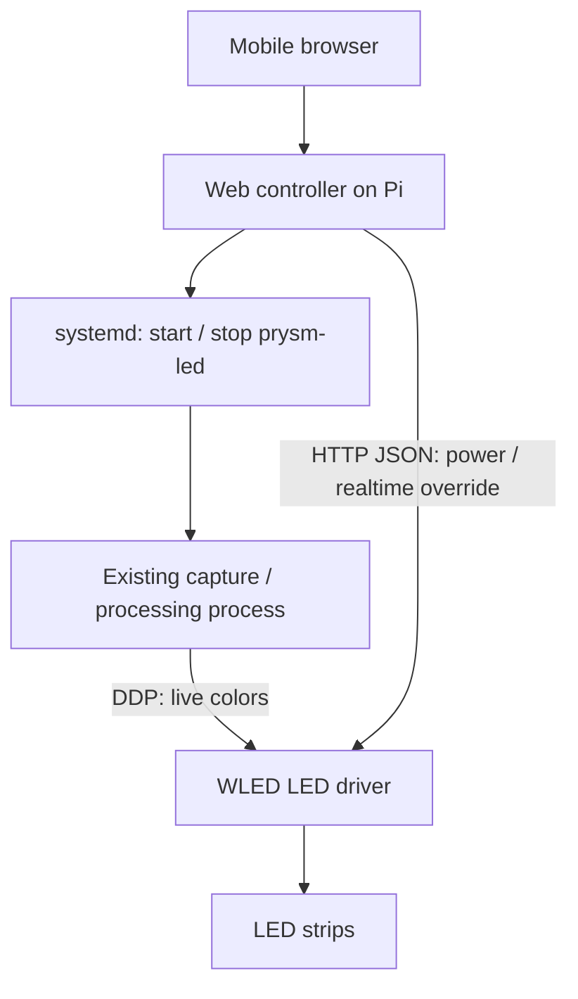

# Mobile control panel

Implemented: run a small web controller on the Raspberry Pi alongside the existing
`prysm-led.service`. The controller stays available when capture is stopped or
fails. WLED continues to drive the LEDs in every mode; Prysm supplies live colors
only when selected.

## User controls

- **Lights:** On / Off. Off means dark, not merely capture stopped. This is a
  software light control, not a physical power disconnect.
- **Source:** Prysm / WLED effects. Keep the selected source when switching Off;
  selecting another source while Off changes the next On action only.
- **Open WLED:** link to WLED's existing interface to choose effects and presets.
  Do not reproduce its effect editor in this panel.

Use a single-column React page, one explicit Turn lights on/off button, two large source cards
(Screen sync / WLED effects), and a status line. Show retry and explicit Off
controls only when the observed state needs attention. The power card fades
between a dark Off state and an RGB glow when On, respecting reduced motion.
Controls need text labels, keyboard support, visible focus,
and at least 44px touch targets. Show pending operations and disable conflicting
inputs while applying them. Loss of connectivity displays Unknown rather than
Off. Poll status every two seconds while the page is visible.

## Ownership

One control module owns switching, operation ordering, and partial failures.
Its implementation uses systemd and WLED directly. No generic process manager,
renderer abstraction, or changes to capture/processing are needed.

The current service already provides graceful SIGINT shutdown, a ten-second
stop deadline, and automatic restart after failures. Keep those policies.
Stopping capture alone currently allows WLED's normal effect to return.

## Three operating states

| Lights | Selected source | Prysm process | WLED behavior |
| --- | --- | --- | --- |
| Off | Either | Stopped | Off; ignore live input |
| On | Prysm | Running | Accept DDP live colors |
| On | WLED effects | Stopped | Render its existing effect |

WLED exposes `on` for light power, `live:false` to release realtime mode, and
`lor` for live-input override. The switching sequences use these
documented controls; their combined behavior must be verified on the installed
firmware before relying on the control panel. WLED main-segment mode may ignore
`lor` during realtime; separate release and post-stop reapplication handle that
ordering. Hardware verification has not been performed.

- **Off:** first request `{"lor":2,"live":false,"on":false,"tt":0}`
  from WLED to suppress live input and extinguish the lights, then stop
  `prysm-led.service`, release realtime with a separate `{"live":false}`
  request, then apply `{"lor":2,"on":false,"tt":0}` after the final DDP packet.
  Attempt the stop even if WLED is unreachable. Only report
  Off confirmed when both operations and observed state agree.
- **WLED effects:** stop Prysm and wait for its service to become inactive;
  then release realtime with `{"live":false}` and separately request
  `{"lor":2,"on":true}`. Leave effect, palette,
  segments, and preset settings intact. Override protects effects from stray
  live packets until the next explicit switch to Prysm.
- **Prysm:** release realtime with a separate `{"live":false}` request, then
  request `{"lor":0,"on":true}`, then start the existing service.
  Await observed live input with a bounded deadline. Do not explicitly enter
  persistent realtime mode with `live:true`; use the existing DDP timeout.
  There may be a brief normal effect before the first video frame arrives.

If Prysm fails to start, stop it to cancel automatic retries and restore the
previous confirmed light state where possible. A failed compensation remains
an error. A later capture crash uses the existing systemd restart policy;
the panel displays Restarting and WLED may resume an effect during the gap.
Do not silently label that fallback as successful Prysm output.

WLED remains usable directly for editing effects. Changes to power or realtime
override outside this panel can disagree with its last request: show the
observed state and offer an explicit retry rather than continually overwriting
external changes. Assume one live-color sender for this installation.

## Small HTTP interface

- `GET /`: static HTML, CSS, and JavaScript served by the controller.
- `GET /api/state`: selected source, observed light power, service state,
  WLED realtime state/source, pending operation, and any error.
- `PUT /api/state`: explicit `{ "power": true, "source": "prysm" }`
  or `wled`. Repeated requests are safe; no toggle command.

Serialize mutations in the controller, including requests from multiple phones.
Return 202 with an operation identifier; status polling reports completion or
failure. Concurrent mutations receive 409 and may retry after the pending
operation completes. Apply deadlines to WLED calls and service commands. A disconnected
browser must not cancel an already accepted operation. Reject invalid fields
and values, and bound request size.

systemd ActiveState/SubState/Result describe process state. WLED's JSON response
describes power and whether realtime input is arriving. Neither proves that
physical LEDs are working. Do not return a single inferred `healthy` boolean.
Retain backend error context in logs and show short actionable errors in the UI.

## Implementation and deployment

Add a Linux-only `prysm-control` binary to the existing application crate, using
Tokio, Axum, and reqwest for WLED.
Embed one static page. React source and CSS live in `prysm/control-ui`; esbuild
bundles React into the checked-in `prysm/src/control.html`. Run `npm ci` and
`npm run build` in that directory after UI edits, before building the Rust binary.
The Pi needs neither Node nor internet access to serve the page. Use fixed-argument
`systemctl` invocations without a shell instead of adding a D-Bus abstraction.

Run a dedicated `prysm-control.service` as an unprivileged account. Grant only
start/stop of `prysm-led.service` through a narrowly scoped polkit rule. The web
request must never supply a unit name, command, destination URL, or filesystem
path. The controller needs no video-group membership.

Keep controller configuration separate from `prysm.toml`: listen address, WLED
HTTP base URL. HTTP and DDP may use different ports on
the same WLED host; do not construct the HTTP URL by reusing port 4048.

The panel has no authentication, by user preference. Accept any Host with
`allowed_hosts = ["*"]`, or restrict it
to configured panel addresses. Validate Origin against the request Host,
require JSON for writes, and leave CORS disabled. Serve on the local network;
use a private VPN when the network is not trusted. Anyone who can reach the
panel can control the lights. Do not expose it through router port forwarding.

Persist only the selected source, atomically, in the controller's state
directory. On controller restart, inspect existing systemd/WLED state without
changing the lights. For a cold boot, install with Prysm disabled at boot and
configure WLED's boot preset to Off; controller startup does not restore power.
Turning lights off during use must not change service enablement. WLED itself
can reboot independently, so configure its startup behavior deliberately.

Implementation reaches: `prysm/Cargo.toml` and `Cargo.lock`, a new control binary
and embedded page, controller unit/account/polkit packaging, and
`prysm/debian/README.md`. The controller unit is an explicit asset with
maintainer scripts for account creation, stop on upgrade/removal, and daemon
reload; installation leaves it disabled. Existing capture,
processor, renderer, and desktop interfaces remain unchanged.

## Acceptance checks

- Every state transition, including choosing a source while Off and repeated
  requests; failures at each step and failure of compensation.
- Concurrent requests from two phones; page refresh during switching.
- WLED offline, denied service permissions, missing camera, restart loop,
  controller restart, Pi reboot, and independent WLED reboot.
- Installed WLED firmware: Off while DDP is arriving, release of realtime mode,
  preservation of effect settings, and resuming DDP after clearing override.
- Invalid/cross-origin API requests; phone-size layout,
  keyboard operation, pending/error announcements, and stale status.

Use a fake service-command/WLED implementation for transition tests, then one
Pi/WLED integration pass. Do not infer physical behavior solely from mocks.

## References

- Existing lifecycle: `prysm/src/main.rs`, `prysm/debian/prysm-led.service`,
  `prysm/debian/README.md`, `renderers/led-renderer/src/lib.rs`.
- [WLED JSON API](https://kno.wled.ge/interfaces/json-api/): power, realtime
  release/override, and observed realtime status.

Deferred: brightness slider, preset browser, configuration editing, live preview,
remote hosting, multi-device control, and automatic power restoration at boot.

Implementation checks: transition/failure/main-segment ordering and HTTP
Host/Origin/body-validation tests run with
`cargo test -p prysm --bin prysm-control`. UI state checks run with
`npm test --prefix prysm/control-ui` after `npm ci --prefix prysm/control-ui`.
The tests check the built React page and reject stale generated HTML.
A read-only check on 2026-10-12 confirmed
WLED 16.0.1 at `http://192.168.18.39/` exposes the required fields and receives
full-strip DDP. It did not verify state transitions or physical light behavior.
