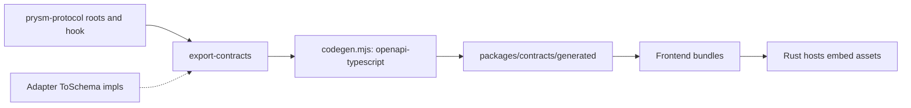

# Contract ownership and generation

Rust owns every value the frontend exchanges with Prysm. The frontend's types
are generated from OpenAPI documents the Rust exporter prints.

| Owner | Declares | Frontend import |
| --- | --- | --- |
| `prysm-ports` | `Settings`, `Processing`, `AdapterSettings`, `LightingTarget`, `Revision`, `Calibration`, `Pattern`, `Candidate` and their serde shape (the settings file format). No OpenAPI dependency. | — |
| [`prysm-protocol`](../../crates/protocol/src/lib.rs) | `State`, `Session`, `Failure`, request/response bodies; schema mirrors of the ports types and the adapter-schema hook ([`schema.rs`](../../crates/protocol/src/schema.rs), feature `schema`) | `@prysm/contracts/application` |
| Adapter crates | Their settings type and its `utoipa::ToSchema` behind feature `schema` | `@prysm/contracts/host-desktop` (device, remote, wled, null), `@prysm/contracts/host-webos` (webos, wled) |
| [`prysm-webos-service`](../../hosts/webos-service/src/schema.rs) | The TV supervisor's Luna values: `State`, `Preferences` (no picture settings: those are the portals'), request and reply bodies; schema mirrors of `Video`, `SlimEncoding`, `FailureKind`, `LightingTarget` (feature `schema`) | `@prysm/contracts/luna` |
| [`prysm-export-contracts`](../../tools/export-contracts/src/main.rs) | Which documents exist and which adapters each host document registers; serialization fixtures | Module names |

Ports types are the wire types: the portal sends `prysm_ports::Settings` as is.
`prysm-protocol` describes them with schema-only mirrors, and its tests keep each
mirror's serde shape equal to the ports type, so ports stays free of OpenAPI.

## Adapter settings schemas

Settings sections are `{ "kind": "...", ...fields }` and are decoded by the
engine's registry. In the `application` document `CaptureSettings` and
`OutputSettings` are open objects with a string `kind`; a host document types
them.

An adapter that wants a typed panel provides, behind its own optional `schema`
feature (`utoipa = { workspace = true, optional = true }`), a
`utoipa::ToSchema` for its factory's `Settings` that describes exactly the
serde shape:

- the adapter's fields only; the hook adds `kind` from the factory's `KIND`;
- fields serde defaults are not `required` (give their `default`);
- `deny_unknown_fields` as `additionalProperties: false`;
- non-JSON types as their serialized form (`IpAddr`, `SocketAddr` as strings,
  via `schema(value_type = String)`);
- the per-field ranges `validate` enforces (`minimum`, `maximum`,
  `min_length`); cross-field rules stay in `validate`.

Each adapter tests, with the feature on, that the schema's properties and
`required` set match what serde writes and accepts for a representative value
(see `schema_tests` in
[`output-wled`](../../adapters/output-wled/src/settings.rs)). `NullSettings`
(`prysm-runtime`, feature `schema`) is an object with no fields.

### Host documents

[`export-contracts`](../../tools/export-contracts/src/main.rs) depends on the
adapters with `schema` enabled and adds one document per set of hosts that
register the same kinds, listing the same factories the hosts register:

```rust,ignore
("host-desktop", Contract::new("Prysm desktop host")   // headless and tui
    .source::<DeviceSource>()
    .source::<RemoteReceiver>()
    .output::<Wled>()
    .output::<NullOutput>()
    .document()?)
```

`CaptureSettings` becomes a `oneOf` of the registered, kind-tagged schemas, each
under the settings type's own name (`DeviceSettings`, `WledSettings`, ...).
Two different schemas with one name are rejected (`SchemaConflict`). The full
TV worker (`prysm-webos`) has its own document, `host-webos`, registering the
`webos` source and the `wled` output, exactly what that host registers. The
exporter also writes a fixture of each registered section, so the frontend
tests validate a real Rust serialization against every variant.

Panels import their section type from the host document
(`import type { WledSettings } from '@prysm/contracts/host-desktop'`); the
webOS hosts import from `host-webos`.

### Luna document

`luna` describes `luna://io.prysm.tv.service`, the TV supervisor both
packages install under one name. It is one document for both flavors: `State`
carries `flavor`, and fields only one flavor uses say so in their description
("Full only", "Slim only"). Request bodies and `Preferences` reject unknown
fields. The fixtures hold a full and a slim `State` serialized by Rust, under
`luna/<Name>` keys because `State` also names an `application` root.

## Generation



The [generator](../../frontend/scripts/codegen.mjs) translates each named document
mechanically; it has no type mappings or adapter branches. Generated files are
checked in; `codegen:check` fails on missing, changed or obsolete files without
writing. `fixtures.json` holds actual Rust serializations of every root, which
the [contract tests](../../frontend/tests/contracts.test.mjs) validate against the
generated schemas.

The documents contain schemas only. Routes, status codes and limits are in the
[portal HTTP contract](../../surfaces/web-portal/HTTP-CONTRACT.md).
