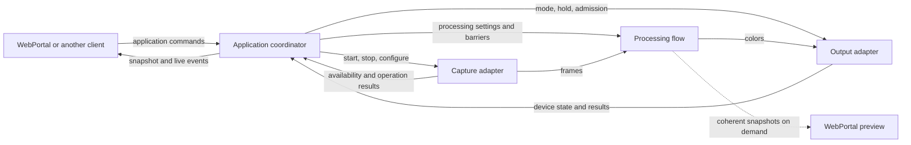
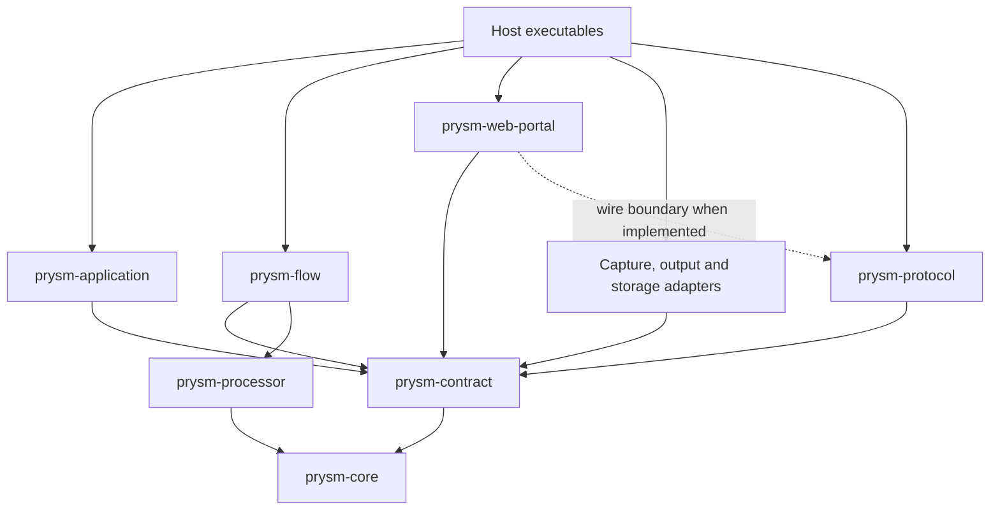

# Prysm v1 architecture proposal

Status: design draft, 2026-11-05. Names and Rust signatures below are proposed,
not implemented APIs. The assembly examples omit imports and error plumbing.
This is a greenfield v1: no compatibility layer or data migration is required.

A [compilable architecture workspace](../../v1/README.md) now lives in isolated
`v1/`. It supplies typed assemblies, a running passive processing flow, application
lighting-session sequencing, video device capture, WLED and
[terminal output](../../v1/adapters/output-terminal/README.md) adapters and explicit unavailable
shells for the remaining runtime behavior. The WLED
[transition table](../../v1/adapters/output-wled/TRANSITIONS.md) documents write
ownership, admission and the boundary between local ordering and physical UDP
delivery. Consult its source for
the current signatures; the sketches here explain the architecture.
The device [transition table](../../v1/adapters/capture-device/TRANSITIONS.md)
defines native readiness, Stop/open races, availability and verified release.
Device capture's old stream/completion-token API has been replaced; backward
compatibility is not an implementation constraint.

## Recommendation

Make processing passive. A capture adapter produces frames, a processing flow
transforms them, and an output adapter displays colors. One application
coordinator owns user intent and sequences capture/output operations. The host
assembles those libraries and owns process lifetime and supervision policy.

The processing pipeline has no start/stop protocol. Without frames it does no
frame processing. A task or thread driving the flow still has an owned lifetime,
configuration interface, and completion barrier.

This revises the earlier idea of a separately controlled pipeline lifecycle.
There is still one coordinated lighting session per application, but its
sequencing belongs in the application's private `session` module. There is no
second pipeline coordinator or generic actor framework.

## Runtime wiring

Solid arrows below represent data or commands, not package dependencies.



The host creates these connections once. Capture start/stop reuses the connection;
it does not reconstruct the graph. A stopped source is idle, whereas a closed
source interface means its owner is gone. Remote capture is another implementation
of the same capture interface.

## Libraries and dependency direction

| Module/package | Public responsibility | Must not know |
| --- | --- | --- |
| `prysm-core` | Frames, colors, geometry and numerical processing values | Tokio, HTTP, webOS, persistence |
| `prysm-processor` | Stateful, synchronous frame processing and configuration | Capture lifetime, output devices, portal |
| `prysm-contract` | Domain ports, validated settings, commands, outcomes and observation contracts | Concrete adapters, Tokio channels, HTTP status codes, OpenAPI |
| `prysm-protocol` | Application wire values, UI projections, serialization helpers and optional OpenAPI roots | Domain workflows, concrete devices |
| `prysm-flow` | Connect frame input to processor and color output; processing execution, barriers, preview tap | User intent, WLED, native capture, persistence |
| `prysm-application` | Coordinator; settings, calibration and lighting-session workflows | HTTP routing, native device APIs, WLED protocol fields |
| `prysm-web-portal` | Complete UI, HTTP API, validation at the HTTP boundary, access policy, on-demand preview encoding | Concrete coordinator, capture or output implementation |
| Capture adapter packages | Device/file capture, native TV capture, remote receiver/sender | WebPortal and application implementation |
| WLED output adapter | Device observation, power/native modes, color delivery and required refresh | Capture implementation and application settings ownership |
| File settings adapter | Typed load and atomic persistence | Pipeline transitions and HTTP |
| Host executables | Concrete assembly, Tokio, listeners, signals and supervision | Processing algorithms and device protocol sequencing |

Reuse existing packages where they fit. `prysm-contract` is reshaped; the HTTP
part of `prysm-api` moves into the portal. The shared `prysm-web` UI becomes the
portal frontend library; each host bundles it with adapter settings panels. The WLED adapter combines the existing renderer with
WLED control/observation currently living in the runtime. Native capture is
extracted from the webOS executable into a reusable adapter library.



Arrows mean "depends on." The portal can compile without the application or flow
implementation. A headless host need not build frontend assets, Axum or JPEG
encoding because of the application library. A remote capture adapter may have
its own networking dependencies.

Ports are grouped by consuming domain in `prysm-contract`: `application`,
`capture`, `processing`, `output`, `preview`, `storage`, and `observation`.
This keeps adapter implementations independent of the engines whose interfaces
they satisfy. It is an interface package, not one universal message enum or bus.
The processor remains directly usable; it does not need a trait merely to exist.

## Public interfaces

These sketches show responsibility and completion semantics. Supporting types,
derives and repetitive observation methods are omitted. Generic bounds select
implementations at assembly time; these return-position futures are not proposed
as `dyn`-compatible traits. If runtime type erasure is actually needed, box at
that specific seam rather than throughout the frame path.

```rust,ignore
pub trait ApplicationControl: Send + Sync {
    type Settings: Clone + Send + Sync + 'static;

    fn submit(&self, request: Request<ApplicationCommand<Self::Settings>>)
        -> impl Future<Output = Result<Accepted, SubmitError>> + Send;

    fn observe(&self)
        -> impl Future<Output = Result<ApplicationObservation<Self::Settings>, ControlError>> + Send;

    fn operation(&self, id: OperationId)
        -> impl Future<Output = Result<OperationStatus, LookupError>> + Send;

    fn calibrate(&self, request: Request<CalibrationCommand>)
        -> impl Future<Output = Result<CalibrationReply, ControlError>> + Send;
}

pub enum ApplicationCommand<S> {
    SetTarget(LightingTarget),
    ReplaceSettings { expected: SettingsRevision, settings: S },
}

pub trait CaptureControl: Send + Sync {
    type Settings: Clone + Send + Sync + 'static;

    fn capabilities(&self) -> CaptureCapabilities;
    fn validate(&self, settings: &Self::Settings) -> Result<(), ValidationError>;
    fn start(&self, request: CaptureStart<Self::Settings>)
        -> impl Future<Output = Result<CaptureStarted, CaptureError>> + Send;
    fn stop(&self, session: SessionId)
        -> impl Future<Output = Result<CaptureStopped, CaptureError>> + Send;
    fn observe(&self)
        -> impl Future<Output = Result<CaptureObservation, ControlError>> + Send;
}

pub trait ProcessingControl: Send + Sync {
    fn configure(&self, update: ProcessingUpdate)
        -> impl Future<Output = Result<Configured, ProcessingError>> + Send;
    fn barrier(&self, session: SessionId)
        -> impl Future<Output = Result<Quiescent, ProcessingError>> + Send;
    fn observe(&self)
        -> impl Future<Output = Result<ProcessingObservation, ControlError>> + Send;
}

pub trait OutputControl: Send + Sync {
    type Settings: Clone + Send + Sync + 'static;

    fn capabilities(&self) -> OutputCapabilities;
    fn validate(&self, settings: &Self::Settings) -> Result<(), ValidationError>;
    fn configure(&self, settings: Self::Settings)
        -> impl Future<Output = Result<Configured, OutputError>> + Send;
    fn admit(&self, epoch: StreamEpoch)
        -> impl Future<Output = Result<OutputApplied, OutputError>> + Send;
    fn hold(&self, epoch: StreamEpoch, colors: EdgeColors)
        -> impl Future<Output = Result<OutputApplied, OutputError>> + Send;
    fn finish(&self, session: SessionId, mode: IdleOutputMode)
        -> impl Future<Output = Result<OutputApplied, OutputError>> + Send;
    fn observe(&self)
        -> impl Future<Output = Result<OutputObservation, ControlError>> + Send;
}

pub trait PreviewSource: Send + Sync {
    fn subscribe(&self)
        -> impl Future<Output = Result<PreviewLease, PreviewError>> + Send;
}

pub trait SettingsRepository<S>: Send + Sync {
    fn load(&self) -> impl Future<Output = Result<Option<S>, StoreError>> + Send;
    fn save(&self, settings: S) -> impl Future<Output = Result<(), StoreError>> + Send;
}
```

`ApplicationHandle` implements `ApplicationControl` locally. A future network
client can implement it without changing the portal. Named convenience methods
such as `set_target` and `update_settings` submit the corresponding commands;
callers do not manipulate reply channels.

Calibration uses the same serialized owner but has a private typed reply, so
pairing/session credentials can reach their requester without entering public
snapshots or operation events. Application snapshots include observed capture
and output state as well as desired intent; capabilities alone cannot report
whether a device actually applied a request.

`LightingTarget` expresses Off, processed lighting, or a supported device-native
mode. It does not expose `Source::Wled` or WLED's `lor`/`live` fields. Output
capabilities determine whether native modes are available.

`CaptureStopped` confirms cleanup, including racing native opens. A timeout is
not this result: it reports cleanup pending and retains the owner. `Configured`
means configuration has reached the worker, not that a frame has already been
processed under it. `Quiescent` confirms that a sealed capture session has no
queued or in-flight processing; it is a barrier, not a pipeline stop operation.

`admit` enters streaming mode for a specific epoch. `hold` prevents processed
colors from being displayed while displaying the supplied color frame; only an
explicit later admission resumes them. Frames at or before the held epoch become
ineligible. Output retains at most one newest candidate from a later epoch of the
same session without displaying it. On admission, a retained matching frame can
be displayed immediately. This handles a fresh frame arriving before its
availability notification, including a source that sends only one frame.
`finish` closes that session's admission, accounts for
in-flight writes, and applies the idle mode. Configuring a different device is
allowed only after the previous streaming session has finished.

Output has one logical owner for both control and color writes. HTTP mode writes
and UDP color writes cannot race through unrelated clients. `OutputApplied`
distinguishes locally applied/sent from device-confirmed state; UDP does not
provide proof that LEDs displayed a packet.

### Data interfaces and execution

`FrameSource`, `ColorSink`, and `PreviewLease` are semantic stream interfaces in
the contract package, not public `watch::Receiver` aliases. For example:

```rust,ignore
pub trait FrameSource: Send + 'static {
    fn next_frame(&mut self)
        -> impl Future<Output = Result<Option<CapturedFrame>, StreamError>> + Send;
}

pub trait ColorSink: Send + 'static {
    fn offer(&self, frame: ColorFrame) -> Result<OfferResult, StreamError>;
}
```

`next_frame` awaits new data; `None` means owner closure, not capture idle.
`offer` is nonblocking and means accepted into a bounded latest-value slot or
discarded as stale, not remotely delivered. Networking executes in the adapter
owner on host Tokio. A source yields immutable frames tagged with session,
source epoch and sequence. Colors preserve those tags and add processing revision.
The coordinator allocates the session ID; capture allocates monotonically
increasing epochs within it. Epoch zero is reserved for initial waiting, and the
first captured epoch is newer. Every unavailability/resumption discontinuity
advances the epoch, so resuming never re-admits a previously invalidated frame.

The processor's public use remains simple:

```rust,ignore
let mut processor = PrysmProcessor::new(&processing_config);
let colors = processor.process_frame(frame);
```

`prysm-flow` supplies the optional reusable driver around that processor:

```rust,ignore
let flow = ProcessingFlow::connect(
    capture.frames,
    processor,
    output.colors,
    ProcessingExecution::DedicatedThread,
);
```

The flow's small Tokio dispatcher awaits `FrameSource` and hands frames to a
bounded latest-value slot for its dedicated processing thread. That thread owns
the processor, sleeps when idle, and uses `ColorSink::offer` without awaiting
network I/O. Commands and barriers reach that same worker through an ordered
private mailbox. At most one frame is processing and one is pending. This bridge
lives entirely inside `ProcessingFlow`; no per-frame task spawning or nested
Tokio runtime is needed. Preserve any partially completed input read across
control events, rather than dropping an unsafe-to-cancel read future.

The host selects execution placement and owns both dispatcher and worker through
the flow owner. Device/network I/O stays with adapters. Neither hot frame delivery
nor preview can block the application command loop.

The implemented flow is driven by `flow.owner.run(instance, shutdown)`, using the
host's application instance identity for observations and session fences. It waits
for its first configuration before processing and retains only the newest frame
while waiting. Session sequences increase within that instance, allowing barriers
to reject sealed and earlier sessions with constant memory. The demand-aware preview
tap is implemented; see the [flow protocol](../../v1/crates/flow/README.md).

A flow barrier seals the old session after capture cleanup; late frames from a
sealed session are rejected. A new capture session/discontinuity resets temporal
processing history. This prevents smoothing and crop history from leaking across
unrelated sources.

### Settings and extensibility

Application settings are typed as `Settings<CaptureSettings, OutputSettings>`:
common processing/calibration fields plus adapter-specific settings. Incomplete
setup is represented explicitly. Capture/output ports validate their own settings
without opening hardware. The coordinator validates cross-field/domain rules and
revisions, persists atomically, then applies changes.

`DeviceCaptureSettings` configures local video devices; its provisional `File`
variant returns unavailable until a separate file adapter is implemented. `RemoteCaptureSettings`
belongs to the remote transport and contains only its peer address. The server
composition owns `ServerCaptureSettings::Device`/`Remote`; neither adapter knows
about the other. Resolution/rate belong to the producing source, with remote source
configuration still deferred. The TV adapter defines `TvCaptureSettings`. These
types live with their adapters/host composition, not in a closed shared `Input` enum.
The application and flow never branch on `native_webos`.

The portal's HTTP implementation is generic over the same settings types, adding
serialization/schema bounds at that boundary. Serialization must preserve
validation. Domain traits do not require HTTP DTOs or OpenAPI derives.

The portal frontend library owns the common application UI and accepts typed
capture/output settings panels supplied by the host. Adapter UI companion
libraries own those panels. Server and webOS frontend assemblies import the
shared portal and their chosen panels, then build a bundle. The Rust host embeds
that bundle as `FrontendAsset` values (URL path, content type and bytes) and
supplies it to the portal server. Neither portal library enumerates adapters.
Adding an adapter/panel changes the host assembly, not the shared portal.

Panels receive their settings and a submission callback from the portal. Changes
go through application commands and adapter validation; panels do not control
devices directly. Adapter capabilities describe behavior, such as pattern support
and native output modes; they contain no schema or editor identifiers.
Adapter settings are defined in Rust, exported through utoipa/OpenAPI and consumed
as generated TypeScript types by panels and host clients. Each Rust library owns
its public schema roots; hosts select library documents and export combined host
documents. The TypeScript generator has no adapter/type mapping. See the
[contract ownership review](../../v1/CONTRACTS.md). A standalone exporter
avoids depending on frontend assets; generation precedes frontend builds and CI
checks drift before regeneration. Wire/schema features are optional on the settings
owner. This generates data contracts, not forms or adapter selection. See the
[buildable frontend assemblies](../../v1/frontend/README.md) for both hosts and
the typed panel boundary. The frontend packages build against an in-memory
application fixture, with type and DOM interaction tests. Rust hosts embed their
generated bundles. Full panels, asset serving and application transport contract
generation remain deferred; adapter settings generation is implemented.

Saved revision, worker-configured revision and last-frame-applied revision remain
distinct. A persisted setting can be valid yet fail to apply to unavailable
hardware. The snapshot reports that outcome rather than pretending storage and
hardware updates were atomic. Processing changes apply at frame boundaries;
capture/output changes use the session cleanup protocol.

The [settings replacement transition table](../../v1/crates/application/SETTINGS-TRANSITIONS.md)
specifies acceptance, save/apply failures, Off/shutdown races and the concrete
repository ownership required for file persistence. The application workflow is
implemented against the typed repository port. The [file adapter](../../v1/adapters/settings-file/README.md)
implements atomic replacement with a host-owned I/O worker. The
[terminal command adapter](../../v1/adapters/control-terminal/README.md) prepares typed
replacements from candidate JSON files; the host owns request IDs and submission.
The `prysm-headless` and `prysm-tui` binaries select WLED and terminal output
respectively. Their explicit `assemblies::headless` and `assemblies::tui` compositions
share a private host module: supervision owns process lifetime, while its application
connection owns observations and command submission. The private `server_capture` module retains
only server-example capture selection/schema, re-exporting `ServerCaptureSettings`
from the assembly crate root. The terminal screen alone owns
input and rendering. Persistence, validation and
save/apply ordering remain in the application and its repository port.

## Readable local implementation

Each constructor returns named parts, such as `capture.owner`, `capture.control`
and `capture.frames`. Client handles are cloneable; owners and consuming stream
ends have exclusive ownership. Only the host holds owner lifetimes. Dropping a
browser client does not stop the owner or cancel an accepted operation.
Dependencies become private owner state after construction. The host retains
emergency control handles before transferring their clones to the application;
neither host code nor assembly tests access an owner's internal wiring. Tests
that claim runtime behavior drive the actual owner through its public ports.

Inside a module, keep one visible protocol and owner loop:

```text
application/
  port implementation / handle    methods clients call
  command                        application command protocol
  coordinator                    authoritative state and dispatch
  session                        capture/output sequencing
  calibration                    calibration workflow
  policy                         v1 behavioral choices
```

The current implementation documents its phase/event rules in the
[lighting transition table](../../v1/crates/application/TRANSITIONS.md).
`session::Lifecycle` exclusively owns the phase model, resource obligations and
outstanding calls. The coordinator requests domain transitions and consumes
readiness/cleanup outcomes; it cannot inspect or mutate steps, futures or phase
fields. Within the session module, synchronous transitions and device-call
execution are separate. Operation history and observation publication have their
own private modules; published snapshots are projections of authoritative state.
These are local code boundaries, not additional actors or tasks.

Do not create one wrapper per Tokio channel. Encapsulate each complete protocol
behind its domain handle. Raw sender/receiver endpoints remain in the module
implementing that protocol. The host assembly remains the topology map.

| Connection | Local primitive | Contract callers see |
| --- | --- | --- |
| Application and device requests | Bounded `mpsc` plus reply slots | Typed request, acceptance/result, explicit failure |
| Current component state | `watch` | Current authoritative snapshot; intermediate states may coalesce |
| Application observations | Bounded live publication | Initial snapshot, sequenced updates, explicit resync requirement |
| Frame/color path | Bounded latest-value slots | Freshness, tags, closed-owner indication |
| Owner completion | Awaited task/thread handles | Actual completion, including cleanup or panic |

Required acknowledgments never depend on a lossy observer bus. A private command
reply or retained task result carries completion. Slow event subscribers cannot
block device cleanup or frame processing.

### Observation and remote semantics

An observation contains an initial versioned snapshot and a subscription created
at the same serialized point. Events carry an instance ID and sequence. On a gap,
the client obtains a new snapshot/subscription and discards superseded events.
There is no race-prone public sequence of "read state, then subscribe."

Application request IDs correlate acceptance and operation results. Accepted
operations live in a bounded in-memory registry; pending operations are not
evicted. Completed-result retention is an explicit policy. Repeated IDs can be
recognized while retained; after expiry an unknown result is not permission to
replay the operation automatically. There is no durable or unlimited exactly-once
guarantee. A new process has a new instance ID and starts idle.

Network adapters implement domain ports and translate domain messages to their
wire protocols. Native handles, reply senders, frame memory pointers and task
handles never become wire payloads. Disconnect/timeout can mean outcome unknown;
remote cleanup must either be acknowledged or remain unconfirmed. Portability
does not erase distributed failure modes. A network transport must authenticate
and authorize control access before dispatching application commands.

## Session sequences and black output

The current application implements the sequences below through
`application.owner.run(instance, shutdown)`, using the same host identity as the
flow. It loads and replaces settings through the repository port, persists before
applying, and keeps Off responsive while saves are pending. File persistence and its
independently retained host owner are implemented. Calibration remains deferred; video device capture, WLED/terminal output and
headless host supervision are implemented. Its
mailbox and observation buffers hold 16 entries; its operation registry retains
64 results and never evicts pending work. The application starts Off and requires explicit commands after session failure.
`ApplicationPolicy` configures waiting colors (black by default); unsupported
automatic startup, retry and end-session choices are not exposed.


The coordinator stays responsive while one owned session operation runs. It does
not block its entire mailbox awaiting hardware. Completion returns to the owner;
conflicting operations are serialized/rejected, and Stop can request cancellation
without dropping in-flight device writes. No accepted work is detached.

### Start

1. Validate complete settings and confirm prior cleanup.
2. Configure processing and output, allocate a new session/epoch.
3. Prepare streaming output held at black, then start capture.
4. Admit the current epoch when capture is available; fresh frames drive output.

Preparation compensates on startup failure and reports any cleanup failure.
Resource readiness is distinct from first-frame readiness.

### Temporary unavailability

The capture adapter reports unavailable with an updated source epoch. The
coordinator holds one black color frame at the output seam. Output rejects old
processed frames and refreshes the held value if its protocol needs it. When the
source resumes, the coordinator admits the fresh epoch. The flow resumes naturally
when frames arrive. A black captured image is ordinary content, not unavailability.

Injecting a synthetic black video frame before processing is a valid alternative
policy, but not equivalent: temporal smoothing may blend it with previous colors,
and it changes capture/preview history. The immediate-black default injects after
processing. It does not need continuous synthetic video frames or another actor.
Preview should report waiting with a clearly stale last captured snapshot, if
retained, rather than presenting synthetic black as captured evidence.

### Stop / switch to native effects

The v1 sequence calls `output.hold(old_epoch, black)` to close old-epoch admission,
requests capture stop, confirms capture cleanup, awaits the flow barrier,
finishes outstanding output writes, then applies the
requested idle output mode. The exact device-specific preparation lives in the
adapter; a successful final mode acknowledgment means no old-session write can
follow it. If cleanup exceeds a deadline, retain ownership and block a new start.

No frames arriving is not evidence of successful stop. Capture can still own an
LG tap, process lock, socket or thread. Likewise, cancelling an awaiting caller
must not allow a late device On write to overtake a newer Off transition.

### Optional preview

The flow owns a small demand-aware snapshot tap, not JPEG encoding. With no lease,
it does not retain pixels for preview. A lease holds coherent frame/crop/colors/
revision data with bounded retention. Preview cannot start capture or backpressure
lighting. The portal owns encoding and client limits. Disconnect/failure releases
leases and encoding resources independently of lighting cleanup.

## Explicit host assembly

The following are Rust-shaped sketches using the proposed named parts. They are
not compilable examples yet. Constructors prepare wiring without launching
lighting. `run_server`/`run_tv` are host-local lifecycle functions, not a hidden
generic application builder or a new framework.

### prysm-server host

The following lifecycle sketches describe the intended runtime, not implemented
APIs. The compilable [server assembly](../../v1/assemblies/examples/server.rs)
and [receiver ports](../../v1/adapters/remote-capture/src/receiver.rs) are the current
review surface. Transport establishment (including listener versus peer dialing),
remote source configuration and runtime source selection remain deferred.
The host retains every owner and its shutdown control before launching it. The
output shutdown handle permanently fences admission; ordinary session controls
and the latest snapshot are not crash-recovery authority. File settings also
requires its independently retained owner and admission fence, as in the concrete
headless/TUI compositions. These sketches omit those persistence details.

```rust,ignore
#[tokio::main]
async fn main() -> Result<()> {
    let deployment = Deployment::load()?;
    let receiver = RemoteCaptureReceiver::bind(deployment.capture_listen).await?;
    let capture = HostCapture::new(
        DeviceCapture::new(),
        FileCapture::new(),
        receiver.capture(),
    );
    let output = WledOutput::new();

    let flow = ProcessingFlow::connect(
        capture.frames,
        PrysmProcessor::new(&ProcessingConfig::default()),
        output.colors,
        ProcessingExecution::DedicatedThread,
    );
    // Retain permanent admission fencing independently of application session controls.
    let output_shutdown = output.shutdown;
    let application = Application::new(
        capture.control,
        flow.control,
        output.control,
        JsonSettings::new(deployment.settings_path),
        ApplicationPolicy::default(),
    );
    let portal = WebPortal::new(
        application.control.clone(),
        flow.preview,
        server_frontend::ASSETS, // Host-built shared portal + device/WLED panels.
        deployment.http_policy,
    );
    let listener = TcpListener::bind(deployment.portal_listen).await?;

    run_server(
        output_shutdown,
        receiver,
        capture.owner,
        flow.owner,
        output.owner,
        application.owner,
        portal.serve(listener),
        HostPolicy::v1(),
    ).await
}
```

The remote receiver has an independent listener/lifetime, so a portal failure
does not close the capture transport. It exposes a capture adapter handle; it
never calls the coordinator. Its terminal failure is surfaced to affected
capture sessions. Ordinary remote peer disconnection is availability, not owner
death. A receiver is only assembled in hosts that offer remote input.

For a headless host, omit the portal constructor/listener and drop the unused
preview handle. Application commands can come from another adapter. For a
processing-only consumer, call `PrysmProcessor` directly and omit every owner.

### Embedded webOS host

The TV UI is always included. This assembly also includes the browser portal for
configuration, preview and calibration; optionality is a library capability, not
the selected product configuration. Both UIs reach the same application port.
See the [UI assembly review](../../v1/UI-ASSEMBLIES.md) for the built boilerplate.


```rust,ignore
#[tokio::main(flavor = "current_thread")]
async fn main() -> Result<()> {
    let deployment = TvDeployment::load()?;
    let platform = LunaPlatformBridge::connect(deployment.supervisor_channel)?;
    let capture = WebosCapture::new(platform.capture_gate());
    let output = WledOutput::new();

    let flow = ProcessingFlow::connect(
        capture.frames,
        PrysmProcessor::new(&ProcessingConfig::default()),
        output.colors,
        ProcessingExecution::DedicatedThread,
    );
    // Retain permanent admission fencing independently of application session controls.
    let output_shutdown = output.shutdown;
    let application = Application::new(
        capture.control,
        flow.control,
        output.control,
        JsonSettings::new(deployment.settings_path),
        ApplicationPolicy::default(),
    );
    let portal = WebPortal::new(
        application.control.clone(),
        flow.preview,
        webos_frontend::ASSETS, // Host-built shared portal + webOS/WLED panels.
        deployment.http_policy,
    );
    let listener = TcpListener::bind(deployment.portal_listen).await?;

    run_tv(
        output_shutdown,
        platform,
        capture.owner,
        flow.owner,
        output.owner,
        application.owner,
        portal.serve(listener),
        HostPolicy::v1(),
    ).await
}
```

The TV supplies a different capture adapter and UI capabilities. There is no
`run_native`, native-only settings store, or embedded switch in shared application
code. The bridge translates platform events into a capture gate; it does not own
Prysm power intent or calibration. Explicit user controls from Luna, if offered,
use the application port, just like the portal.

Native capture owns its tap/thread and acknowledges actual release. The outer
webOS supervisor retains permission handling, process/descriptor setup, power
policy, native watchdogs and process reaping. Process death starts a new idle
application instance if the host chooses to launch another process.

For capture on TV with processing elsewhere, compose the same native capture
adapter with `RemoteCaptureSender`. The sender supplies the remote session's
capture requests and consumes the frame source. The TV needs neither the
processor, output adapter nor portal for that composition. Its TV UI remains
present, with a local platform client and an injected remote application client.
The receiving host
uses `RemoteCaptureReceiver` as its capture adapter.

### What host lifecycle code actually does

`run_server` and `run_tv` retain each owner task/thread handle and observe exits
with a small explicit `select!` loop. They perform staged startup and cleanup on
partial startup failure. They do not use a shared fail-fast `try_join!` that drops
all futures when an optional server fails.

After startup, the v1 match is conceptually:

```text
portal exit       -> report unavailable; continue observing other owners
preview failure   -> report preview unavailable; lighting continues
session failure   -> notify coordinator through retained failure state;
                     terminate active session and await remaining cleanup
required adapter
owner exit        -> terminate the composition through terminal owner shutdown
coordinator exit  -> host permanently fences output admission and requests
                     terminal owner shutdown; retain and join every owner
process shutdown  -> stop accepting commands; request coordinated cleanup;
                     then close and join remaining owners
```

Host shutdown capabilities are retained before moving regular controls into the
coordinator; they bypass a dead coordinator, not device serialization or cleanup
barriers. A last application snapshot is not authority for emergency session/epoch
arguments: accepted work may be ahead of publication. Terminal shutdown therefore
uses owner-scoped controls and an irreversible output admission fence. Remaining
owners clean up independently; output Off need not wait for capture release once
reopening is impossible, but the host still joins every owner and preserves any
unconfirmed cleanup. Only the resource-free coordinator may be cancelled during
this takeover; device/flow owners remain retained. See the concrete
[host ownership and failure transitions](../../v1/assemblies/HOST-LIFECYCLE.md).

Session faults are distinct from owner-task death. A dead owner cannot
accept a new Start; the host must explicitly reconstruct that composition or
terminate it. No automatic actor restart is assumed.

An in-process policy cannot contain a process abort or arbitrary native memory
corruption. Host-chosen process isolation handles those failure domains. Deadline
expiry is reported to the host without pretending cleanup succeeded.

## Architectural guarantees versus v1 policies

| Architectural guarantee | Changeable v1 policy and its owner |
| --- | --- |
| One authoritative application mutation order | Conflicting operations serialize or reject; application policy |
| Every owner/task/native resource is tracked to completion | Host shutdown deadlines and escalation actions |
| Capture stop and output/flow barriers have truthful completion semantics | No restart after terminal failure; application policy |
| Frame lineage prevents stale writes after an acknowledged output transition | Black while waiting; application policy using output hold |
| Availability is distinct from terminal failure and cleanup | Wait and resume on temporary loss; application policy |
| Clients observe snapshots and explicit gaps, never an assumed reliable broadcast | Buffer sizes and completed-operation retention |
| User intent is separate from observed device state | Start idle after process restart; application policy |
| WebPortal/preview have separate resources and failure reporting | Isolate their runtime failures; host/portal policy |
| Host controls deployment, capabilities and composition | Which inputs, modes and settings panels a host offers |
| Processing is independent of capture lifecycle and transport | Dedicated processing thread; host execution choice |
| Native hardware/adapter contracts preserve required sequencing | Device-specific timeout/refresh tuning inside adapter constraints |

These policies are named functions/state transitions in application and host
modules. No general `PolicyEngine`, plugin registry or configurable workflow
language is proposed. Waiting presentation is a concrete `ApplicationPolicy` value. A new startup or
recovery rule requires implementing and testing its transitions before exposing
it to hosts; there is no generic policy trait for unsupported behavior. A changed
public guarantee requires a contract change.

Calibration stays in the application: pairing authorization, temporary overrides,
mutation exclusivity, profile save and restoration. Capabilities replace checks
for particular capture implementations. Pattern presentation is an explicit
capability; the ordinary diagnostic preview tap is not a calibration authority.

## Refactor sequence and proof

1. Define contract modules and the two explicit host assemblies. Keep the
   existing processor/frame representations where suitable; remove deployment
   flags and vendor-specific application commands.
2. Extract native/host capture ownership and unified WLED control/output behind
   the ports. Preserve tap admission, cleanup, mode ordering and error causes.
3. Extract passive processing flow and demand-aware preview tap. Remove the
   existing nested pipeline runtime/start-stop owner.
4. Extract the shared application coordinator, typed settings and calibration.
   Move session sequencing into its private module; keep policies identifiable.
5. Assemble the complete optional portal, then both hosts. Remove old runtime
   entry points and replace generated API contracts and frontend callers together.
6. Validate end-to-end behavior before the v1 release; no compatibility or
   migration path is part of this work.

Small, meaningful acceptance tests should demonstrate:

- The same coordinator works with fake, host and TV capture ports without
  deployment branches; headless builds exclude portal assets and encoding.
- Capture stop racing an open acknowledges only after resource release; a timed
  out cleanup prevents another start.
- Delayed old frames/device writes cannot override held black, Off, native mode,
  or a newer session. An output timeout never becomes false confirmation.
- No input means no processing calls; resumed epochs reset temporal history.
- Preview disconnect, lag and encoding failure do not stall or terminate lighting.
- A command remains owned after client disconnect; snapshot subscription cannot
  miss a transition silently; restart invalidates old operation identities.
- Saved and applied revisions remain distinguishable, including calibration
  cleanup and persistence failures.
- Coordinator death invokes host cleanup without depending on the dead mailbox.

Before freezing v1 signatures, compile minimal server/TV assemblies and one fake
network port against the interfaces. This checks configuration generics, async
Send bounds, subscription ownership and CPU-thread integration. Hardware tests
must then verify native tap cleanup and WLED transition/refresh behavior.

## Current-code evidence

The proposal derives its hardware and ownership constraints from:

- [Application assembly](../../apps/prysm/runtime/src/application.rs)
- [Native input seam](../../apps/prysm/runtime/src/input.rs)
- [Worker ownership and dataflow](../../apps/prysm/runtime/src/pipeline/worker.rs)
- [Lifecycle cleanup retention](../../apps/prysm/runtime/src/pipeline/runtime.rs)
- [WLED transition ordering](../../apps/prysm/runtime/src/control/switching.rs)
- [Settings commit ordering](../../apps/prysm/runtime/src/settings.rs)
- [Preview ownership](../../apps/prysm/runtime/src/preview.rs)
- [TV capture and supervisor bridge](../../apps/prysm-webos-capture/src/portal.rs)
- [WLED color delivery](../../crates/rendering/prysm-renderer-wled/src/lib.rs)

Those files describe the current implementation. This proposal is not evidence
that the new interfaces compile or have been verified on hardware.
