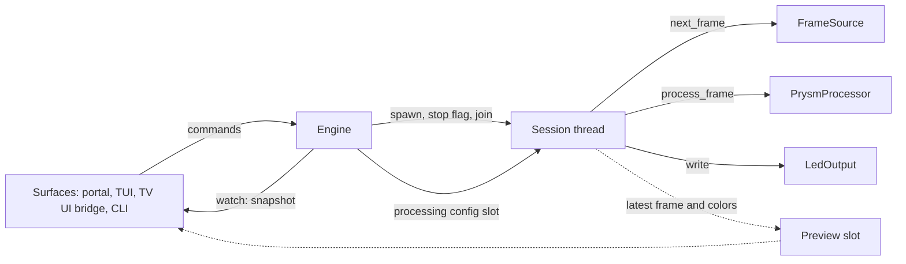

# Prysm v1 simplified runtime

Status: implemented in [v1](../../v1/README.md) for the desktop hosts
(`prysm-headless`, `prysm-tui`), 2026-11-12; the webOS hosts are not built yet.
Supersedes the runtime model of the [v1 architecture proposal](prysm-v1-architecture.md).
The code is authoritative where the snippets below differ in detail.

## Why revise

The [v1 workspace](../../v1/README.md) has the right boundaries but the wrong
amount of machinery inside them.

| Observation | Evidence |
| --- | --- |
| Every component is its own actor | Application, flow, device capture, WLED, terminal output and settings each define a command enum, reply channels, a mailbox, an observation stream, a shutdown handle and a `run` signature |
| Adapters carry the hard parts | The WLED adapter is about 720 lines of owner/mailbox/control around 156 lines of protocol in `transport.rs` (both since removed) |
| In-process calls use a distributed protocol | Instance, session, epoch, frame-stamp, operation and cursor identities guard frames that cross three independent mailboxes |
| The host is closed | `assemblies/src/host/owners.rs` (since removed) had fixed owner fields and an enum naming the WLED and terminal outputs; a capture-only TV host cannot use it |
| Static generics block runtime choice | Ports are not `dyn`-compatible, so a server cannot choose between a local device and a remote TV at runtime |

Two of the four required products (both webOS assemblies) are still fixtures.

## Rule

**Concurrency lives in one runtime. Adapters are plain objects.**

A new capture source or LED driver is one file that implements one trait. It
contains no channels, no `select!`, no identities and no lifecycle state machine.

## Runtime shape



There are exactly two long-lived owners:

- **Engine**: one Tokio task and the only mailbox. It owns user intent,
  settings, the adapter registry and at most one session.
- **Session**: one dedicated thread that owns a source, the processor and an
  output for as long as lighting is on.

## Ports

Blocking, object-safe, owned by the session thread.

```rust,ignore
pub enum Pull { Frame(Frame), /* no frame within the timeout */ Idle, /* finished */ Ended }

pub trait FrameSource: Send {
    /// `Idle`: the loop checks its stop flag. `Ended` (a file at its end) is
    /// completion, not failure.
    fn next_frame(&mut self, timeout: Duration) -> Result<Pull, AdapterError>;
    /// Release native resources. Returning `Ok` certifies release.
    fn close(self: Box<Self>) -> Result<(), AdapterError>;
}

pub trait LedOutput: Send {
    fn write(&mut self, colors: &EdgeColors) -> Result<(), AdapterError>;
    /// Called once after the last `write`; also the failure-compensation path.
    fn idle(self: Box<Self>, mode: IdleMode) -> Result<(), AdapterError>;
}

/// Capture-only hosts forward frames instead of colors.
pub trait FrameSink: Send {
    fn send(&mut self, frame: &Frame) -> Result<(), AdapterError>;
}

pub trait SettingsStore: Send {
    fn load(&mut self) -> Result<Option<Settings>, AdapterError>;
    fn save(&mut self, settings: &Settings) -> Result<(), AdapterError>;
}
```

Opening is construction. Each adapter registers a factory with typed settings;
the registry erases the type so the engine and settings file stay generic-free:

```rust,ignore
pub trait SourceFactory: Send + Sync + 'static {
    const KIND: &'static str;                       // "device", "remote", "webos"
    type Settings: DeserializeOwned + Serialize + ToSchema;
    fn validate(&self, settings: &Self::Settings) -> Result<(), ValidationError>;
    fn open(&self, settings: &Self::Settings) -> Result<Box<dyn FrameSource>, AdapterError>;
}
// OutputFactory has the same shape and returns Box<dyn LedOutput>.
```

Persisted capture/output settings are `{ "kind": "...", ... }`. Validation stays
typed inside the adapter; the OpenAPI export collects the registered schemas.

A push-style native source (callback or watch channel) keeps the newest frame in
a shared `LatestSlot<Frame>` helper from `prysm-ports` and reads it in
`next_frame`. That preserves bounded, replaceable frame delivery without each
adapter inventing a mailbox.

## Session loop

```rust,ignore
fn run(mut source, mut processor, mut output, shared: &Shared) -> SessionEnd {
    let failure = loop {
        if shared.stop.load(Acquire) { break None; }
        if let Some(config) = shared.config.take() { processor.configure(&config); }
        match source.next_frame(TICK) {
            Ok(Pull::Frame(frame)) => {
                shared.frames.fetch_add(1, Relaxed); // sampled by the engine
                let colors = processor.process_frame(frame);
                shared.preview.offer(&colors);
                if let Err(e) = output.write(&colors) { break Some(e); }
            }
            Ok(Pull::Idle) => { /* output refresh if due; after VIDEO_GRACE
                                   (3 s) without frames: output.idle(Native),
                                   reopened at the next frame */ }
            Ok(Pull::Ended) => break None, // same release and idle path
            Err(e) => break Some(e),
        }
    };
    let released = source.close();
    let idled = output.idle(shared.idle_mode());
    SessionEnd { failure, released, idled }
}
```

The output is opened by the session at the first frame, not when lighting
starts, so a source without video (no signal, screen saver, no sender) never
takes the device over; the snapshot's `input.receiving` is then `false`. At the
end a held output is idled in the stop's mode; a released one is reopened only
if that mode differs from `Native`, and an untouched one only for `Native`.

Shutdown ordering is the structure of this function: stop flag, loop exit,
capture release, output idle, thread join. After the join no frame is in flight,
so stale-frame fences, epochs and barriers are unnecessary. Output compensation
runs on every exit path, including source failure.

The engine joins with a deadline. If the thread does not finish, the engine
enters a single `Faulted` state, reports which step is outstanding and accepts
only shutdown. This replaces the cleanup-pending, outcome-unknown and
recovery-required categories. Native watchdogs stay inside the capture adapter.

## Engine

```rust,ignore
pub enum Command {
    SetTarget(LightingTarget, Reply<()>),
    ReplaceSettings { expected: Revision, settings: Settings, reply: Reply<Revision> },
    Calibrate(CalibrationCommand, Reply<CalibrationReply>),
}

#[derive(Clone)]
pub struct EngineHandle { /* mpsc::Sender<Command>, watch::Receiver<Snapshot>, preview */ }
```

- Commands are processed in order and return their result directly. There is no
  accepted/operation registry; HTTP idempotency, if needed, belongs to the portal.
- State is one `watch<Snapshot>`: target, session state, settings revision,
  last failure, input, output issue. Late or slow observers always see the latest value.
- Input: the session thread only counts frames (one relaxed atomic add); the
  engine samples the count once a second while a session runs and publishes
  `Snapshot::input` (frames per second to one decimal, and whether any frame
  arrived in that second) only when it changed.
- Output issue: the session calls `LedOutput::observe` after every write and
  keeps its answer; the engine publishes it with the input as
  `Snapshot::output_issue`. An adapter asks its device at its own low rate
  without waiting on the session thread (WLED: one connect, at most 200 ms).
- A session that ends because its source returned `Pull::Ended` is completion:
  source released, output idled `Off`, `Stopped` with no failure, and the
  target set to `Off`, so a later settings change does not replay a finished
  file. A failure leaves the target as requested, so the next settings change
  retries.
- The `remote` receiver binds only while a session runs. Rather than keep a
  listener alive across sessions (a background service in the factory, and a
  TV streaming frames nobody uses), the slim TV worker's sink reconnects at
  most every second and reports "waiting for the receiver" in its status
  without exiting, so lighting resumes within about a second of being
  switched on and the TV supervisor neither backs off nor records a failure.
  The uplink owns one `RemoteSender` at a time, and the sender owns the
  configured H.264 encoder (a plain object; GStreamer's own streaming thread
  is the only extra thread). On each frame the sender reads the receiver's
  one-byte control messages without blocking: pause (sent when the source is
  closed), resume and keyframe. An encoder failure is not a wait: it fails
  `send`, so the worker exits and the supervisor's backoff applies. There is
  no automatic switch between encoders (`prysm-3jx.12.2`).
- Calibration keeps its private reply so credentials never enter the snapshot.

### Settings changes

No process restart. Order is validate, persist, apply.

| Changed section | Action |
| --- | --- |
| Processing only | Put the new config in the session's slot; applied at the next frame boundary |
| Capture or output | If a session is running: stop, join, open with new settings, start. Otherwise nothing until the next start |
| Deployment values (listen address, token) | Process options, not runtime settings |

The restart path is the same code as Off followed by On. If apply fails, the
settings stay saved and the snapshot carries the failure.

## Surfaces

```rust,ignore
/// `H` is `EngineHandle` in a full host and `()` under a `Forwarder`.
pub trait Surface<H = EngineHandle>: Send + 'static {
    fn run(self: Box<Self>, handle: H, shutdown: Shutdown) -> BoxFuture<'static, Result<()>>;
}
```

Web portal, TUI, the Luna TV-UI bridge and CLI flags are surfaces. A surface
failure is reported and does not stop lighting. The TUI renders from the preview
slot, so the terminal is a surface rather than an output adapter plus a control
adapter; a TUI host with no LEDs uses a `NullOutput`.

## Assemblies

Each host is a `main` that lists blocks.

```rust,ignore
// prysm-headless / docker
Prysm::builder(FileSettings::new(path)?)
    .source(DeviceSource)          // v4l / AVFoundation
    .source(RemoteReceiver)        // frames from webOS slim
    .output(Wled)
    .surface(WebPortal::new(assets, policy))
    .run(shutdown).await

// prysm-tui
Prysm::builder(FileSettings::new(path)?)
    .source(DeviceSource).source(RemoteReceiver)
    .output(Wled).output(NullOutput)
    .surface(WebPortal::new(assets, policy))
    .surface(Tui::new())
    .run(shutdown).await

// prysm-webos (full)
Prysm::builder(FileSettings::new(path)?)
    .source(WebosCapture::new(luna))
    .output(Wled)
    .surface(LunaBridge::new(luna))
    .surface(WebPortal::new(assets, policy))
    .run(shutdown).await

// prysm-webos-slim: no engine, no processor
Forwarder::new(WebosCapture::new(luna), Uplink::new(encoding, || RemoteSender::connect(peer, stream)))
    .surface(LunaBridge::new(luna))
    .run(shutdown).await
```

`Forwarder` reuses the session loop with a `FrameSink` in place of
processor-plus-output. Adding a TV platform, capture card or LED driver means a
new adapter crate and one builder line; no shared crate changes.

## Crates

| Crate (v1 path) | As built |
| --- | --- |
| `prysm-core`, `prysm-processor` (root workspace) | Unchanged |
| `prysm-ports` (`crates/ports`) | Ports, `Registry`, factories, `Settings`, `Snapshot`, one `Error`, `LatestSlot` |
| `prysm-runtime` (`crates/runtime`) | `Engine`/`EngineHandle`, `Session`, `Forwarder`, `Surface<H>`, `Shutdown`, `Prysm` builder, `NullOutput`; fakes behind feature `testkit` |
| `prysm-protocol` (`crates/protocol`) | JSON wire values and OpenAPI roots |
| `prysm-output-wled`, `prysm-capture-device`, `prysm-capture-remote`, `prysm-capture-webos`, `prysm-settings-file` (`adapters/`) | Plain adapters: `Wled`, `DeviceSource`, `RemoteReceiver`/`RemoteSender`, the webOS capture, `FileSettings` |
| `prysm-surface-tui`, `prysm-web-portal` (`surfaces/`) | `Tui` and `WebPortal` surfaces |
| `prysm-headless`, `prysm-tui`, `prysm-host` (`hosts/`) | Desktop host binaries and their shared process code |
| `prysm-contract`, `prysm-flow`, `prysm-application`, `prysm-output`, `output-terminal`, `control-terminal`, `assemblies`, `testkit` | Removed |

## What is given up

- Per-operation tracking and resynchronising observation streams.
- Fine-grained cleanup states; a hung stop is `Faulted` and needs a restart.
- Zero-cost static dispatch on control paths. One boxed call per frame is noise
  next to capture and processing.
- Output writes share the session thread. A blocking device write delays the
  next frame instead of being replaced by it; DDP over UDP does not block, and a
  slow driver can use `LatestSlot` internally.

## Sequence

1. Write the four `main` functions above against stubs, and agree on how they read.
2. Build `prysm-runtime` (session loop, engine, builder) against fake adapters;
   port the lifecycle and settings tests that still describe wanted behaviour.
3. Port WLED and device capture; run headless against real hardware.
4. Port the portal and TUI as surfaces.
5. Implement webOS capture and remote transport; run webOS slim into headless.
   This is the largest unproven risk and precedes further lifecycle hardening.
6. Delete the superseded crates and transition documents.

## Open decisions

- **Blocking or async ports.** Proposed: blocking, on the session thread. Async
  adapters would need their own runtime handle.
- **Registry or per-host enum for adapter settings.** Proposed: registry, so a
  new adapter does not edit shared types. An enum gives exhaustive matching but
  each adapter then touches the host.
- **LED-count changes.** Proposed: treat as an output change and restart the
  session rather than hot-swapping processor geometry.
