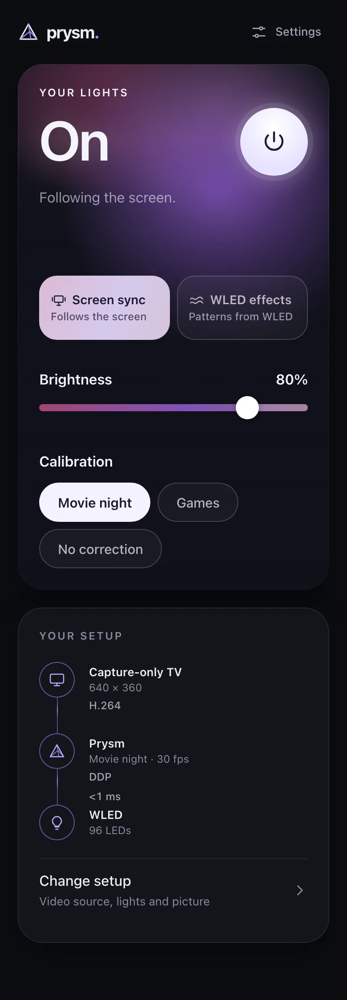
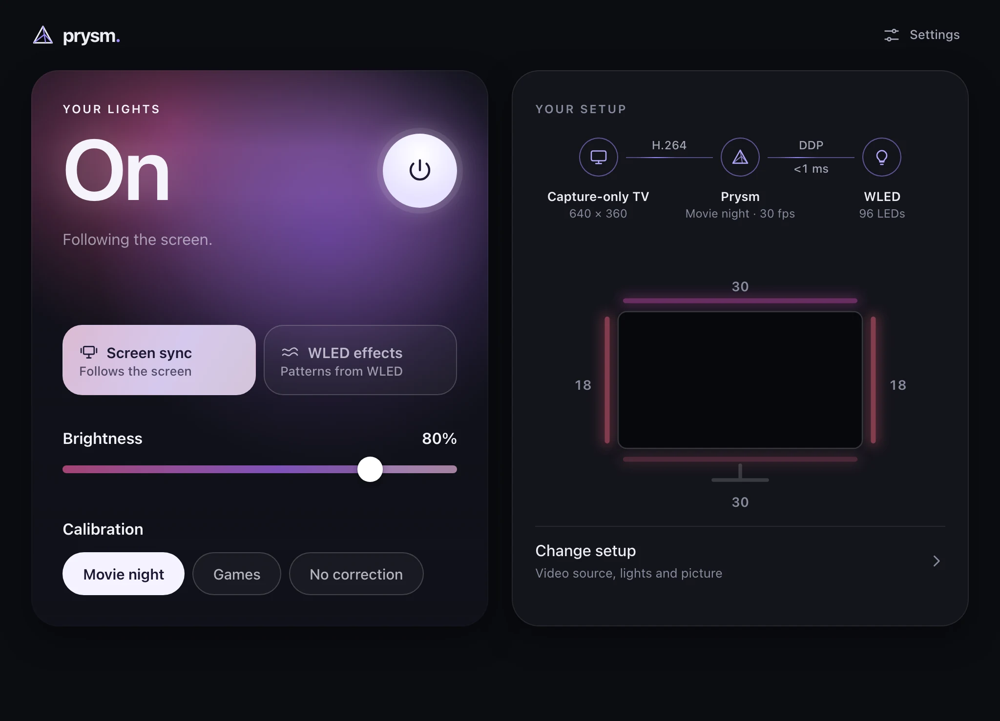
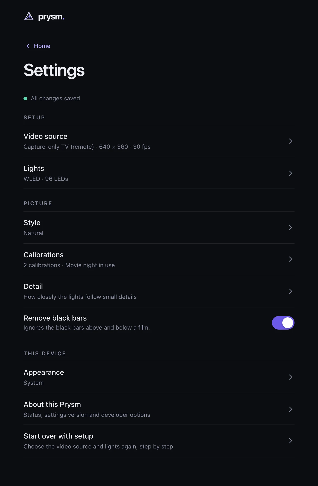
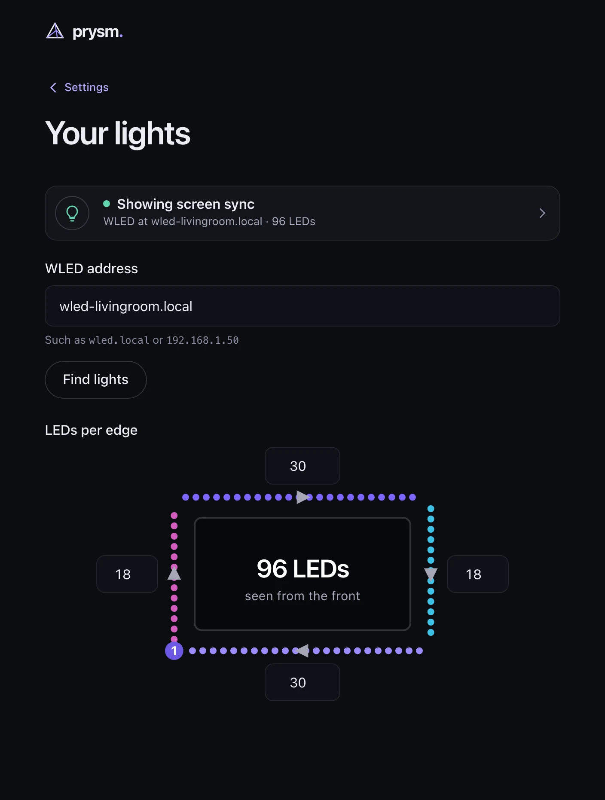

# Set up your lights and use Prysm

## 1. Prepare WLED

Open WLED in a browser and check that it lights the whole strip. Then set:

| WLED page | Setting |
| --- | --- |
| **Config → LED Preferences** | The physical LED count; **Use Gamma for color** on, at 2.2. |
| **Config → Sync Interfaces** | DDP input allowed; **Disable realtime gamma correction** off. |

Prysm sends colours to WLED over UDP port 4048 (DDP) and switches WLED into
live mode over HTTP. Both must be allowed between Prysm and WLED.

Prysm reads WLED's gamma settings and adapts its colours to them, so any
gamma shows the right brightness; a change applies within about 30 seconds.
If it cannot read them (a settings PIN is set in WLED), it assumes a gamma of
about 2.2, which is why 2.2 is recommended.

## 2. Open the web portal

| Where Prysm runs | Portal address |
| --- | --- |
| This computer | `http://localhost:8787` |
| Another computer, Raspberry Pi, Docker or NAS | `http://COMPUTER_IP:8787`, for example `http://192.168.1.20:8787` |
| LG TV, full package | The address the Prysm app shows on the TV |

The portal works from a phone on the same network; no extra setting is
needed. When Prysm starts it prints the address in its log.



## 3. Run the setup wizard

The portal opens the wizard until a video source and lights are saved.
Nothing is saved until the last step.

1. **Video source.** Choose where the picture comes from:
   **Capture card or camera** ([capture card](quickstart.md)),
   **LG TV on your network** ([slim TV package](webos.md#slim-package-the-tv-sends-the-picture)),
   or **This TV** on the full TV package.
2. **Your lights.** Choose **WLED**. Select **Find lights** to list WLED
   devices on your network, or type the address: a name such as `wled.local`
   or an IP address such as `192.168.1.30`, with `:PORT` only if WLED's web
   page is not on port 80. Do not type `http://`.
   Enter the number of LEDs on each edge; use 0 for an edge without LEDs.
   Prysm takes 1 to 16384 LEDs in total (the most a WLED device drives;
   smaller chips such as the ESP8266 stop far earlier). The edges should add
   up to WLED's own LED count: a device picked from **Find lights** shows its
   count under the drawing, and while screen sync runs the light card and the
   Lights page warn when the two differ, for example **The lights have 120
   LEDs, Prysm sends 96**. Prysm keeps sending either way.
3. **Review and start.** Check the summary, then choose
   **Save and start screen sync**, or **Save only** to start later.

**Find lights** only finds WLED devices on the same network segment. In
Docker it needs host networking, so in a normal container type the IP address.

Wire the strip so that, seen from the front, it starts at the **bottom-left
corner** and runs **up the left edge, across the top, down the right edge and
back along the bottom** (clockwise). The wizard draws this layout with your
counts.

**No lights (test)** runs Prysm without LEDs, for trying a video source.

## 4. Daily use

Home has two cards.



- **The light card**: whether the lights are **Off**, **On** or **Stopped**,
  the power button, the two modes **Screen sync** (the lights follow the
  screen) and **WLED effects** (WLED plays its own patterns), brightness, and
  your calibrations. A line under **Off** / **On** says what is happening,
  for example what Power turns on, or that the lights follow the screen.
  While the lights are off the chosen mode is only outlined; choosing one
  while off turns the lights on in that mode. With WLED effects, brightness and
  calibrations do not apply (WLED controls its own effects), so they are dimmed
  until the lights follow the screen again. Problems show here in plain words, with the
  action that fixes them. **Open WLED** opens WLED's own page.
- **Your setup**: the path from the video source through Prysm to the lights,
  with what each step is and whether pictures are flowing, and your LEDs
  around the TV. A step that failed is marked. **Change setup** opens
  Settings, or the part that has a problem.

Good to know:

- Prysm starts with the lights off after every restart. Turn Screen sync on
  again, or start Prysm with `--start` (see your install guide).
- Stopping Prysm turns the lights off.
- When no picture arrives for about 3 seconds, WLED goes back to what it was
  showing before. Screen sync takes over again when the picture returns.
- Closing the browser leaves Prysm running.
- The lights show Prysm's brightness times WLED's own: Prysm at 100% with
  WLED at 40% gives 40%. When WLED's brightness is below 75%, the line under
  **On** says so, for example **WLED limits brightness to 40%**. Prysm does
  not change it; raise it in WLED, or turn on **Force max brightness** in
  WLED's **Sync Interfaces** so screen sync ignores it.

## 5. Change settings

Open **Settings** (top right on Home). It is one list in three groups:
**Setup** (Video source, Lights), **Picture** (Style, Calibrations, Detail,
Remove black bars) and **This device** (Appearance, About this Prysm, Start
over with setup). Each row shows its current value; choose it to open its
page. The line under the title says whether everything is saved: **All
changes saved**, **Saving…** or **Not saved**; a change that could not be
saved also says so at its control, with **Try again**. Brightness and the
calibration in use are chosen on Home.



<a id="processing"></a>

### Picture

Picture changes apply while you move the control; there is no Save button.

**Style** sets how the lights follow the picture, in one choice. Choose it to
see the styles; the ticked one is in use.

| Style | What it is like |
| --- | --- |
| Natural (the default) | Calm in quiet scenes, follows cuts at once. |
| Calm | A slow, soft glow. Nothing sudden: cuts and flashes are eased in. |
| Vivid | Stronger colours, follows the action. |
| Game | Reacts at once, with the least delay. |
| Custom | Your own values. |

The styles' values are first guesses and have not yet been tuned on a TV;
they may change in an update.

**Adjust this style**, under the list, opens the ticked style's sliders; it
is open while Custom is chosen. Moving a slider switches to Custom, starting
from that style's values with your change, and replaces your earlier Custom
values. Choosing Custom returns to your own values, which are kept while
another style is chosen; the first time, they start from the ticked style.

| Slider | Natural | Effect |
| --- | --- | --- |
| Smoothing | 0.3 s | Softens quick changes. 0 reacts at once. The slider goes to 2 s. |
| Scene cuts | 100% | How much of a scene cut the lights take at once. 0% eases a cut in like everything else; 100% shows it in one frame. Movement in the picture is not a cut. Lets a longer Smoothing calm flicker without the lights lagging behind cuts. |
| Brightness ramp | 0 s | The least time the lights take from dark to full brightness, so a sudden flash does not dazzle. 0 follows at once. The slider goes to 2 s. |
| Edge depth | 10% | How far into the picture each light looks. |
| Colour focus | 0% | Each light keeps the colour next to it and takes less from the rest of the picture, so two different colours side by side do not mix into a duller one. Brightness stays as it is. 0% is off. |
| Colour boost | 0% | Makes the lights’ colours stronger; 100% is up to twice as strong, as far as the lights can show. Brightness and hue stay as they are. 0% leaves them as they are. |
| Dark-scene glow | 0% | A faint white glow the lights keep while the picture is dark, instead of going fully dark. The percentage is of full light; the slider goes to 20%. 0% lets them go fully dark. |

Scene cuts and Brightness ramp have not yet been tried on a TV. Colour focus
has not yet been tried on a TV either; compare 0% with 50% and 100% on a scene
with two strong colours. On a TV it is heavy work for now: use it with a
capture rate of 30 fps, not 60. Colour boost and Dark-scene glow have not yet
been tried on a TV.

The rest of the Picture group stays as it is whichever style is chosen:

| Setting | Default | Effect |
| --- | --- | --- |
| Detail | 128 | Higher follows small details more closely but works the computer harder. Leave it at 128 to start. The slider goes to 512. |
| Remove black bars | On | A switch: ignores letterbox and pillarbox bars. Takes a second or two to settle after the picture changes. |

**Calibrations** lists your calibrations: each matches the lights’ colours to
your screen and wall. Choose one to rename it, switch it **In use**, adjust its
colours or delete it; after **Delete calibration** the list offers **Undo** for
a few seconds. **New calibration** makes one with test patterns on the TV; see
[Calibrate colours](calibration.md).

Use [Live preview](preview.md) to check a change: select the status at the top
of the Video source or the Lights page.

### Video source and lights

Choose **Video source** or **Lights** to change it on a page of its own, with
the same fields as the setup wizard. The top of the page says whether it works
now: **Picture arriving** with a small live picture, **Showing screen sync**,
**Starting…**, **Not in use** while Screen sync is off, or in red what is wrong.
A part not set up yet says **Not set up yet** and opens the same page. A
problem with either also shows in its row in Settings, in red, and **Change
setup** on Home opens the part that has the problem.



Once you change something, a bar at the bottom offers **Use this video
source** or **Use these lights**, which saves, and **Cancel**, which leaves
without saving. If a field is wrong, the bar says **Fix 1 field** and takes you
to it. Saving restarts Screen sync if it is on, and the bar then says how it
went: **Saved. Picture arriving.**, or why it does not work. Until it works,
**Go back to the previous video source** (or lights) puts the old one back.
The options few setups change are under **Advanced**.

On the Lights page, **Advanced → Smooth dark colours** (on by default) lets
neighbouring LEDs mix the few brightness steps WLED has for dim colours, so
dark scenes fade evenly and keep their colour instead of stepping. Each LED
stays still while the picture does. Turn it off if dark scenes twinkle; each
LED then shows the nearest step. In the settings file it is
`"dither": false` under `output`.

If someone changed the same part in another browser, Prysm asks: **Use
theirs** shows their settings, **Keep mine** saves yours.

### This device

**Appearance** chooses System, Light or Dark, kept in this browser only.
**About this Prysm** shows what the lights are doing and the settings version.
**Start over with setup** reopens the wizard.

**Developer options**, under About this Prysm, also offer a video file and
**No lights (test)** as a setup, for testing Prysm without a capture device or
LEDs. They are kept in this browser only. A setup already using one of them
always shows and can be changed.

## Settings file

Prysm keeps all of the above in one JSON file:

| Installation | Settings file |
| --- | --- |
| Debian package | `/var/lib/prysm/settings.json` |
| Docker | `/data/settings.json` in the container's volume |
| TrueNAS | `settings.json` in the app's dataset |
| LG TV, full package | `/var/lib/io.prysm.tv/settings.json` on the TV |
| From source | The path you pass on the command line |

The portal creates the file on the first save. Back it up before upgrades.
Stop Prysm before editing it by hand. The format is described in the
[settings-file reference](../../crates/adapters/settings-file/README.md).

To check a file without starting the lights (the Debian package's file is
readable only by root):

```sh
sudo prysm-headless --check-settings /var/lib/prysm/settings.json
```

It prints `settings OK` or the field that is wrong. It does not contact the
capture device or WLED.

## Video files

Playing a video file instead of a live source is a developer feature. It needs
FFmpeg 9 or newer and does not work in the Debian package or the Docker image.
See [Develop Prysm](../developers/README.md#play-a-video-file).
