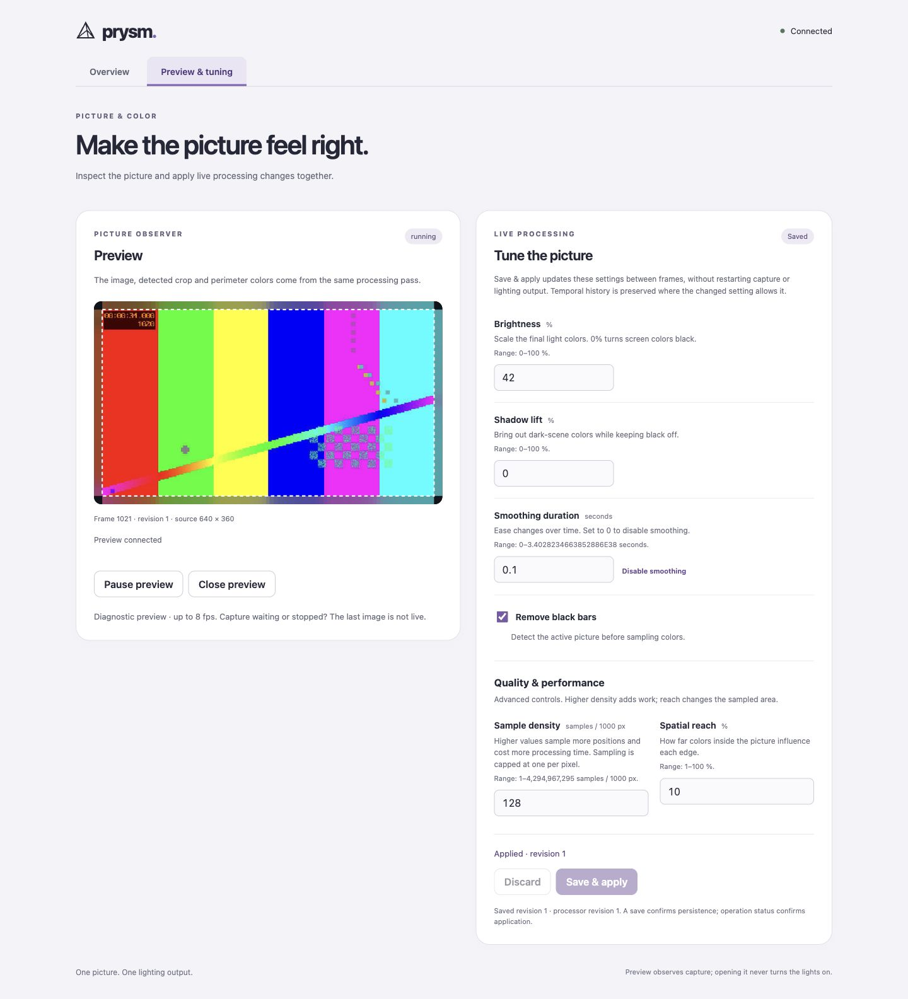

# Preview and tune

1. Turn on **Screen sync** in Overview. WLED must be configured.
2. Choose **Preview → Open preview**.
3. Open **Settings**, adjust a [picture setting](configuration.md#processing),
   then **Save & apply**.

The dashed outline marks the picture inside black bars. The colored edges show
the calculated LED colors. If the picture moves but the LEDs are wrong, check
WLED and the LED layout.

Start with brightness and smoothing. Change one setting at a time.
For tint differences with an LG TV, use [color calibration](calibration.md).

Preview updates at up to 8 fps; judge smoothness on the lights. A stopped capture
keeps the last image. Closing Preview or the browser leaves Screen sync running.
