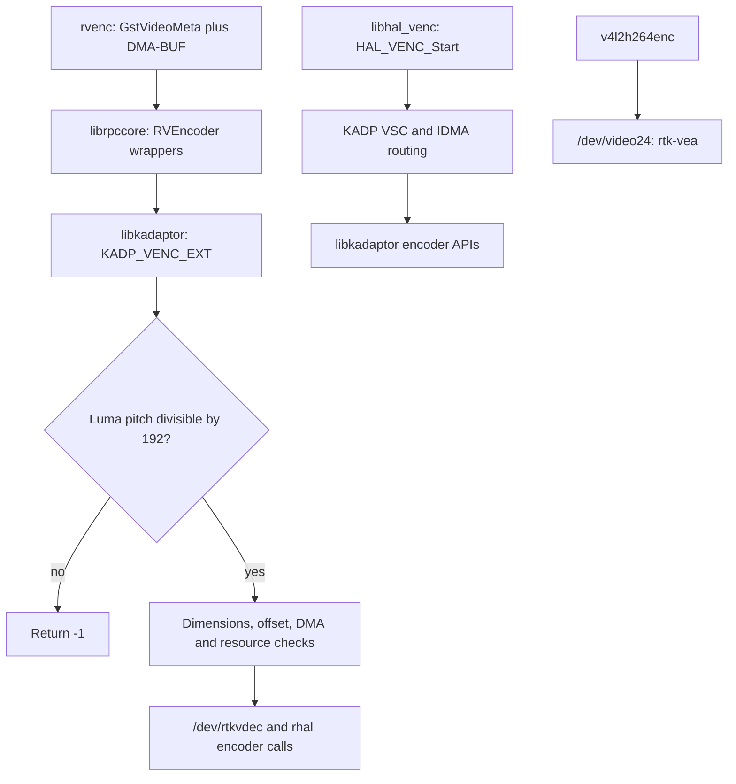
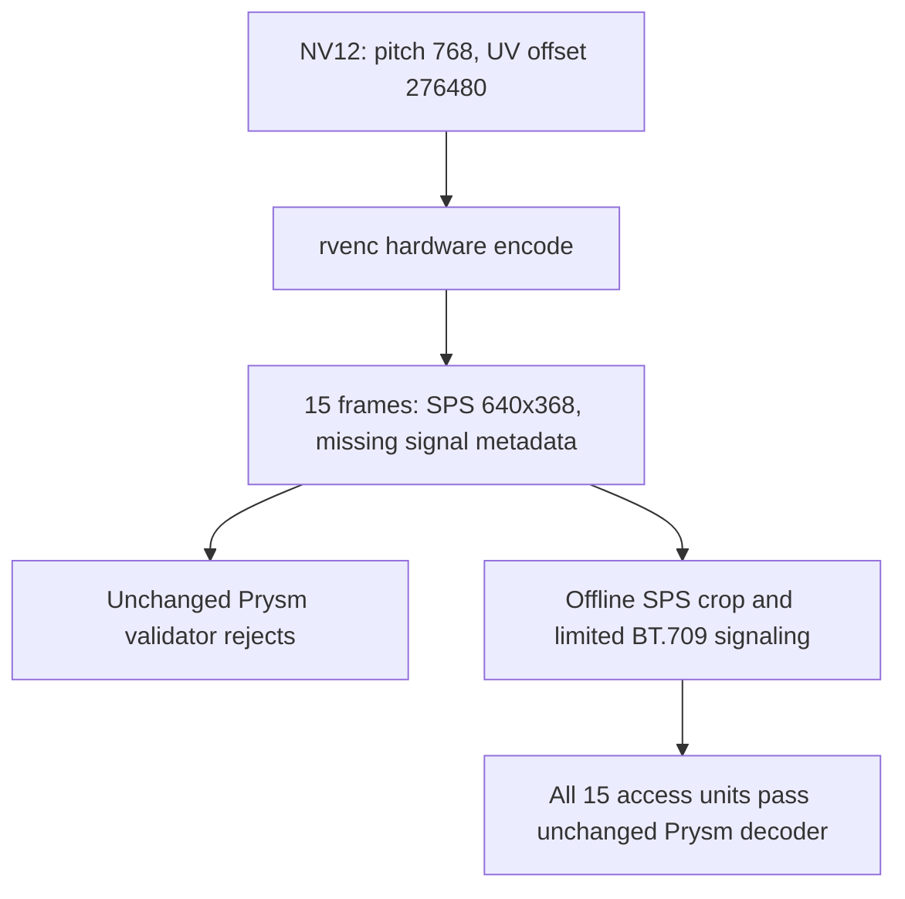

# webOS Realtek encoder: working synthetic hardware path

Hardware encoding is now demonstrated: the corrected pitch-768 DMA probe
produced fifteen H.264 frames, received EOS, completed stop/close/finalize and
exited normally. The raw output needs SPS correction for Prysm: it advertises
640x368 instead of 640x360 and omits required video-signal color metadata.
After an offline SPS-only correction, all fifteen access units passed Prysm's
unchanged decoder and RGB-content assertions. This is a synthetic proof, not
a production integration or a coexistence/performance qualification.

The earlier DMA probes violate a verified vendor requirement: luma pitch must
be divisible by **192 bytes**. Their pitch of 640 fails; 768 works in the new
isolated run. Changing only height to 384 could not fix the prior layout.

This owner-authorized investigation ran on the existing project TV on
2026-11-01. It did not change production encoder code. Resource sharing,
colored-input validation and performance were not qualified. The user had
disabled capture for the successful run; this is historical operational state.

## Evidence and reproducibility

| Evidence | Archived source | Identity / reproduction |
|---|---|---|
| E-001 | `report.txt`, `inventory.txt`, original V4L2/DMA logs | Historical failed probes, superseded by the successful run below |
| E-002/E-003 | `evidence/library-sha256.txt` | Eight copied libraries and one cached dependency matched TV SHA-256 before analysis; binaries remain local |
| E-004 | `evidence/*.excerpt.txt` | Selected instruction evidence; ELF identity/build IDs below; PLT targets cross-checked against GOT relocations |
| E-005 | `evidence/pitch-health-{before,after}.json` | Initial probe refused the held capture lock before GStreamer loaded; healthy status and unchanged PIDs |
| E-006 | `evidence/rvenc-pitch-768.log`, `evidence/pitch-idle-health-*.json`, `poc/fixtures/pitch-768.h264` | Exit 0, 15 outputs, EOS/normal teardown; raw clip SHA-256 `0f8e407196b0603f6eeea9f6ee0ca75e420f3d3804c22447b6ee104be574c8aa` |
| E-007 | `poc/evidence/`, `poc/fixtures/`, `poc/receiver-check/` | Stream metadata, content statistics, SPS-only comparison and existing-receiver assertions |
| E-008 | [upstream source identities](upstream-sources.json) | Main Kodi commit `6a26de1efa2d908d020eec39f9a2c06d554d49a4`; pinned URLs, blob IDs and SHA-256 |

See [PoC instructions](poc/README.md) for runnable offline checks and
[TV reproduction](poc/RUN-ON-TV.md) for the bounded active experiment.

Analysis used rabin2/r2 6.2.4 and Python 3.15.2. All nine samples were
little-endian ELF32 ARM EABI5, using Thumb code and ARM PLT stubs. AArch64
kernel identity does not make these libraries AArch64. The original local
analyzer asserted full `.rel.plt` coverage and checked each derived GOT slot
against ELF relocations. It did not execute the libraries. Bulk generated
analysis and the vendor samples are intentionally not part of this archive.

Important build IDs:

| File | GNU build ID |
|---|---|
| libgstrvenc.so | 22ae9394b08493657f9dab46282462e4ebeda0f0 |
| librpccore.so | 617ee8d5cb4211269d7b9f74beece11ee84162ee |
| libkadaptor.so | 6b05e922834ebab2d48fcc869ab10176af24d057 |
| libhal_venc.so.1.0.0 | 7f7f7176353040f22303ad3b4c46fe75b4e6af34 |
| libgstvideo4linux2.so | 8789bbaecef3f0104e93390422208f5660a5e64f |

The hash manifest identifies the exact library samples. The initial health
read reported capturing=true, receiverConnected=true, senderRunning=true,
error=null. This is a snapshot, not proof of uninterrupted capture.

## Findings

All severities below are `n/a_re`; these are interface findings, not vulnerabilities.
Addresses are ELF virtual addresses before runtime relocation.

| Finding | Evidence | Confidence | Location | Status |
|---|---|---|---|---|
| F-001: luma pitch must be a multiple of 192 | E-001, E-003, E-004 | High | libkadaptor `0x76348–0x76362` | Verified static precondition; old probes violate it |
| F-002: RVEncoder is a thin KADP_VENC_EXT wrapper | E-002, E-004 | High | librpccore `0x1c1e8–0x1c21b` | Call targets relocation-verified |
| F-003: rvenc constructs both planes from one DMA-BUF fd | E-002, E-004 | High | libgstrvenc `0x2e82–0x2f86` | Verified caller representation; accepted in the synthetic run |
| F-004: extended encoder wrapper opens /dev/rtkvdec | E-003, E-004 | High | libkadaptor FD_OPEN `0x774bc`, open64 call `0x774ea` | Path literal resolved at `0x1236d3` |
| F-005: HAL start includes VSC/display routing | E-002, E-004 | High | libhal_venc `0x2d4e`, `0x2fe6–0x2fea` | Arbitrary CPU-frame input not established |
| F-006: V4L2 faulting instruction remains unknown | E-001 | High | last log: gstv4l2bufferpool.c:1460 | No new live crash trace |
| F-007: corrected DMA layout produces a real stream | E-006, E-007 | High | pitch-idle-probe and decoded clip | Demonstrated with production capture stopped |
| F-008: original SPS fails Prysm; SPS-only correction passes | E-007 | High | original/adjusted SPS and unchanged Decoder | All 15 adjusted frames validated; non-SPS NAL bytes identical |
| F-009: Kodi's inspected video path is compressed playback | E-008 | High | MediaPipelineWebOS Load/FeedVideoData/PlayerCallback | Lifecycle reference; no raw encoder layout contract in inspected files |

### Pitch check and failure ordering

`KADP_VENC_EXT_Qbuf` at `0x762d8` first checks port <=3, then encoder state ==2
at `0x7632e–0x76334`. At `0x76348` it loads descriptor+0x18, the luma pitch;
at `0x7634a` it loads divisor 0xc0; at `0x7634c` it calls `__aeabi_uidivmod`.
A nonzero remainder takes `0x76354–0x76362` to return -1 at `0x76318`.
The referenced diagnostic at `0x1243ce` explicitly identifies plane-0 pitch
alignment to 192. Thus the interpretation is supported by instructions and
the matching vendor diagnostic, not just a guessed numeric alignment.

Later checks require width 176..1920 and height 144..1088, then positive chroma
offset. These bounds belong to this wrapper, not the separate V4L2 caps path.
At `0x763a4`, the DMA physical-address lookup uses ioctl `0x4004761a`; at
`0x763b4`, r2's relocation-corrected target is `ioctl`, with the first plane fd
passed as the third argument. Its return is treated as a physical base and the
chroma offset is added at `0x763c0`. Driver-side meaning, error conventions,
cache ownership and address lifetime still need verification. No private
ioctl was invoked directly by the offline analysis; the live plugin uses its
own vendor calls internally.

The old -1 is consistent with pitch rejection if state==2. It is not a
runtime trace proving which earlier/later check executed. The rvenc wrapper
only rewrites -8 to -11; it preserves -1.

### Reconstructed queue descriptor

`gst_rv_enc_handle_frame` obtains GstVideoMeta at `0x2e76`, checks GstMemory[0]
is DMA-BUF at `0x2e92`, then gets its fd at `0x2e9e`. It calls
`RVEncoderQueueBuffer(port, descriptor)` at `0x305c`. Fixed-width fields below
are reconstructed from stores; their semantic names are descriptive, not
vendor-header declarations. The local SDK GstVideoMeta header corroborates
the metadata field offsets; its 1.24.13 patch version is not the TV's 1.24.0.

| Offset | 32-bit value constructed by rvenc |
|---|---|
| 0x00 | VideoMeta n_planes |
| 0x04 | VideoMeta offset[1], chroma offset |
| 0x08, 0x0c | zero; unknown/reserved/address-related fields |
| 0x10, 0x14 | visible width, height |
| 0x18, 0x1c | luma stride, first GstMemory DMA-BUF fd |
| 0x20, 0x24 | zero; unknown/reserved/address-related fields |
| 0x28, 0x2c | visible width, height >> 1 |
| 0x30, 0x34 | chroma stride, same DMA-BUF fd |
| 0x38 | reset-GOP bit derived from codec-frame flags |
| 0x3c | target bitrate from plugin state |

The observed extent is 64 bytes. Further ABI fields, signedness and accepted
plane counts must not be inferred solely from this one caller.

### Call and lifecycle map

P-001 (`path_type=callflow`, E-002/E-003/E-004, F-002/F-003/F-004):



Arrows are verified userland calls or the retained V4L2 device selection.
The diagram intentionally makes no kernel/hardware equivalence claim between
the two endpoints. `/dev/lg/venc0` exists in the earlier inventory, but no
edge to it is established by these selected call sites.

The plugin's observed ordering is open -> register callback -> set resource
information -> start -> queue -> copy/release output -> stop -> close.
Open is called at libgstrvenc `0x3e32`; callback registration at `0x3e42`;
resource information at `0x3782`; start at `0x378e`; queue at `0x305c`;
copy/release at `0x4040/0x4054`; stop/close at `0x3bc4/0x3bd0`.
Resource information delegates to KADP_VENC_EXT_SetParam, rather than proving
an external resource-manager reservation. Full callback signatures, output
ownership, teardown races and all state transitions are not reconstructed.

The HAL calls `KADP_VSC_GetInputInfo`, `KADP_VENC_IdmaEnable` and
`KADP_VENC_Connect_VSC` within start. Its shared lower library with rvenc is
established; hardware sharing, concurrency safety and arbitrary-frame support
remain unresolved. Do not call HAL_VENC_Connect as a speculative substitute.

## Dynamic result and receiver validation

The [executed probe](poc/probe.py) keeps visible 640x360 NV12, uses
stride 768, allocates 414720 bytes and sets chroma offset 276480 through
gst_buffer_add_video_meta_full. This changes the required representation of
one hypothesis: row pitch. It retains fifteen synthetic frames, EOS and normal
teardown assertions. Its offline layout self-check passed.

The [bounded execution procedure](poc/RUN-ON-TV.md) was explicitly approved.
The first attempt refused the lock held by the production capture worker;
both health snapshots remained healthy and PIDs were unchanged. The user then
disabled capture. A second baseline verified capturing=false,
senderRunning=false, receiverConnected=false and error=null before the same
probe ran. The probe obtained the lock normally; no lock bypass or service
configuration action was performed by the investigator.

The second run produced 16286 bytes and fifteen encoded-frame callbacks;
EOS, stop, close and finalize completed in approximately 1.87 seconds of
GStreamer process time. Exit status was 0, not a watchdog termination. The
post-check retained the same supervisor PID and idle/error-free state; no
private probe directory remained. This does not qualify repeated restart,
driver allocation retention or simultaneous native capture.

FFprobe reports Constrained Baseline, level 4.0, progressive, zero B frames,
one reference frame and fifteen decoded frames. The original SPS has coded
and visible size 640x368, no frame cropping, and VUI with
video_signal_type_present_flag=0. The first 360 rows of every decoded luma
plane match the intended 32+8*frame-index exactly in this run; U/V are neutral
128. The extra eight rows are also uniform. This grayscale test cannot verify
matrix handling for colored capture input.

P-002 (`path_type=solve`, E-006/E-007, F-007/F-008):



Reproduce the offline correction from the project root; use a fresh output
path because `-n` prevents overwrite:

```bash
ffmpeg -v error -n -i research/webos-capture/2026-11-01-hardware-encoding/poc/fixtures/pitch-768.h264 -map 0:v -c copy -bsf:v h264_metadata=crop_bottom=8:video_full_range_flag=0:colour_primaries=1:transfer_characteristics=1:matrix_coefficients=1 -f h264 /tmp/prysm-hardware-encoding-sps-adjusted.h264
cargo run --offline --manifest-path research/webos-capture/2026-11-01-hardware-encoding/poc/receiver-check/Cargo.toml --target-dir /tmp/prysm-encoder-receiver-check-target -- research/webos-capture/2026-11-01-hardware-encoding/poc/fixtures/access-units
```

The retained access units were split using FFprobe packet pos/size. Only the
original first unit and the fifteen adjusted units needed by the checker are
archived; the full original and adjusted clips are also included. The isolated checker imports the
existing protocol crate; it does not replace or weaken any SPS validation.
It asserts the original dimension failure, the original BT.709 failure at
matching dimensions, then all fifteen corrected RGB frames. The adjusted
clip SHA-256 is `2f49a985753933f34fd5ff7f1ffd3fd8d93aa4a586f0cc526d2fd52c01146ca1`.
Every non-SPS NAL was byte-identical before/after; no picture re-encoding was
performed. Marking this synthetic limited-range input is supported by its
construction; color behavior for real captured frames still needs checking.

## Upstream Kodi pointers

The [pinned upstream pipeline](https://github.com/xbmc/xbmc/blob/6a26de1efa2d908d020eec39f9a2c06d554d49a4/xbmc/cores/VideoPlayer/MediaPipelineWebOS.cpp)
loads Starfish as BUFFERSTREAM, supplies app identity, selects an exported
window or ACB handle, calls notifyForeground, and waits for LOADCOMPLETED
before feeding/playing. FeedVideoData passes compressed demux/bitstream
packet addresses, sizes and nanosecond PTS; BufferFull provides backpressure.
Unload stops feeding threads and optionally waits for UNLOADCOMPLETED.

These are concrete managed-playback lifecycle examples. They do not establish
an ACB/Starfish reservation requirement for the bare rvenc route: this run
encoded without separately creating an ACB handle or calling Starfish. Kodi's
`m_audioEncoder` is the FFmpeg audio-transcoding path, not evidence of hardware
H.264 encoding. Platform configuration queries TV capabilities and ARC audio;
it does not specify the encoder's DMA plane contract. Its webOS build requires
PlayerAPIs, PlayerFactory, WebOSHelpers, AcbAPI and GObject, and ships a
webos-userland dependency at version 0.0.17. These identify useful headers and
libraries for future managed-pipeline analysis, not an encoder implementation.

## Remaining limits

Still untested: colored/patterned inputs, real capture-to-encode conversion,
latency/CPU, timestamp behavior, repeated restart/coexistence, exact V4L2 crash
site, vendor allocator implementation, and kernel resource/ownership behavior.
Callbacks logged a repeated vendor PTS value in this run; timing was not
qualified, and a one-second elementary clip does not establish transport pacing.
The baseline failure and successful run also differ in capture activity, so
pitch is a verified necessary precondition and successful remedy in isolation,
not a controlled proof that production capture never contributes to failure.
No production integration was attempted.
