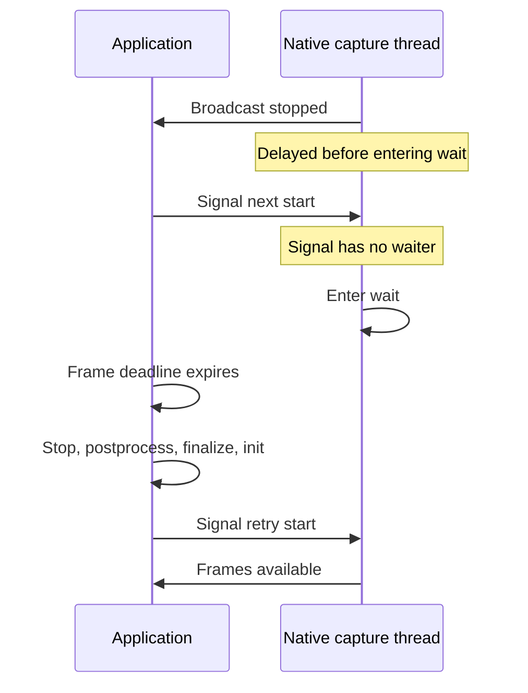

# Video lifecycle follow-up

Ghidra and Frida Gum reveal that failed construction leaves a freed resource-manager pointer in a global registry, in addition to the previously measured GLib/eventfd leak. Keeping one successfully constructed driver across sessions works in short hardware tests, but restart shares the teardown lost-wakeup race. One ordinary cleanup/reinitialize retry recovered the induced restart stall. These are application-side mitigations, not a complete alternative to process-level failure recovery.

Scope and authorization: [scope](../scope.md). Work: [timeline](../timeline.md), [work items](../workitems.md). Single investigator; no other-process attachment, system changes, production deployment or pixel collection. Report flavor: null, ordinary binary reverse engineering. ATT&CK and IOC analysis are inapplicable.

## Findings

### F-001
- title: Failed constructor leaves a freed pointer in the resource-manager registry
- severity: n/a_re
- category: design
- status: validated
- evidence_ids: [E-002, E-008, E-009]
- location: libvtcapture.so.1.0.0 offsets 0x15916, 0x15920, 0x1592a; g_rmcs 0x312c8
- impact: Retrying construction can leave stale native object pointers, not only leaked descriptors. Later policyAction at 0x16c68 dereferences entries in this list; an actual downstream invalid read was not induced.
- confidence: high
- repro_steps: Run denied-role constructor probe with register/unregister/free Gum hooks; observe each free followed by registry membership. Compare authorized-role control with registry hooks only.
- remediation: Preflight known registration permissions; after actual constructor exception, terminate the affected process instead of retrying indefinitely. No public partial handle exists. Private registry surgery would not repair the separate GLib ownership leak.

The denied run produced three register calls, three frees and zero unregister calls. List sizes were 1, 2, 2 because one object address was reused. The control removed all entries after each of three releases. It does not prove absence of other constructor failure modes.

### F-002
- title: Persistent driver supports public lifecycle reuse but restart can lose its wakeup
- severity: n/a_re
- category: design
- status: validated
- evidence_ids: [E-002, E-005, E-006]
- location: VtDriver::captureThread wait 0x11536; streamOnOff signal 0x116e4; processVtCapture 0xedb0
- impact: A successful start return does not guarantee frames arrive. No destructor is required for the reproduced stall.
- confidence: high
- repro_steps: Create once; capture and finalize; delay second native wait entry by 500 ms; start next session during the gap; poll for a frame.
- remediation: A first-frame deadline detects this stall. Repeating process does not signal; the full public lifecycle can be retried once, subject to an external process watchdog.

The uninstrumented eight-cycle control alternated 320x180 and 160x90, asserted geometry and frame metadata, and retained ten FDs/four threads between sessions. Maps settled at 121. No capture-device FD remained at idle. Final release returned to five FDs/one thread. Totals include standard descriptors and lock; no image-content validation was performed.

### F-003
- title: One public lifecycle retry recovered the injected restart stall
- severity: n/a_re
- category: other
- status: validated
- evidence_ids: [E-002, E-006, E-007]
- location: scripts/reuse_retry_probe.cpp and VtDriver::streamOnOff 0x11628
- impact: Driver reuse is more viable than repeated construction for ordinary sessions, but this single recovery path does not bound native cleanup or final destruction.
- confidence: high
- repro_steps: Repeat F-002 with one stop/postprocess/finalize/reinitialize retry after the frame deadline; assert frames on retry and next cycle, then release.
- remediation: Treat as an optional mitigation. Keep failure recovery outside the capture thread. A thread-only service requires whole-service restart after constructor failure or a shutdown deadline.

The next init began about 4.56 seconds after the missed signal. The watchdog bounded the process, not each native call. Further stress, policy revocation, device error, and firmware compatibility tests are outstanding.

### F-004
- title: Alternative exposed entry points do not provide a shutdown handshake
- severity: n/a_re
- category: reverse_algo
- status: candidate
- evidence_ids: [E-002, E-003, E-004]
- location: createEx/onPolicyAction, initEx, fdClose, postprocess/clearBuffer, destructor
- impact: Callback and priority variants do not address ownership and synchronization defects. Closing first can race with dequeue; skipping postprocess omits buffer unmaps; periodic waits would need accompanying state-machine changes.
- confidence: medium
- repro_steps: Inspect named Ghidra exports and compare assembly before considering any firmware-specific patch.
- remediation: Preserve documented lifecycle ordering. No production interposition or private-pointer writes were introduced. These rejected variants were not run against the device.

## Call paths

### P-001
- title: Constructor failure and stale registry ownership
- path_type: callflow
- start: vtCapture_create
- goal: Explain why application Drop cannot repair the failed object
- steps:
  1. ResourceManagerClient wrapper registers itself before init — evidence: E-002 — finding: F-001.
  2. Dependency allocates context/loop; connector registration throws — evidence: E-003, E-004 — finding: F-001.
  3. Unwind frees wrapper without unregister; registry still contains address — evidence: E-008 — finding: F-001.
  4. Successful construction/release removes entry in control — evidence: E-009 — finding: F-001.
- residual_risks: Static policy callback dereference risk not induced; heap loss not quantified; constructor failures beyond denied registration untested.

### P-002
- title: Restart wake loss and public retry
- path_type: callflow
- start: stopped native capture thread about to wait
- goal: Assess reuse as an alternative to destroying the driver
- steps:
  1. Hold one driver across sessions — evidence: E-005 — finding: F-002.
  2. Start signal arrives before native wait; no frames follow — evidence: E-006 — finding: F-002.
  3. One ordinary lifecycle retry sends a new start and restores frames — evidence: E-007 — finding: F-003.
- residual_risks: Final release remains unbounded; successful retry is not a general recovery guarantee.



## Tools, limits and reproduction

Ghidra 12.2, ARM:LE:32:v8, default compiler, image base 0x10000. Report offsets subtract this image base. Some exported PLT/external stubs are not meaningful decompilations; exception landing pads require assembly verification. Tool paths are in [tool-index](../tool-index.md). The initial ELF metadata/import/export JSON accompanies E-001. Hashed vendor samples remain in authorized local `/tmp/prysm-cleanup-evidence`, outside this repository.

Gum came from the verified openlgtv 2026.08 SDK, source commit 0c8df6742d2c7a08c32fc3c3b691779b062fb34a (E-012). It was statically linked into our own temporary executable, with archive symbols hidden. A self-function hook asserted a correct result and one callback before vendor hooks. This is native Frida Gum, not a connection from the installed Mac Frida 17.25.0 CLI. No TV server or Gadget was installed.

`operator delete` attach returned -1 (unsupported signature); switching to `free` worked for denied construction. A successful-role run with the broad free hook timed out (E-010); cause unresolved, so it is excluded from vendor-race conclusions. The narrowed registry-only control passed. Original logs are retained, including failures.

Example static reproduction, with the existing project and authorized ELF copies:

```sh
JAVA_HOME=/opt/homebrew/opt/openjdk@25/libexec/openjdk.jdk/Contents/Home \
JAVA_TOOL_OPTIONS=-Duser.home=/tmp/prysm-reverse/java-home \
/opt/homebrew/Cellar/ghidra/12.2/libexec/support/analyzeHeadless \
/tmp/prysm-reverse/projects lifecycle \
-process libvtcapture.so.1.0.0 -noanalysis \
-scriptPath /tmp/prysm-reverse/scripts \
-postScript ExportLifecycle.java /tmp/prysm-reverse/vt-recheck.c
```

Original imports used `-import` instead of `-process`, omitted `-noanalysis`, and set `-max-cpu 2 -analysisTimeoutPerFile 120`. Repeated for the resource manager and connector implementation libraries; logs retained. All three sample hashes are recorded in the repository diagnosis.

Build the reuse probe using the existing webOS SDK:

```sh
/Users/eschaal/webos-sdk/arm-webos-linux-gnueabi_sdk-buildroot/bin/arm-webos-linux-gnueabi-g++ \
 --sysroot=/Users/eschaal/webos-sdk/arm-webos-linux-gnueabi_sdk-buildroot/arm-webos-linux-gnueabi/sysroot \
 -I/Users/eschaal/src/github.com/prysm/crates/capture/webos-capture/native \
 -std=c++11 -O1 -mfloat-abi=softfp -mfpu=neon \
 /tmp/prysm-reverse/scripts/reuse_probe.cpp -o /tmp/prysm-reverse/reuse_probe -ldl -pthread
```

Use `reuse_retry_probe.cpp` for the single-retry variant. Exact Gum build argv is saved in `scripts/build-gum-command.txt`; all sources are retained under `scripts`. Run the commands in E-005 through E-009 from the Prysm repository, with the same already-authorized TV and active input. These commands are hardware reproductions, not offline tests. The runner honors the shared capture lock, bounds the process to eight seconds and removes only its own executable, role and manifest. The delay shim is restricted to this hashed libvtcapture wait call site; do not reuse its offset blindly on another firmware.

Evidence records E-001 through E-012 contain excerpts and reproduction context. Repository artifacts have SHA-256 values; E-002 through E-004 explicitly reference external vendor decompilations with their original hashes. Source snapshots and archived evidence are covered by `../evidence/artifact-sha256.txt`. Historical commands below retain the original workstation and temporary paths; see the research README for restoration instructions.

Cleanup inspection found no temporary probe directories or manifests, and the installed supervisor remained present (E-011). Only the repository diagnosis document changed in this follow-up; existing production fixes and unrelated worktree edits were preserved. Existing Rust tests were not rerun for this documentation-only follow-up; the new probes cross-compiled and their hardware assertions ran as described.
