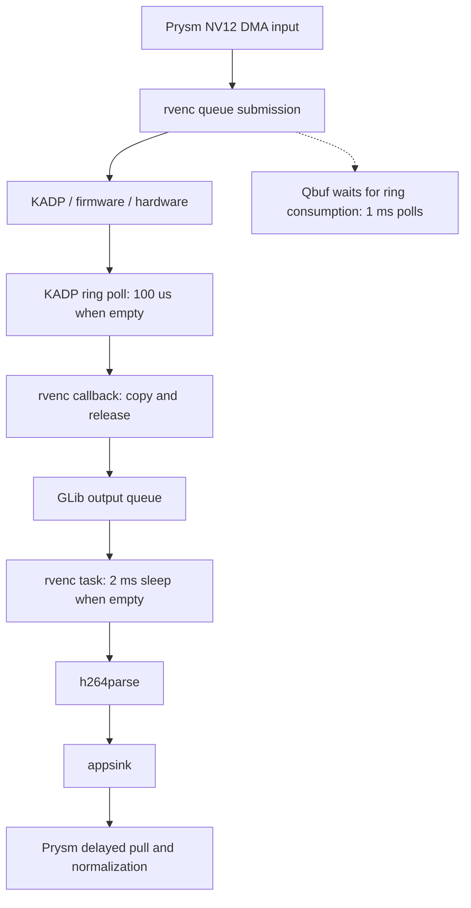

# webOS encoder latency and rate limits

**Combined capture deployed:** version 0.1.22 now selects the blended tap for
Both, retains UI fallback, and passed readiness/reset and separate-source
qualification. Deployed live mean: 12.9 ms/iteration, 61% average headroom at
30 fps, no missed deadlines in 901 iterations. See
[integration and deployment](combined-deployment.md).

**Combined capture tested:** the UI split measures ~12.4 ms inside HAL and
~2.8 ms copying pixels. VT `BLENDED_OUTPUT` includes a visible toast and reduces
steady iteration time to 13.4 ms with ~60% mean headroom at 30 fps. See
[UI split and combined capture results](ui-combined-results.md). This initial
staged experiment preceded the production integration above.

**Live 640×360 follow-up:** 28.9 ms mean iteration at 30 fps leaves 4.4 ms
(13.2%) average headroom. UI acquisition is now the largest stage at 15.1 ms.
See [live performance and capture alternatives](live-performance.md).

**Integration follow-up:** the direct path and current-frame metadata pairing
are now implemented and passed staged TV qualification, including 300 real
640×280 frames at ~30 FPS and 405 independently replayed wire frames overall.
See [integration results](integration-results.md). The user then explicitly
requested deployment: version 0.1.21 is installed, the sender targets the current
computer and capture is active. Deployment evidence (local evidence at `work/webos-encoder-latency/deployment/evidence/deployment.json`; not distributed).

**Live follow-up completed:** removing the parser reduced measured frame latency
from 45.6–45.8 ms to 11.8 ms at 640×360 with 30 fps input pacing. Native V4L2
encoding also worked. See [live results, validation and limitations](live-results.md).
The static investigation below is preserved chronologically; its F-006 hypothesis
was resolved by the live traces, and its no-TV-access statement describes only
that initial offline phase. Deployment followed the later integration checks.

## Initial offline investigation

The retained Realtek encoder path has avoidable software overhead, but this
investigation does **not** demonstrate a faster encoder. Its `rvenc` wrapper
programs a maximum nominal rate of **30 FPS**, even when given 60 FPS caps.
There are two output polling loops and a submission-side ring wait. The historical logs place most of the
submission-to-callback delay below the GStreamer output queue. These findings
give us a focused next experiment; they do not justify promising 4K60 encoding
or removing the current input/output ownership safeguards.

Investigation: 2026-11-02. Platform: webOS, not Apple tvOS. Ordinary native
reverse engineering (`flavor=null`, severity `n/a_re`).
Scope (local evidence at `work/webos-encoder-latency/scope.md`; not distributed) and
timeline (local evidence at `work/webos-encoder-latency/timeline.md`; not distributed).
No TV connection, deployment, driver change, or production-code edit occurred.
Existing uncommitted implementation changes were inspected and preserved.

## Findings

| ID | Finding | Evidence | Confidence and status |
| --- | --- | --- | --- |
| F-001 | Requested rates above 25 FPS select vendor rate 30 | E-001, E-002 | High static confidence; actual 60-input/s behavior untested |
| F-002 | rvenc polls its completed-output queue with a 2 ms sleep when empty | E-001 | High static confidence; contribution to live latency unmeasured |
| F-003 | KADP's output thread polls its firmware ring with a 100 µs sleep when empty | E-002 | High static confidence; actual scheduling delay unmeasured |
| F-004 | Fifteen historical input-log-to-callback intervals average 9.79 ms | E-003 | Validated retained-log calculation; not pure hardware execution time |
| F-005 | A next-input dependency is not established at the vendor callback boundary | E-003, E-001 | First callback precedes second input; downstream picture pairing remains unqualified |
| F-006 | Parser removal is a hypothesis, not an established one-frame latency fix | E-003, E-005 | Negotiated AU caps and upstream source weaken the generic parser-lookahead explanation |
| F-007 | QueueBuffer itself polls input-ring consumption with 1 ms sleeps | E-001/E-002/E-004 | High static confidence; duration per current submission unmeasured |

All addresses below are ELF virtual addresses before relocation, specific to
the hashed retained firmware libraries. They are not runtime pointers.

### F-001: 60 FPS caps do not program a 60 FPS encoder

In `libgstrvenc.so`, `gst_rv_enc_set_format` calculates the integer input rate
at `0x3806–0x3810`. The comparison at `0x3814` is against 25. Rates above that
store enum zero at `0x381a–0x381c`. The resource structure is passed to
`RVEncoderSetResourceInfo` at `0x3782`.

In `libkadaptor.so`, `KADP_VENC_EXT_SetParam` checks the enum at `0x77d86` and
uses a byte branch table at `0x77da6`. The mapped rate is stored at context
offset `0x54` at `0x77dbe`:

| Enum | Programmed FPS |
| --- | ---: |
| 0 | 30 |
| 1 | 25 |
| 2 | 24 |
| 3 | 15 |
| 4 | 10 |
| 5 | 15 |

`KADP_VENC_EXT_Start` loads that field and calls `rhal_venc_SetFrameRate` at
`0x77b2c–0x77b30`. The extraction script checks the branch-table bytes and
each destination's immediate instruction. The old log's `fps 15/3` describes
input rate 15 and vendor enum 3; it is not a 15/3 rational frame rate.

This establishes a configuration ceiling on this userspace path, not a measured
silicon throughput ceiling. Frame-rate programming may affect rate control or
timestamps rather than submission acceptance. Supplying 60 FPS may still cause
other behavior; it is not qualified 60 FPS encoding. The plugin's sink template
advertises up to 60 FPS, and its source template advertises 720p30 AVC, but
runtime negotiation in the retained log produces byte-stream/AU. Template caps
alone are therefore a poor hardware-capability oracle.

The earlier `KADP_VENC_EXT_Qbuf` analysis also establishes width 176..1920 and
height 144..1088 checks. They prevent 4K inputs through this wrapper. A decoder
capability is not evidence that this encoder path has matching capabilities.

### F-002 and F-003: two polling layers

The rvenc callback at `0x3fe4` allocates storage, copies compressed output with
`RVEncoderCopyData` (`0x4040`), releases vendor data (`0x4054`), wraps the copy
and pushes it onto a GLib asynchronous queue (`0x4092`). A separate output task
tries that queue at `0x21c4`; empty returns 100 at `0x2630`. The task compares
against 100 at `0x36a0` and requests `g_usleep(2000)` at `0x36b8–0x36bc`.
When data exists it pairs with the oldest codec frame (`0x21ec`) and calls
`gst_video_encoder_finish_frame` at `0x2338`.

The KADP output-thread address is recovered from `Start`: its PC-relative
callback value at `0x77bb8` resolves to Thumb pointer `0x75b25`, code `0x75b24`.
The thread compares firmware-ring write/read pointers at `0x75b7a–0x75b9c`.
The empty branch requests `usleep(100)` at `0x75de4–0x75de8`. The data branch
constructs a callback record and invokes the registered function at `0x75d10`.

Neither requested sleep is an upper bound on elapsed delay: scheduling can
extend both. The 100 µs loop may also generate frequent wakeups. Its actual
wakeup frequency and CPU cost have not been measured. Replacing the top queue
with an event-driven consumer could remove polling overhead; changing or
bypassing KADP is a larger ABI/lifecycle project. Blindly shortening sleeps is
not yet a justified CPU optimization.

### F-007: submitting to appsrc is not submitting to hardware

`KADP_VENC_EXT_Qbuf` calls `rhal_venc_check_read_pointer` at `0x764f0` after
writing the input command and PTS. Until it returns one, the branch at `0x76572`
requests `usleep(1000)`, increments a counter and retries through count 1000.
This is approximately a one-second requested-sleep budget, not a hard elapsed
deadline. The helper at `0x110dbc` reads two firmware-ring header fields at
offsets `0x10` and `0x20` and returns one when the pointers agree.

The plugin calls that queue operation under its mutex at `0x3054–0x3064`.
Prysm's `HardwareSubmit` measures only `AppSrc::push_buffer`; the appsrc streaming
thread invokes rvenc later. Consequently **the small 0.064 ms submit phase does
not prove hardware submission is cheap or asynchronous**. Time spent in this
vendor wait can fall inside Prysm's output-wait phase. Instrument QueueBuffer
entry/return along with callback entry before attributing the 12 ms to encoding.
Do not remove the consumption wait: its buffer-lifetime role has not been fully
reconstructed.

### F-004 through F-006: what the timing actually establishes

The old pitch probe logs the last plane description immediately before queueing,
then logs the encoder callback. All fifteen pairings are unambiguous in that
serial trace: mean **9.794 ms**, minimum **7.637 ms**, maximum **12.913 ms**.
This interval includes queue submission, firmware/hardware work, ring polling,
scheduling and logging. It cannot isolate silicon time.

The first callback is at 0.768332 s; the second input's plane log is at
0.824934 s. Output therefore exists before the next input reaches the vendor
queue in this historical run. That does not prove that the parser/appsink
delivers a complete, correctly paired picture at that point.

The current retained synthetic benchmark is a different run and workload:

| Native 640×360 NV12, 30 FPS configuration | Mean per encode call |
| --- | ---: |
| Wall time | 12.492 ms |
| Process CPU during call | 2.012 ms |
| Output wait phase | 12.131 ms |
| Upload | 0.121 ms |
| Normalization | 0.119 ms |

Do not subtract the historical 9.794 ms from the current 12.131 ms to claim a
measured queue cost. The native upload is already small; zero-copy cannot
recover the entire wait. Process CPU during calls also excludes idle periods
between calls, where vendor threads can still wake up.

Prysm currently returns without pulling on the first submission, then submits
the next input before pulling one output. The code and prior qualification
document a one-picture delay. At 30 FPS that represents 33.3 ms of picture age;
it is not an additional 33.3 ms of CPU work. Capture, encode and socket send
are serial within `Session::run`, so whole-iteration wall time still matters
for sustainable throughput. No 640×280 benchmark was found in this evidence;
the measured case is 640×360.

The historical negotiation already includes `alignment=au`. Upstream GStreamer
1.24.0 consumes complete AU-aligned buffers without waiting for the next AU
(`gst_h264_parse_handle_frame`, lines 1737–1739 and 1915–1925). The TV's parser
binary has not been verified against that source. This makes parser lookahead
a testable hypothesis rather than an explanation we can assume. [Source](https://raw.githubusercontent.com/GStreamer/gstreamer/1.24.0/subprojects/gst-plugins-bad/gst/videoparsers/gsth264parse.c)

## Next experiment

Use a separate synthetic probe under the existing capture lock and a bounded
external watchdog. Arrange an idle TV window first. Keep the production
implementation and stable DMA allocations unchanged.

1. Add monotonic timestamps at appsrc submission, rvenc sink/src pads,
   h264parse src pad and appsink collection. Record negotiated caps, buffer
   sizes, NAL types and frame identifiers. Do not infer pairing from vendor PTS.
2. Submit **one** distinctive frame and wait 250 ms before any second frame or
   EOS. Then submit the second. This distinguishes a true next-input dependency
   from our caller's deliberate delayed pull. Limit each run to 12 seconds.
3. Compare the existing parser path to a scratch direct rvenc-to-appsink path.
   Inspect raw buffer boundaries before treating any buffer as one access unit.
   Preserve SPS correction, stream validation and first-frame decoder checks.
4. If rvenc output arrives promptly but appsink does not, investigate downstream
   buffering. If callbacks are prompt but rvenc output is delayed, investigate
   its queue/task. If callback delay dominates, instrument KADP ring visibility,
   actual sleep durations and submit return time before changing the wrapper.
5. Decode changing patterned frames through Prysm's unchanged decoder and verify
   content/header pairing, EOS, repeated teardown and fallback before adopting
   a new scheduling strategy. A shorter timeout or successful caps negotiation
   is not sufficient validation.

The immediate target is recovering one frame of latency and reducing unnecessary
wakeups. Faster-than-30-FPS or 4K encoding requires a separately verified lower
interface. Prysm's receiving decoder is currently OpenH264 in the receiving
process; the TV's playback decoder is not part of this encoding pipeline.

## Evidence and reproduction

Run from the project root:

```sh
/opt/homebrew/bin/python3 research/webos-capture/2026-11-02-encoder-latency/analyze.py
```

The script uses the registered r2 6.2.4 and Python tool paths, checks ELF32 ARM
identity, instruction anchors, FPS branch destinations and all fifteen timing
pairs. It writes only this report directory's `evidence/` files. Original
binaries and logs remain in ignored `work/`; the report has no runtime dependency.

| ID | Source and reproduction | Identity |
| --- | --- | --- |
| E-001 | [rvenc disassembly](evidence/libgstrvenc.so.txt), imports/exports beside it; `analyze.py` | Build ID 22ae9394b08493657f9dab46282462e4ebeda0f0 |
| E-002 | [KADP disassembly](evidence/libkadaptor.so.txt), imports/selected exports beside it; `analyze.py` | Build ID 6b05e922834ebab2d48fcc869ab10176af24d057 |
| E-003 | `work/webos-encoder/evidence/pitch-idle-probe.log`; [computed timings](evidence/analysis.json) | SHA-256 in manifest |
| E-004 | `work/webos-hardware-dma/evidence/1-current.stdout`, current gst.rs and session.rs | SHA-256 in manifest; source was already modified by other work |
| E-005 | [public references](references/README.md) | Release-pinned parser source; LG documentation dated by retrieval |

[Source SHA-256 manifest](evidence/source-sha256.json). Imports/exports are
readable: rvenc anchors RVEncoder calls, GLib queue/task APIs and GstVideoEncoder;
KADP anchors VENC entry points, firmware-ring functions, thread/mutex APIs and
sleep. PLT call names use the prior analyzer's relocation-verified mapping,
because automatic labels are incorrect for some mixed ARM/Thumb stubs.

P-001 (`path_type=callflow`, E-001/E-002/E-004, F-002/F-003):



This is a call/data-flow map, not a claim that every stage consumes its sleep
duration on each frame. No live gain or sustainable throughput was measured in
this continuation. Private driver ABI, firmware execution and TV decoder
capacity remain outside this report's demonstrated findings.

The parallel [hardware and open-driver investigation](../2026-11-02-open-encoder-driver/report.md)
identifies RTD2875Q and the existing `rtk-vea` V4L2 encoder endpoint. An independent
native V4L2 harness could test a path without LG encoder userspace libraries,
while retaining stock kernel/firmware. That path has not yet produced a verified
stream in the retained experiments.

The editable Mermaid source was checked by inspection. Automated rendering was
attempted but unavailable because the local Mermaid CLI is not installed; no
dependency was installed for this report.
