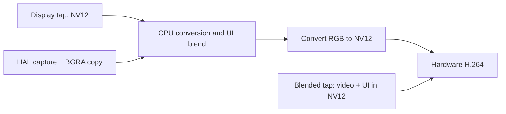

# UI timing split and combined capture: TV results

**Follow-up:** the experiment below was subsequently integrated and deployed as
0.1.22. See [production qualification and deployment](combined-deployment.md).

2026-11-02. User-authorized bounded experiments on the existing RTD2875Q TV,
at 640×360, requested 30 fps, hardware H.264. **BLENDED_OUTPUT works on this
TV and removes the separate UI capture cost.** This is a staged experiment,
not a production backend rollout. The installed 0.1.21 sender was restored
after each session, connected and capturing with its original configuration.

## UI split

Production source now retains `UiCapture/Acquire` and adds two nested timers:
`UiCapture/NativeCapture` around the GM/HAL call, and `UiCapture/CopyPixels`
around copying its BGRA output. The metrics catalog and existing metric-label
test cover the new stages. No capture behavior changed in production source.

The steady baseline worker measured:

| UI operation | Mean ms | Samples |
| --- | ---: | ---: |
| Entire acquisition | 15.185 | 219 |
| HAL capture call | 12.367 | 219 |
| BGRA pixel copy | 2.799 | 219 |

The remaining ~0.019 ms is wrapper/validation/instrumentation overhead.
An independent C++ probe confirmed the split: native HAL means 12.23–12.29 ms
and copy means 2.86–3.10 ms across four 80-sample windows after ten-frame
warm-up. Thus roughly 81% of the acquisition cost is inside HAL, rather than
the copy. This does not identify the individual wait/ioctl inside HAL.

## Capture modes and visible overlay proof

The probe requested three buffers, 640×360 and 30 fps using the existing
libvtcapture ABI. Modes ran in order **2 → 3 → 4 → 2**, each in a separate
process under the existing capture lock. Every session acquired 90 frames and
completed stop/postprocess/finalize/release successfully. Every tap returned
640-pixel stride and 640×360 geometry with readable two-plane buffers.

For each session, a short test toast was requested through Luna. HAL captured
the corresponding visible UI simultaneously, providing a positive control.
Raw VT and HAL frames were saved at indices 15, 45 and 75.

| Tap | Observed frame at index 45 |
| --- | --- |
| 2, DISPLAY_OUTPUT | Playing video; test toast absent |
| 3, BLENDED_OUTPUT | Playing video **and the test toast**, in the NV12 frame |
| 4, OSD_OUTPUT | Playing video; test toast absent. It was not an isolated UI feed in this test. |

Successful API return alone was not treated as proof of mode support. The
mode-3 toast was visually verified in both the raw capture and a subsequently
H.264-encoded/decoded frame. No successful alternate OSD backend is claimed.

## End-to-end staged worker comparison

The baseline was the normal worker with the new timers and `source=both`.
The candidate was built from an isolated copy of that source with just
`Properties.dump` changed from 2 to 3. Its **temporary** worker configuration
used `source=video` to bypass separate HAL capture: the selected tap already
contained both video and UI. The installed configuration was never switched
to video-only. Both retained the same rvenc encoder, normalization and wire
protocol. There was no software-encoder fallback.

First A/B: 150 frames per variant, including startup in cumulative timings.
The candidate preserved the toast and reduced sampled CPU usage from 48.2%
to 15.3% of one core. Startup-contaminated duration means were not used to
calculate steady-state headroom.

Follow-up A/B: 240 frames per variant. Metrics were captured after frame 20
and at completion; differences cover **220 completed iterations**. Individual
stage counts can differ by one because metric scrapes are not atomic with
the capture loop. The video was playing throughout, and a test toast was
shown at the beginning of each variant.

| Steady measurement | Normal Both capture | Combined tap |
| --- | ---: | ---: |
| Whole iteration, mean | 33.338 ms | **13.427 ms** |
| Native video acquisition | 0.376 ms | 0.454 ms |
| UI capture + copy | 15.185 ms | Bypassed |
| Hardware output wait | 12.154 ms | 11.989 ms |
| Whole encoder preparation | 14.097 ms | 12.574 ms |
| Sender CPU, one-core equivalent | 38.75% | **14.32%** |
| Mean received frame interval | 35.744 ms | **33.353 ms** |
| Skipped deadlines / 220 iterations | 93 | **0** |

Combined capture leaves **19.906 ms / 59.7% mean processing headroom** against
the 33.333 ms frame budget. This is local iteration time, not glass-to-glass
latency or evidence of 60 fps support. Hardware wait is now the largest stage.

The baseline steady sample contained 93 CPU-blended and 127 video-only encoded
frames. Its 33.3 ms average therefore describes an overlay-bearing workload,
not the earlier transparent-UI window's 28.9 ms. During blended frames, the
baseline also paid about 3.24 ms video-to-RGB conversion, 3.02 ms UI blending
and 3.63 ms RGB-to-NV12 conversion. Combined capture avoids those operations.
The sequential samples contain different moving pictures; they are not a
pixel-identical image-quality or rate-control comparison.

## Validation and restoration

- All **780 A/B wire frames** (300 initial + 480 follow-up) decoded with the
  unchanged Prysm receiver decoder; each connection's first frame also
  decoded independently. Dimensions and exact payload framing were checked.
- Raw and encoded mode-3 screenshots visibly contain the test toast.
- ARM worker build and strict Clippy passed. Host capture/metrics tests passed
  (4 metrics, 51 capture unit, 1 capture integration; hardware-only test ignored
  on host). The extended phase-label regression test passed after its update.
- Each experiment stopped the sender through its service, used the capture
  lock, bounded probe processes, removed temporary Luna roles/staging and
  restored the prior enabled state. Saved configuration bytes were unchanged.
  Final service state: connected, capturing, error null.
- Experimental binaries and split-timing instrumentation were staged only.
  The installed 0.1.21 binary remains in use, so its regular Prometheus export
  does not yet contain the two new timings.

## Limits and next integration boundary

The combined mode is now supported by direct observation on this TV. Before
making it the normal Both backend, qualify UI-only screens/no active video,
larger menus, input/power transitions, HDR/color behavior and sustained use.
Also verify image freshness and capture-to-display latency: readable buffers
and successful 30 fps encoding alone do not prove unique or equally fresh
source frames. Preserve the existing HAL/composition path as a fallback.

## Reproduction and evidence

Retained source, timing summaries, raw timing CSVs, runner scripts and binary
hashes are in [ui-combined/](ui-combined/). The scripts describe temporary
staging, role registration and restoration; `PRYSM_TV` supplies the SSH target.
Use the configured webOS SDK and the project native headers to compile the
C++ probe (`-std=c++17 -O2 -mfloat-abi=softfp -mfpu=neon -ldl -pthread`). The
candidate differs from the instrumented worker only at the tap selector;
runner configuration bypasses separate UI acquisition.

Full raw metrics, wire captures, screenshots, stdout/stderr and status records
remain in ignored `work/webos-encoder-latency/ui-combined/`, with initial A/B
under `ab/evidence/` and startup-excluded A/B under `steady/evidence/`. Captured
screen content and local network details were not copied into research output.

Key evidence:

- [Per-tap timing summary](ui-combined/tap-summary.json)
- [Steady phase means, counts and events](ui-combined/steady/timing-summary.json)
- [Steady receiver rates and CPU](ui-combined/steady/results.json)
- [Follow-up unchanged-decoder replay](ui-combined/steady/replay.log)
- [Tested binary SHA-256 hashes](ui-combined/binary-hashes.json)

## Follow-up: OSD-only cold start on Home

A later [mode-4 Home test](osd-home/README.md) used fresh driver processes with
MAIN disconnected. Preparation stayed pending through ten seconds of retries
in both runs; no frames were produced. The same probe captured HDMI video after
restoration. Mode 4 is not a working Home fallback through this tested API.
