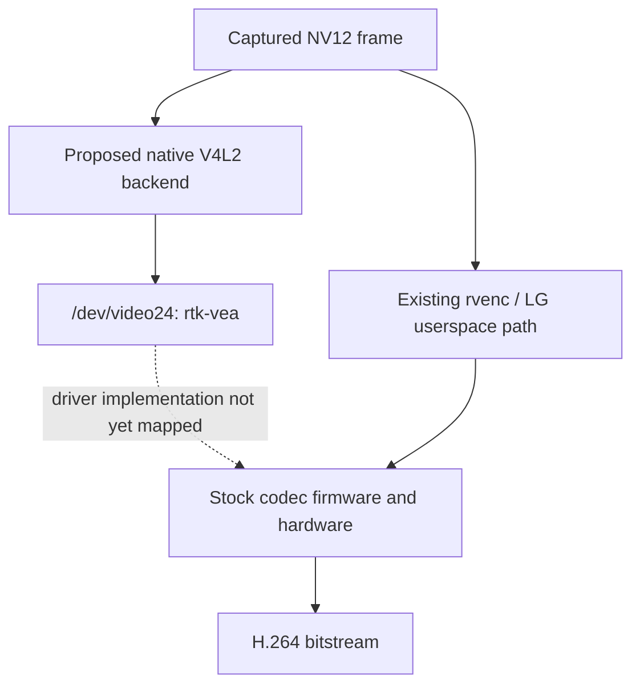

# RTD2875Q: using the encoder without LG userspace libraries

Date: 2026-11-02. Initial offline review followed by user-authorized, parent-executed TV probes and independent host validation. Scope: existing authorized encoder case (local evidence at `work/webos-encoder/scope.md`; not distributed), extended by the user's explicit request to build and test both paths. This sub-agent performed no TV connections, driver installation, or production change.

**The native V4L2 experiment now works: 1-frame and 15-frame clips passed complete content validation through FFmpeg and Prysm's unchanged receiver.** This demonstrates H.264 encoding without LG encoder userspace libraries, using the stock kernel driver and codec firmware. A fully open replacement for that driver/firmware has not been identified. Capture and receiver decoding remain separate. See the final section for measured results and limits; the initial source review and proposed experiment are retained below for provenance.

## Hardware actually established

| Finding | Evidence | Confidence and limit |
|---|---|---|
| Realtek RTD2875Q | [Colorimetry evidence](../2026-11-01-colorimetry/evidence.json): `chip: rtk,rtd2875q` | High; retained evidence, not a fresh inventory |
| Rockhopper 10.3.2-34, kernel 5.4.268-294.24.papikonda.2 | Same evidence file | High for the retained firmware |
| Hardware H.264 encoder interface `/dev/video24`, driver `rtk-vea` | [V4L2 capability capture](../2026-11-01-hardware-encoding/v4l2-capabilities.txt), [successful native trace](native/evidence/frames-15.jsonl) | High; native encoding now validated for the bounded synthetic clips |
| Multi-planar raw input `NM12` (NV12M), encoded output `H264` | Same capture: OUTPUT_MPLANE type 10; CAPTURE_MPLANE type 9 | High; do not substitute packed single-buffer NV12 without checking driver negotiation |
| GOP, bitrate, H.264 profile/level and keyframe controls exposed | Same capture | High for enumeration; enumeration alone does not prove each control works |
| Other vendor interfaces include `/dev/lg/venc0` and `/dev/dma_heap/dvr` | [Inventory](../2026-11-01-hardware-encoding/inventory.txt) | High; names alone do not establish a complete programming ABI |

The retained evidence does **not** establish the retail model, CPU topology, GPU model, or silicon's maximum H.264 encode throughput. Do not import those facts from another RTD2875Q television or a related RTD1295/RTD2875P SoC. The observed 3840×2160 50 Hz HDMI input in the colorimetry evidence describes the input/display pipeline, not encoder capacity.

## What could be shipped

| Approach | Dependencies and status | Assessment |
|---|---|---|
| Small native V4L2 encoder backend | Own code → `/dev/video24` → stock `rtk-vea` → hardware/firmware | Bounded synthetic encoding validated; no LG encoder userspace libraries linked |
| FFmpeg `h264_v4l2m2m` | Open-source userspace with stock kernel/firmware | Useful independent implementation; not validated on this driver |
| GStreamer `v4l2h264enc` | Already installed, version 1.24.0 | Existing attempts crash; isolate the failure before choosing it |
| x264/OpenH264 software encoding | CPU encoder unless coupled to a separate hardware backend | Merely bundling a software codec does not access this accelerator |
| New open kernel driver/firmware | Exact hardware/RPC/DMA/register ABI and firmware compatibility | No verified drop-in RTD2875Q encoder implementation found; much larger project |

The standard interface is documented in the [Linux stateful encoder API](https://docs.kernel.org/userspace-api/media/v4l/dev-encoder.html). FFmpeg has a real [V4L2 M2M encoder implementation](https://github.com/FFmpeg/FFmpeg/blob/master/libavcodec/v4l2_m2m_enc.c), including encoder control setup and raw/coded queues. Neither source establishes compliance or performance of LG's `rtk-vea` implementation.



The native path has now been demonstrated for synthetic input; the exact driver-to-firmware implementation remains unmapped. Capture-side buffer acquisition and synchronization remain separate requirements. Reusing an input buffer before the driver returns ownership can corrupt frames; removing vendor waits without understanding their purpose is unsafe for correctness.

## Public driver sources: useful, but not a matching replacement

The primary-source review included [TCLOpenSource/rt2875p](https://github.com/TCLOpenSource/rt2875p/tree/e2bef2357c45b65eb02bde5b040853888232a077), revision `e2bef2357c45b65eb02bde5b040853888232a077`. The repository root recursive listing was truncated, so the `drivers/rtk_kdriver` and `drivers/media` subtrees were inspected separately: 10,131 and 2,520 entries respectively, both complete. No matching `rtk-vea` H.264 encoder implementation was found in those inventories. This is a bounded search result, not proof that no such source exists anywhere.

The retained source manifest (local evidence at `work/webos-open-encoder-driver/sources/manifest.json`; not distributed) records exact URLs and SHA-256 hashes. In the related `rtd6748` code:

- [`rtk_vdec_driver.c`](https://github.com/TCLOpenSource/rt2875p/blob/e2bef2357c45b65eb02bde5b040853888232a077/drivers/rtk_kdriver/vdec/rtd6748/rtk_vdec_driver.c) names the device `rtkvdec`, exposes DMA/RPC-related plumbing and allocates encoder memory (`RTKVDEC_ENCODER_ALLOC`, `EncoderMemAddr`). It declares GPL licensing. An encoder memory allocator is not a complete H.264 encoder implementation.
- [`rtk_vdec_dmabuf.c`](https://github.com/TCLOpenSource/rt2875p/blob/e2bef2357c45b65eb02bde5b040853888232a077/drivers/rtk_kdriver/vdec/rtd6748/rtk_vdec_dmabuf.c) supplies useful related buffer-management source, without proving ABI identity with LG's Q platform.
- [`rtk_omxdev.c`](https://github.com/TCLOpenSource/rt2875p/blob/e2bef2357c45b65eb02bde5b040853888232a077/drivers/rtk_kdriver/omx/rtk_omxdev.c) dispatches clock acquisition/release operations. The OMX name does not make it an open codec implementation.

The [upstream Linux media platform inventory](https://github.com/torvalds/linux/blob/master/drivers/media/platform/Kconfig) also did not identify a matching RTD2875Q/rtk-vea driver. Upstream Hantro, Rockchip, MediaTek, and other drivers cannot be selected solely because all devices implement H.264.

The [LG Open Source portal](https://opensource.lge.com/) is the next primary source for a matching retail-model/firmware archive. No exact archive was identified or inspected in this investigation. A matching kernel source release would be useful even if codec firmware and vendor userspace remain closed.

## Why the existing V4L2 failure is not the final answer

The [current hardware-encoding report](../2026-11-01-hardware-encoding/report.md) records the unresolved fault: `v4l2h264enc` at 640×360 segfaulted during buffer allocation; explicit MMAP on both queues also failed, producing zero output. The [MMAP log](../2026-11-01-hardware-encoding/v4l2-mmap.log) ends around `gstv4l2bufferpool.c:1460`. That is the last log location, not a proved faulting instruction. Possible userspace/plugin or driver-interaction faults remain unresolved.

Runtime V4L2 probing reported approximately 192×192 to 1920×1152 with driver warnings. This is not a qualified hardware maximum. Separately, the vendor KADP path checks 176..1920 × 144..1088 and a 192-byte luma-pitch multiple. These are different paths; do not transplant those values blindly into V4L2 buffer allocation. Use the bytesperline, sizeimage, plane count, and adjusted dimensions actually returned by that driver.

The parent [latency investigation](../2026-11-02-encoder-latency/README.md) found FPS above 25 maps to a vendor enum that programs 30. That proves requested codec configuration, not a silicon throughput ceiling: the [Linux encoder API](https://docs.kernel.org/userspace-api/media/v4l/dev-encoder.html) explicitly distinguishes coded framerate from the rate at which frames arrive and are processed. Similarly, a TV's 4K decode/display capability does not establish 4K H.264 encode capability.

## Next experiment and evidence needed

First build a minimal native V4L2 harness with no GStreamer dependency. Use a synthetic, changing NV12M pattern, set H.264 on CAPTURE, negotiate raw OUTPUT dimensions, record every returned format/plane field, allocate MMAP buffers correctly, and use `poll` plus nonblocking DQBUF. Keep buffer ownership until OUTPUT DQBUF; record QBUF, OUTPUT DQBUF, CAPTURE DQBUF and decoded timestamps separately. Start at a known reasonable size such as 640×360, request a low-delay configuration, and verify accepted controls rather than assuming that exposed B-frame controls work. Then compare the decoded stream and latency against the existing vendor path. Importing capture DMABUFs is a second step after basic correctness.

This was the initial proposed test; the successful parent-executed TV runs are documented below. The single-encoder ownership, bounded-duration and cleanup constraints applied to those runs. Native V4L2 success demonstrates a userspace backend is possible; it does not explain the older plugin crash or justify a new kernel driver.

Missing hardware identity can be collected with read-only inspection of `/proc/device-tree/compatible`, `/proc/cpuinfo`, `/sys/class/video4linux/video24/name`, the video24 device's driver/of_node symlinks, and the TV's existing model/firmware information service. Those observations would select the correct LG source archive. They are unnecessary to establish the already retained RTD2875Q identity, but needed before asserting retail-model or core/GPU details.

## Timeline and evidence-to-action record

1. Reused authorized case scope and retained capability/inventory captures; established exact SoC and V4L2 raw/coded formats.
2. Reviewed existing failed V4L2 attempts and successful vendor-path report; kept crash location and throughput uncertainty explicit.
3. Reviewed Linux/FFmpeg primary interfaces and related TCL public source; retained pinned files with hashes.
4. Promoted finding: a userspace V4L2 path is plausible, while full open-driver replacement lacks a matched implementation. Next action is an independent native ABI test, not production replacement.

At completion of the initial offline source review, no performance gain had been measured, no native harness had been run, and no matching open encoder firmware had been found. Subsequent native results follow below. Public sources retrieved are research material; third-party code has not been integrated into Prysm. Global reverse-skill journal/index writes and publication were not performed by this subtask; its local research record and source manifest are available for the parent case's synthesis.

## Follow-up: native harness built

The user subsequently authorized building the native probe and live tests of both encoder paths. The native harness and run instructions (local evidence at `work/webos-v4l2-native/README.md`; not distributed) are now ready. Its ARM EABI5 executable links only libc/libdl/librt, negotiates two-plane NV12M MMAP input and H.264 output, acquires the existing capture lock with O_NOFOLLOW before opening the video device, and has bounded deadlines plus signal cleanup. It requests 640×360, 30 fps, 2 Mbit/s and Baseline/zero B frames, logging driver readback rather than assuming control acceptance.

The exact pattern-generation functions passed a host ASan/UBSan self-check over 16 frames, padded strides, extra plane capacity and allocation guards; the SDK build passes `-Wall -Wextra -Werror`. Initial binary SHA-256: `7c24877f62b114092de35c478de79230d680ac85346d3e6e0eed391e609dede1`. This sub-agent has not run the TV: the parent serializes all hardware sessions and captures live evidence. The user's latest steering leaves the production sender disabled after testing.

## Verified native V4L2 results

The first parent-run attempt exited cleanly before allocation because the driver's initial CAPTURE G_FMT returned zero `sizeimage`. The [failure trace](native/evidence/initial-format-failure.jsonl) preserves that observation. The corrected standard S_FMT request supplies a bounded 1 MiB compressed capacity, raw stride 768, and raw capacity preferences; it defers provisional coded geometry checks until raw negotiation is complete. Final returned capacity and QUERYBUF lengths remain mandatory checks. This is an API-negotiation correction, not a private ioctl or a bypass of allocation checks. It does not establish why the older GStreamer probes crashed.

The successful executable SHA-256 is `19389ffb62e920c7a7748f094fa6dfa9954424531ed0803ddb61d832914a5548`; [source](native/v4l2_probe.c), [build hashes](native/BUILD-SHA256SUMS), and [artifact manifest](native/manifest.json) are retained. The executable remains in the work directory; [provenance](native/PROVENANCE.md) distinguishes build hashes from archived files. The driver accepted visible 640×360 and 768-byte Y/UV strides, returning capacities 294912/147456 bytes, corresponding to allocation heights 384/192. This shows why returned plane capacity must govern allocation rather than width × height alone.

Both [one-frame](native/evidence/frames-1.jsonl) and [15-frame](native/evidence/frames-15.jsonl) runs exited zero. Each submitted frame returned on OUTPUT and produced a nonempty CAPTURE buffer; every captured PTS matched exactly one submitted PTS. Both STREAMOFF and buffer-release calls succeeded. Host validation independently found:

- FFmpeg decoded exactly 1 and 15 frames. Every visible Y, U and V sample matched the intended changing pattern **exactly**, including stripe boundaries: maximum error 0 in each plane.
- Each V4L2 capture `bytesused` segment exactly matched FFprobe's access-unit packet offset and length. All bytes were accounted for; no inferred boundary splitting was needed.
- Every AU passed the unchanged production `normalize_access_unit` and `Decoder`. All 3,686,400 decoded RGB pixels across both clips matched their intended frame with maximum channel error **1**, below the existing comparison threshold of 4. No decoder relaxation or special handling was added. See [receiver-check results](native/validation/receiver-check.log) and [checker source](native/receiver-check.rs).

The raw stream still needs the existing normalization. SPS describes 640×368 with no crop, while VUI omits video signal/color description. The driver reports success/readback for level 3.0, but SPS emits `level_idc=40` (level 4.0). It also accepts a 1/30 frame interval, while SPS timing has `num_units_in_tick=1`, `time_scale=30`, `fixed_frame_rate_flag=1` for a progressive stream: nominal 15 fps timing. This is bitstream metadata, not measured processing throughput. Successful control readback therefore does not establish emitted metadata correctness. [SPS trace](native/validation/frames-15.sps-trace.txt), [FFprobe output](native/validation/frames-15.ffprobe.json).

| Timing observation | Result | Interpretation |
|---|---:|---|
| Standalone first frame, submission to capture dequeue | 24.142 ms | Includes queue/STREAMON startup |
| Standalone first frame, STREAMON completed to capture dequeue | 11.412 ms | Output arrives without a second input or EOS |
| 15-frame run first frame, STREAMON completed to capture dequeue | 9.877 ms | First output preceded second input by 234.295 ms |
| Frames 1–14, submission to capture dequeue | Median 13.866 ms; range 12.497–19.771 ms | Observed userspace timing, not isolated hardware execution time |
| Submission cadence after the initial 250 ms gap | Approximately 26.43 fps | Harness scheduling/pattern generation; not a sustained 30 fps capacity test |

These timings use matched driver PTS and monotonic trace timestamps. The probe's 10 ms poll timeout can delay raw-buffer reuse and subsequent submission; scheduler load and pattern generation also contribute. This small run does not demonstrate CPU savings over the direct vendor path, higher maximum throughput, 4K encoding, restart endurance, or capture DMABUF compatibility. It does demonstrate that vendor encoder userspace libraries are unnecessary for this bounded encoding path.

Reproduce host validation from the repository root:

```sh
/opt/homebrew/bin/python3 work/webos-v4l2-native/validate.py
/Users/eschaal/.cargo/bin/cargo run --offline --manifest-path work/webos-v4l2-native/check/Cargo.toml --target-dir work/webos-v4l2-native/check/target -- work/webos-v4l2-native/validation
```

The copied [validator](native/validate.py) can instead use `--evidence research/webos-capture/2026-11-02-open-encoder-driver/native/evidence --output /tmp/prysm-v4l2-validation`. [Detailed validation results](native/validation/validation.json) retain per-frame content checks, exact input-to-output timings, observed submission intervals and clip hashes. Retained artifacts exclude device health payloads, addresses and connection scripts.
