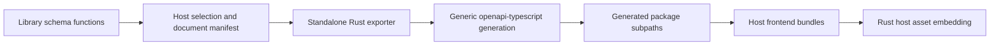

# Contract ownership and generation

This is the contract architecture for review. Library-owned schemas, host selection,
generic TypeScript generation and drift checks are implemented. Complete HTTP
commands and observations are not yet defined.

## Start here

| Owner | Public schema declaration | Frontend import |
| --- | --- | --- |
| Application wire contracts (`prysm-protocol`) | [Shared roots](crates/protocol/src/schema.rs) | `@prysm/contracts/application` |
| Video device capture | [Device roots](adapters/capture-device/src/schema.rs) | `@prysm/contracts/device` |
| Remote capture | [Remote roots](adapters/remote-capture/src/schema.rs) | `@prysm/contracts/remote-capture` |
| webOS capture | [webOS roots](adapters/capture-webos/src/schema.rs) | `@prysm/contracts/webos` |
| WLED output | [WLED roots](adapters/output-wled/src/schema.rs) | `@prysm/contracts/wled` |
| Host composition | [Server/webOS assembly and export manifest](assemblies/src/contracts.rs) | `@prysm/contracts/host-server`, `/host-webos` |

`prysm-contract` owns domain ports and models, with no Serde, JSON or OpenAPI
dependency. `prysm-protocol` owns application wire values, UI projections, shared
serialization helpers and optional OpenAPI roots. Explicit conversions connect
those values to domain types; local error sources never enter the wire format.

The adapter crates own their actual settings types, not copies for codegen.
Their `wire` feature enables Serde; `schema` adds utoipa. Capture adapters reuse
protocol helpers for core resolution values. Ordinary application traits acquire
no serialization bounds.

Each library exposes the same plain function, under its optional schema feature:

```rust,ignore
pub fn document() -> utoipa::openapi::OpenApi
```

Its local `#[derive(OpenApi)]` declaration lists its public root types. Adding
settings, commands, errors or observations means registering roots in their
owning library. Referenced types follow the schema graph. Internal traits,
task handles, frame buffers and private credentials are not automatically exported.

## Hosts own composition

The server host combines shared, video device capture, remote capture and WLED documents,
plus its own [source selection](assemblies/src/server.rs). The webOS
host combines shared, webOS capture and WLED documents. Each library document is
also exported independently, allowing adapter UI packages to import their own
types without depending on a host. Host frontend entry points consume the combined
host document, so their panel composition is checked against that selected surface.

`documents()` in the host assembly assigns stable package subpaths to documents.
It names libraries and hosts, never individual Rust types. This is intentional
host wiring, not a runtime registry or automatic plugin discovery.

Composition accepts identical repeated schema definitions and rejects conflicting
definitions with the same name. Public schema names must therefore be unique or
identical within a host. Current documents contain only schemas; the composer
rejects HTTP routes instead of pretending to assemble a complete HTTP API.

## The generator knows no adapters



The [exporter](tools/export-contracts/src/main.rs) serializes the manifest. The
[generator](frontend/scripts/codegen.mjs) translates each named document, using
`openapi-typescript`'s root-type exports. It contains no type-name mapping and no
adapter-specific branches. The npm package uses a wildcard export; introducing
a module does not require another package export entry.

Generated files are grouped per document, rather than all pointing into one
global schema file. Check them into source control. Drift checking compares
fresh generation without writing and detects missing, changed and obsolete files.
CI runs it before the build, which regenerates intentionally.

Serialization samples in the exporter's `fixtures.rs` are regression-test input,
not the list of exported contracts. Adding a type to a library's public roots is
sufficient for generation; add samples/tests when its wire behavior needs proof.

## Extending the surface

- **New type in an existing library:** define its Rust wire representation, add it
  to that library's public roots, run codegen, and import its generated type. No
  generator or package-export edit is required.
- **New library:** give it a schema document, select it in the appropriate host,
  and register its module in the host export manifest. The generator is unchanged.
- **Generic application API:** define its wire contract in its owning library and
  register concrete instantiations in the host. A test demonstrates generic schema
  specialization without changes to the composer or generator. Actual command and
  snapshot specialization will follow once those wire representations are reviewed.

## Guarantees and current limits

Tests prove independent library exports, host selection, conflict rejection,
generic specialization, automatic exports for an unfamiliar multi-type library,
schema/serialization agreement and non-writing drift checks. TypeScript checks
the host panels against generated types; Rust keeps semantic input validation.

Adapter settings, shared capabilities, UI snapshot/configuration projections,
instance-scoped IDs, operation outcomes and private presentation messages are now
registered. The TV platform surface has its own document. See the
[UI assembly guide](UI-ASSEMBLIES.md) for their use. Full processing/profile state,
event coverage, calibration workflow and preview transport remain to be defined. No HTTP paths or runnable network client are implied by
these documents. Adding them should extend library/host declarations, not the
mechanical generator.
