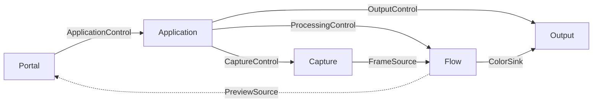
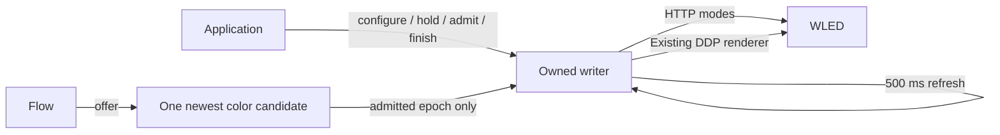
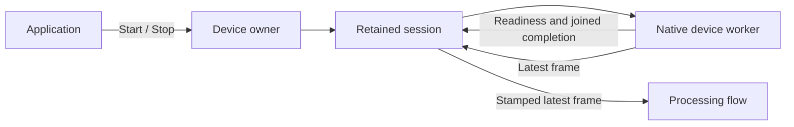

# V1 architecture workspace

This is an independent Cargo workspace for the v1 architecture. The passive
processing flow, application lifecycle, video device capture and WLED/terminal output
run in a supervised headless host; TV capture and remote transport remain skeletons.
It has its own lockfile and target directory.
The npm hooks, packaging and webOS toolchain are unchanged. Existing root capture
callers now use the same explicit native ownership API.
The existing `prysm-core`, `prysm-processor`, `prysm-capture` and `prysm-renderer-wled`
are used by path dependency. Video device capture disables the native crate's remote
transport/codec feature.
A separate npm workspace builds four frontend surfaces for three applications; their generated bundles
are required when compiling the Rust host examples.

## Names and composition

| Name | Responsibility |
| --- | --- |
| `prysm-server` | Processing, output and web portal, with local or remote capture |
| `prysm-webos` | TV UI, native capture, processing, output and web portal |
| `prysm-webos-slim` | TV UI, native capture and remote sender |
| `prysm-web-portal` / `@prysm/web-portal` | Complete browser feature: Rust HTTP/API/assets/preview boundary and browser UI |
| `@prysm/tv-ui` | Reusable UI for TV navigation |

The three application names remain assembly examples in this milestone;
`prysm-headless` runs the local device-to-WLED composition described below.
Production packaging remains deferred. `prysm-web-portal`
names the complete feature, with its browser code in the companion npm package.
The library is optional to hosts; the current `prysm-webos` assembly includes it.
`prysm-server` accepts transport adapters, including remote capture from webOS,
without making webOS part of the processing contract. Its [source selection](assemblies/src/server.rs)
composes local device settings and remote connection settings. The [remote receiver](adapters/remote-capture/src/receiver.rs)
exposes the same control/frame ports as local capture, with explicit unavailable
responses until networking is implemented. Capture resolution/rate belong to the
producing source, not the receiver connection. The server example still uses a
fixture for aggregate source selection; runtime adapter switching is deferred.

## Start the review here

1. [Server assembly](assemblies/examples/server.rs) and
   [webOS assembly](assemblies/examples/webos.rs): named ports, owners, and explicit
   emergency controls. Both compile on the development machine. Their
   [frontend assemblies](frontend/README.md) compile selected settings panels and
   supply the resulting assets to Rust. The
   [webOS slim assembly](assemblies/examples/webos_slim.rs) connects capture to a remote sender.
2. [Public contracts](crates/contract/src/lib.rs): application, capture, processing,
   output, preview, storage, calibration and snapshot subscriptions.
3. [Application assembly](crates/application/src/lib.rs),
   [passive flow](crates/flow/src/lib.rs), and
   [portal assembly](crates/web-portal/src/lib.rs): compile-time dependency direction.
4. [Application policy](crates/application/src/policy.rs) and
   [host lifecycle](assemblies/src/server/lifecycle.rs): changeable defaults, separated from ports.
5. [Flow runtime tests](crates/flow/src/tests.rs),
   [wiring checks](assemblies/tests/wiring.rs) and
   [independent portal client](assemblies/tests/portal.rs): what this milestone proves.
6. [WLED transitions](adapters/output-wled/TRANSITIONS.md) and
   [protocol/integration tests](adapters/output-wled/src/tests/network.rs): real
   output with local HTTP/DDP fixtures, including the application and processing flow.
7. [Video device capture transitions](adapters/capture-device/TRANSITIONS.md) and
   [tests](adapters/capture-device/src/tests.rs): readiness, epochs, interrupted
   opening and verified release, with the native boundary controlled by test gates.
8. [Host ownership and failure transitions](assemblies/HOST-LIFECYCLE.md):
   headless supervision, coordinated shutdown and terminal owner cleanup.

Review the [UI and host assemblies](UI-ASSEMBLIES.md), including both TV compositions,
the [RTK frontend state wiring](frontend/STATE.md),
and the [contract ownership and codegen architecture](CONTRACTS.md) before
extending the wire surface. Library schema roots and host selection are separate
from the generic generator.

Full rationale: [architecture proposal](../docs/plans/prysm-v1-architecture.md).



The application and portal depend on contracts, not concrete devices. The
application does not depend on the flow implementation. The flow owns an existing
processor and its input/output ports. Nothing exposes Tokio channel ends.
Constructors transfer dependencies into private owner wiring. Hosts retain only
the public owner/control/data endpoints and clone any emergency controls before
passing them to the application; they cannot reach through an owner to drive its
processor or devices directly.
Capture/output settings are associated types, so server and TV compositions use
different settings types without a shared deployment flag. Hosts compose the
shared frontend with adapter settings panels and supply the resulting assets to
the Rust portal. The portal library has no adapter/editor enum; capabilities
contain no schema identifiers. The domain contract crate has no serialization or schema
dependencies; `prysm-protocol` owns application wire values, UI projections and schema roots.
Adapter settings are generated from Rust through
OpenAPI into the frontend contracts package, with a drift check before CI builds. Calibration has a private reply path
for credentials; public observations contain only non-secret status.

## Build and inspect

From the repository root:

```sh
npm --prefix v1/frontend ci
npm --prefix v1/frontend run codegen:check
npm --prefix v1/frontend test
cargo check --manifest-path v1/Cargo.toml --workspace --all-targets --locked --offline
cargo test --manifest-path v1/Cargo.toml --workspace --all-targets --locked --offline
cargo clippy --manifest-path v1/Cargo.toml --workspace --all-targets --locked --offline -- -D warnings
cargo run --manifest-path v1/Cargo.toml -p prysm-assemblies --example prysm-server --locked --offline
cargo run --manifest-path v1/Cargo.toml -p prysm-assemblies --example prysm-webos --locked --offline
cargo run --manifest-path v1/Cargo.toml -p prysm-assemblies --example prysm-webos-slim --locked --offline
cargo doc --manifest-path v1/Cargo.toml --workspace --no-deps --locked --offline
```

Offline Cargo commands require cached Rust dependencies. Node.js 24+ is required
for the frontend workspace; codegen also needs Rust. Build it before compiling
the host examples. The
headless Rust libraries do not need Node.js or frontend assets. No FFmpeg,
GStreamer, TV SDK or network service is required by the examples. They embed the
built frontends, construct wiring and exit; they are not production executables.
WLED tests bind loopback TCP/UDP sockets; they require local networking permission
but no physical device.

Use `cargo tree --manifest-path v1/Cargo.toml -p prysm-application -e normal` to
inspect the headless dependency closure. The testkit is a dev-dependency of the
assembly examples/tests, never a fallback adapter inside a production library.

## Implemented versus deliberately absent

| Present | Deferred |
| --- | --- |
| Domain traits, data types, error/cleanup outcomes | Physical-device verification |
| Typed assemblies, host supervision, deadlines and coordinated shutdown | Physical shutdown qualification |
| Passive flow, bounded frame handoff, configuration acknowledgments and session barriers | TV capture cleanup |
| Typed settings load/replacement through the repository port, frontend compositions and asset boundary | Concrete file persistence and complete frontend panels |
| Application/session sequencing, operation registry and component observations; demand-driven preview tap and terminal video | Browser preview encoding and client serving |
| Video device ownership, readiness, cleanup and availability epochs; WLED mode writes, DDP delivery and refresh | TV capture, file playback and remote transport adapters |
| Fake source/sink connected through the real flow owner | Calibration workflow and credential generation |

Constructors create inert wiring. The application and flow have working bounded
control mailboxes, driven by host-owned `run(instance, shutdown)` futures. WLED and video device capture
receives the instance at construction and exposes `owner.run(shutdown)`. Portal
execution, calibration, concrete file persistence and remaining capture shells remain
explicitly unavailable. No placeholder claims device cleanup or delivery.

`prysm-testkit` contains named fake adapters that record calls and frames; it
depends on contracts and core values, not the flow implementation. These fixtures
do not implement real admission, hardware cleanup or remote delivery guarantees.
The assembly tests run the real flow through its public configuration, observation,
frame and barrier ports, then await owner completion on source closure or failure.
Application tests use separate gated capture/output fixtures with the real flow
to exercise lifecycle ordering, delayed replies and cleanup failures, including
cleanup through retained controls after aborting a running coordinator. WLED adds
gated-write and real HTTP/DDP tests. Device tests exercise the real application
and flow with controlled native readiness/release, plus actual missing-device failure.
Successful physical device acquisition/release still needs hardware verification.

All four frontend compositions compile, bundle and run against in-memory fixtures.
Their tests check panel/client type compatibility, submissions and snapshot updates.
The Rust examples embed the generated bundles; HTTP serving remains deferred.
See the [frontend proof and limitations](frontend/README.md).

The portal's optional preview value disables runtime preview. When encoding is
implemented, its compilation must also be controlled by a Cargo feature or
separate package; an `Option` alone cannot remove dependencies.

## Passive processing flow

The host drives `flow.owner.run(instance, shutdown)` on its Tokio runtime and
retains its task handle. `instance` is the host-owned application identity, shared
with capture session IDs. The flow starts one dedicated processing thread, with
no nested runtime or per-frame tasks. It parks while idle. Input reads stay alive
across control commands; an always-ready source yields to other host tasks.
The private [mailbox](crates/flow/src/mailbox.rs) accepts commands, frames and
shutdown requests and owns their wake notifications. It registers the dedicated thread when the worker starts;
control handles only submit commands and await replies.

Configure through `flow.control.configure(update)` before processing. Until then,
the flow retains only the newest input frame. Thereafter at most one frame is in
flight and one is pending. Configuration acknowledgments come from the worker at
frame boundaries. Observations distinguish configured from last-frame-applied
revision, which reports processing rather than device delivery. They provide an
atomic initial snapshot/subscription and explicit resync on lag.
Commands and observation updates each have a fixed capacity of 16.

After capture cleanup, `barrier(session)` waits for in-flight processing, discards
pending work for that session and rejects subsequent late frames. Sessions must
increase within the host instance; sealing also rejects earlier sessions without
retaining an ever-growing set of IDs. Foreign instances, epoch zero and regressing
frame stamps are discarded. Each new session or epoch resets processor history
using the last configured settings. Ordinary configuration preserves history.

Shutdown discards pending frames, finishes the in-flight processor/output offer,
and joins the thread before returning `OwnerStopped`. Source closure/failure,
output failure and worker panic return an error after joining. Dropping the driving
future also stops and joins the worker synchronously as a fallback; hosts should
request shutdown and await completion to keep their executor responsive.

The flow barrier accounts for processing and synchronous `ColorSink::offer` calls,
not queued device writes. Output admission/finish remain the output adapter's job.
The [preview tap](crates/flow/README.md) publishes one latest coherent source/crop/colors
snapshot while leases exist. Subscribing never starts capture. The last lease releases
tap retention; flow closure ends subscriptions even while handles survive. Terminal
preview conversion and encoding stay in the output adapter.

## Application lifecycle

The host drives `application.owner.run(instance, shutdown)` with the same instance
as the flow, and retains both futures until completion. The application loads
initial typed settings through its injected repository, validates aggregate relationships
before publishing them, and starts with Off intent;
it does not automatically configure devices. The implemented policy is `V1Policy`
(idle startup, hold black while waiting, explicit commands after failure).
Automatic-start/retry and end-session-on-unavailability policies are unavailable.

Start a lifecycle review with the [transition table](crates/application/TRANSITIONS.md).
The [coordinator](crates/application/src/coordinator.rs) handles application intent,
command acceptance and dispatch. The private [lifecycle](crates/application/src/session.rs)
owns phases, resource obligations and pending device calls; its fields are private.
The coordinator keeps serving commands, operation queries and observations while
a device reply is pending.

The private [settings workflow](crates/application/src/settings.rs) validates
replacement revisions, retains one save and publishes the last confirmed saved
value. [Lifecycle settings entry points](crates/application/src/session/settings.rs)
choose immediate installation, live processing update, or adapter restart. The
existing lifecycle model owns restart and cleanup; there is no separate replacement
state machine. It keeps old resource settings through cleanup even after new settings
are saved. Completions return directly to the coordinator with the lifecycle outcome. Off can interrupt a
replacement without cancelling its save or allowing a late restart; each operation
retains its own result. Saved, worker-configured and frame-applied revisions remain
distinct. See the [settings transition table](crates/application/SETTINGS-TRANSITIONS.md)
and [gated repository tests](crates/application/src/tests/settings.rs).

The headless composition still uses a read-only repository and exposes only target
commands. A writable file adapter must retain started I/O independently of the
application and be joined by the host; that integration is not implemented yet.

The lifecycle's [transition model](crates/application/src/session/model.rs) is
synchronous, with explicit Idle, Starting, Active, Stopping and Blocked phases.
Preparation and cleanup each define their completion rules. The separate
[device calls](crates/application/src/session/devices.rs) translate actions into
port calls and check acknowledgments. No extra task, mailbox or scheduler is used.
[Operation history](crates/application/src/operations.rs) owns acceptance/result
retention; [observations](crates/application/src/observations.rs) own publication and
component subscription recovery. Snapshots are projections of owned state.

Start validates settings, configures processing/output, holds black and
opens capture. Start completion means resource readiness; the session stays
Waiting until capture announces an available epoch and output admits it. Newer
waiting epochs close admission and hold black; newer available epochs resume it.
Old sessions and regressing epochs cannot drive these transitions.

A conflicting DeviceNative request before Start has begun output preparation is
rejected; Off remains available. Once output preparation is owned, Off and
DeviceNative close admission, stop capture, await capture cleanup and any
racing open reply, cross the real flow barrier, then finish output in the requested
mode. In-flight writes remain owned. A later Off or shutdown waits out an earlier
Native write and follows it with Off. Partial startup failures compensate. A failed
cleanup hold still proceeds toward the requested idle mode and reports the failure.
Failed capture/barrier/finish cleanup retains the session, reports `cleanup_complete:
false`, and blocks Start; an explicit Off retries. The snapshot keeps the latest
failure diagnostic rather than an unbounded failure history. Failures retain a stable
category through snapshots and operation results; their local source chains are omitted
from protocol projections. Uncertain WLED mode writes report `recovery_required`,
distinct from failures that permit an explicit cleanup retry.

Commands and observation updates each have capacity 16. The operation registry
retains 64 results, evicting completed entries only. Reusing a retained request ID
with the same target returns its acceptance; using it for a different target
conflicts. Expired or foreign IDs are unknown to operation queries. Observations
establish a snapshot/subscription atomically and explicitly report gaps. The
coordinator reacquires component snapshots after gaps. Configured/applied revisions
come from processing; output confirmation comes from the output adapter.

Dropping clients does not cancel accepted work or stop the owner. Host shutdown
requests Off and awaits cleanup, including an already idle Native output. If
cleanup stays unconfirmed, the owner stays alive for an explicit Off retry or host
escalation. There is no coordinator timeout, detached cleanup task or async Drop
fallback: the host must retain the owner future and emergency controls. Device
adapter deadlines and host emergency cleanup remain separate responsibilities.

## WLED output

Construct `WledOutput::new(instance)` with the application's host identity. Give
its `control` to the application and `colors` to the flow; drive and retain
`owner.run(shutdown)` on the host Tokio runtime. Construction is inert. Settings
keep the existing address/LED-count wire format. No new public backend or scheduler
abstraction is introduced.



Review the [transition table](adapters/output-wled/TRANSITIONS.md) first. Shared
[admission](crates/output/src/lib.rs) owns session/epoch fences and
the latest candidate; [mailbox](adapters/output-wled/src/mailbox.rs) owns shared
state, notifications and atomic observations. The
[owner](adapters/output-wled/src/owner.rs) serializes writes and refresh; the
[transport](adapters/output-wled/src/transport.rs) owns WLED HTTP details and reuses
the DDP renderer. A failed finish keeps the session and configured device reserved
until cleanup succeeds. Changing devices or starting another session cannot bypass it.

Accepted writes survive caller cancellation. HTTP has a connection deadline but
no request/read deadline: a stalled write remains owned and later controls wait.
Observations stay responsive. Connection failures and completed rejections permit
cleanup retry; ambiguous HTTP outcomes require host/device recovery and cannot be
cleared by reconfiguration. The host must retain the owner through pending writes.

All acknowledgments are `Sent`, never physical display confirmation. Observations
describe local adapter state, not changes made through WLED's UI. DDP cannot fence
packets already in the network; local send ordering cannot guarantee their arrival
order. Native preserves the selected effect/preset and brightness is untouched.
Hardware verification remains necessary.

## Video device capture

Construct `DeviceCapture::new(instance)`, connect `control` to the application and
`frames` to the flow, and retain `owner.run(shutdown)` on host Tokio. One native
worker owns the device; the adapter keeps commands and observations responsive
while opening or releasing it. Review the
[transition table](adapters/capture-device/TRANSITIONS.md) first.

The [session](adapters/capture-device/src/session.rs) owns Start/Stop replies,
availability epochs and completion. Its phases are Starting, Waiting, Available
and Stopping; only Available owns a silence deadline. `next_event()` selects by
priority, and `progress()` applies the selected transition without another await.
The [owner](adapters/capture-device/src/owner.rs)
dispatches commands and blocks reuse after unconfirmed release. The
[mailbox](adapters/capture-device/src/mailbox.rs) owns one pending frame and atomic
observations. The private [backend boundary](adapters/capture-device/src/backend.rs)
translates native results; it contains no platform-specific device logic.



Start succeeds after native activation, independently of the first frame. Stop
seals the session, cancels opening/running capture and waits for verified release
and thread join. A late open cannot resume a stopped session. Native operational
failure with proven release permits a new session; cleanup failure or panic reports
`RecoveryRequired` and blocks reuse. Caller cancellation does not cancel accepted work.

Delivery silence for max(2 seconds, 3 frame periods) advances to a waiting epoch;
resumption advances again. This measures delivery continuity, not physical signal
or acquisition age. Black frames are valid. While idle/waiting/stopped, the frame
port stays pending; only owner closure ends it.

The [native backend](../crates/capture/prysm-capture/src/device.rs) exposes readiness,
frames and an owned worker. Linux explicitly starts streaming before readiness and
releases mapped buffers without panicking on cleanup errors. macOS disables frame
publication, detaches its delegate, stops capture and drains its callback queue.
The old stream/completion-token device API was replaced; existing root callers and
the smoke example use the new API.

`Device.path` identifies a Linux device node or a macOS AVFoundation device UID;
the current settings require an explicit nonempty UTF-8 identifier. The existing
File settings variant returns unavailable until a dedicated file adapter owns
FFmpeg readiness, frame reads and process reaping. Native platform code is isolated
from the safe v1 adapter. Host abort/drop requests cancellation but is not proof of
cleanup; the host must retain the owner through shutdown.

## Run the headless host

Copy [the example configuration](assemblies/examples/headless.json), replace its
WLED address and LED counts, and select your capture device. On Linux `path` is a
device node; on macOS use an AVFoundation device UID. Processing uses the existing
defaults. Settings are loaded once and are read-only for this milestone.

```sh
cargo run --manifest-path v1/Cargo.toml -p prysm-assemblies \
  --features headless --bin prysm-headless -- /path/to/config.json
```

The `output` selects an adapter, for example
`{"adapter":"wled","settings":{"address":"192.0.2.1","leds":[30,18,30,18]}}`.
For a live terminal display, use [the terminal configuration](assemblies/examples/terminal.json):
`{"adapter":"terminal","settings":{"leds":[30,18,30,18]}}`.
The [terminal output crate](adapters/output-terminal/README.md) displays four color
edges, application/capture status, frame/revision information and recent diagnostics.
It uses Ratatui/Crossterm, needs an interactive stdout, and restores the terminal
on shutdown. It does not send colors to WLED or support device-native mode.

This starts idle and does not open capture. Append `--start` to request processed
lighting through the application after initialization. Ctrl-C or SIGTERM requests
coordinated Off and joins every owner. The binary needs no frontend build or HTTP
listener. WLED mode prints application status and operation results to stderr;
terminal mode routes them through the screen owner, with stderr used after it closes.
Terminal mode also subscribes to the flow preview and displays cropped source imagery
inside the admitted LED perimeter. See [terminal video behavior](adapters/output-terminal/README.md#live-video-preview).

The [assembly](assemblies/src/server.rs) constructs the graph. The private
[host loop](assemblies/src/server/host.rs) polls owners and application entry;
[lifecycle](assemblies/src/server/lifecycle.rs) owns shutdown transitions and
failure retention; [owners](assemblies/src/server/owners.rs) retains the concrete
four tasks and their shutdown controls. There is no automatic restart.

Initialization and coordinated shutdown each have a 10-second deadline. Expired
coordinated shutdown switches to terminal cleanup. After another 10 seconds the
host reports pending owners and keeps waiting; it never treats a timeout as proof
of native release or output cleanup. Keep `run_headless` alive until it returns.
The host retains the selected output's concrete shutdown handle, which fences new
commands, frames and refresh immediately while an existing write remains owned.

## Next implementation boundary

Implement concrete file persistence and its host-owned I/O worker following the
[settings replacement transition table](crates/application/SETTINGS-TRANSITIONS.md).
The application workflow already covers validation, persist-before-apply ordering,
live processing updates and device cleanup/restart with gated repository tests.

Qualify video device capture cleanup and WLED behavior on physical hardware using
the supervised headless host. File/TV/remote capture,
file persistence and calibration remain separate milestones.
Browser preview and HTTP/Luna serving remain deferred. Integrate packaging and the old
workspace only after those libraries are usable. No backward compatibility or
data migration is planned.
