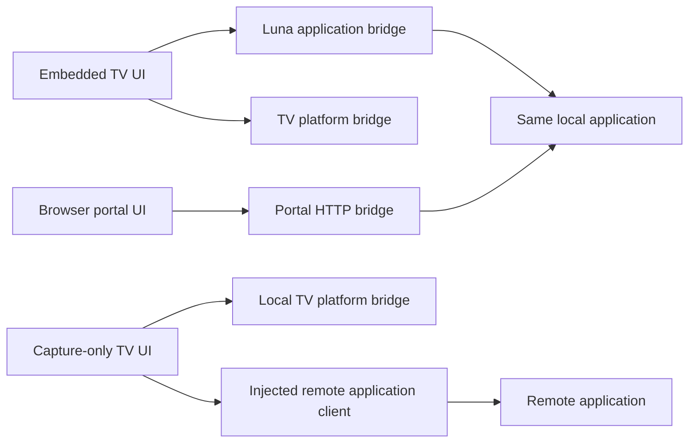

# UI and host assemblies for review

The webOS application always has a TV UI. The embedded-processing composition
also includes the browser portal for configuration, preview and calibration. The
portal library remains independently reusable, but this assembly includes it.
The capture-only TV composition has no local processor, output or portal.

| Composition | TV UI | Browser portal | Processing |
| --- | --- | --- | --- |
| `prysm-server` | None | Included | Local |
| `prysm-webos` | Included | Included | Local |
| `prysm-webos-slim` | Included | None on the TV | Remote application |

## Read the wiring

- [prysm-webos Rust assembly](assemblies/examples/webos.rs): native capture fixture,
  processing flow, output, application, packaged TV UI, Luna application bridge
  and browser portal. Luna and the portal receive clones of the same application port.
- [prysm-webos-slim Rust assembly](assemblies/examples/webos_slim.rs): packaged TV UI,
  local platform bridge and [capture sender](adapters/remote-capture/src/lib.rs).
  There is no local application coordinator or processing/output assembly.
- [Embedded TV frontend](frontend/hosts/webos/tv-ui/app.tsx): shared TV UI, local
  Luna application client, platform client, presenter and required portal address.
- [Remote TV frontend](frontend/hosts/webos-slim/tv-ui/app.tsx): the same TV UI, local
  platform client and an injected client for the remote application. It accepts
  no local portal configuration. Its physical remote transport is still undecided.
- [Browser frontends](frontend/hosts/server/web-portal/main.tsx) and
  [embedded webOS browser frontend](frontend/hosts/webos/web-portal/main.tsx): shared portal
  UI with an HTTP application bridge. Fixture bridges are explicit in each entry point.



## Shared interfaces

[application-client](frontend/packages/application-client/index.ts) owns the
transport-independent port and generated payload types. It imports neither Redux
nor React. [application-state](frontend/packages/application-state/index.ts) assembles
one RTK store per frontend with typed command thunks and an observation listener.
[application-react](frontend/packages/application-react/index.tsx) provides typed
React-Redux hooks; its [Provider](frontend/packages/application-react/provider.tsx)
is mounted by each host and owns that UI's observation lease. Both UI libraries
consume the same state layer. See [frontend state wiring](frontend/STATE.md).

Commands carry instance-scoped operation IDs; acceptance and operation results
are separate. IDs, revisions and cursors use canonical decimal strings to preserve
all Rust `u64` bits. Observation starts with an atomic initial snapshot/subscription.
Gaps, instance changes and explicit resync signals clear the cached state and
disable application controls. Automatic reconnect/resynchronization is deferred;
a new connection must acquire a fresh observation. UI teardown only releases
observation. It does not send a stop/off command or cancel accepted operations.

[client wire projections](crates/protocol/src/client.rs) define the reviewed UI
payloads in Rust. Configure-capture/output requests are frontend conveniences:
the eventual mapping to `ApplicationControl` must preserve processing and profile
settings and apply the expected revision. That mapping is unimplemented, not an
alternative application coordinator. Full application state/event projections,
HTTP routes, Luna methods, encoding and boundary validation remain deferred.

Hosts inject `ApplicationClient` directly. HTTP/Luna transport implementations
remain deferred; there are no pass-through transport wrappers. The
[production stub](frontend/packages/application-client/adapters.ts) returns explicit
unavailability; fixtures provide interactive behavior. Timeout/disconnect errors
may retain an operation ID with `outcome_unknown`; the UI must not treat them as
rejection and replay.

[webos-platform](frontend/packages/webos-platform/index.ts) separately exposes
platform status/setup and a pattern presenter. Its [host wire types](assemblies/src/tv.rs)
are generated independently of application commands. Platform controls do not
own lighting intent. Source lifetime remains with the capture/sender owners.

## Calibration presentation and UI lifetime

The shared [TV UI](frontend/packages/tv-ui/index.tsx) supplies basic arrow/OK/Back
navigation, application controls, platform actions and a calibration entry surface.
The [presentation controller](frontend/packages/tv-ui/presentation.ts) tracks
private presentation lifetime. Pairing/session values never enter public snapshots.
Playback readiness comes from the presenter, not React mounting. Failure, Back,
hide and unmount release presentation and report it through the private client.
Late replies after teardown are cleaned up without starting playback. A late
readiness acknowledgment cannot restore a closed presentation. Overlapping opens
are rejected, and remote session closure is attempted even if local release fails.
Overlapping stops await the same cleanup. Failed cleanup retains the session and
blocks another open; an explicit stop retries with the same close operation ID.
This also applies to an open reply arriving after teardown. The presenter must
invalidate pending playback when released.

Coordinator-owned calibration expiry must still cover browser crashes and lost
cleanup requests; browser cleanup is not a guarantee. The fixture presenter only
simulates readiness. Actual full-screen video, pattern sequencing, pairing and
native playback acknowledgments are not implemented. Ordinary lighting intent
does not change when the TV UI or calibration presenter disappears.

## Build, inspect and limits

```sh
npm --prefix v1/frontend ci
npm --prefix v1/frontend run codegen:check
npm --prefix v1/frontend test
npm --prefix v1/frontend run dev:webos
# Or independently:
npm --prefix v1/frontend run dev:webos-slim
```

Build creates four bundles: `dist/server/web-portal`, `dist/webos/web-portal`, `dist/webos/tv-ui`, and
`dist/webos-slim/tv-ui`. Browser bundles produce Rust asset lists. TV bundles use relative
asset URLs and are intended for application packaging, not portal serving. Actual
IPK packaging and TV installation are deferred. Rust examples include their TV
entry page at compile time to make the frontend prerequisite visible.

Each standalone demo uses its own in-memory fixture. They do not communicate
across tabs. Tests mount the embedded TV UI and portal against the same fixture
to prove shared application access and independent observation cleanup. Further
tests cover command routing, private calibration data, late presentation replies,
playback failure, uncertain outcomes and resync invalidation.

No Luna calls, sockets, TV hardware, native pattern video or WLED writes occur.
The ES2020 target and remote navigation still require validation on actual webOS.
