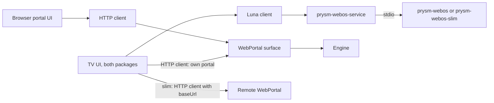

# UI and host assemblies

The webOS application always has a TV UI. The embedded-processing composition
also serves the browser portal. The capture-only TV composition has no local
engine, output or portal.

On the TV, Luna belongs to the supervisor (`prysm-webos-service`, Luna
`io.prysm.tv.service`, both packages), not to the workers: it owns power and
video, the TV preferences and the worker process, and the TV UI calls it for
state, preferences and enable/disable ([Luna API](../docs/plans/prysm-v1-webos-supervisor.md#6-luna-api),
generated types `@prysm/contracts/luna`). The workers talk only to the
supervisor over stdio and have no Luna surface.

| Composition | TV UI talks to | Browser portal | Processing |
| --- | --- | --- | --- |
| `prysm-headless`, `prysm-tui` | — (`prysm-tui` adds the terminal surface) | `WebPortal` surface | Local engine |
| `prysm-webos` worker | supervisor over Luna; its own portal over HTTP for settings | `WebPortal` surface | Local engine |
| `prysm-webos-slim` worker (a `Forwarder`) | supervisor over Luna; the remote headless portal over HTTP | None on the TV | Remote engine |

On the Rust side every UI is a runtime surface over one `EngineHandle`; see the
[simplified runtime](../docs/plans/prysm-v1-simplified-runtime.md) and the
[portal HTTP contract](surfaces/web-portal/HTTP-CONTRACT.md).

## Frontend wiring

- [Desktop browser host](frontend/hosts/headless/web-portal/app.tsx), shared by
  `prysm-headless` and `prysm-tui`: shared portal with capture kinds `device`,
  `remote` and `file`, and output kinds `wled` and `null`.
- [webOS browser host](frontend/hosts/webos/web-portal/app.tsx): shared portal,
  capture kind `webos` and output kind `wled`, typed by
  `@prysm/contracts/host-webos`.
- [Embedded TV](frontend/hosts/webos/tv-ui/main.tsx) and
  [capture-only TV](frontend/hosts/webos-slim/tv-ui/main.tsx): the shared
  [TV UI](frontend/packages/tv-ui/index.tsx) with the
  [Luna client](frontend/packages/webos-platform/index.ts) of the supervisor
  (generated `luna` types; `getState` subscription, `setPreferences`,
  `setEnabled`, `uninstall`, and set-up through the Homebrew Channel's `exec`
  of `setup.sh`) and an HTTP client factory for the Prysm that drives the
  lights. Full: the TV's own portal over loopback (`http://127.0.0.1:<port of
  State.portal>`). Slim: `preferences.instance`, the computer's portal, which
  must allow the app's origin (`--allow-origin null`; a `file://` app sends
  `Origin: null`); the UI says so when that portal answers but refuses. The
  slim UI fills `preferences.receiver` from that portal's `capture.listen`
  port. `demo.html` in each host folder runs the same UI on in-memory fakes
  (`npm run dev:webos`, then `/demo.html`); production builds load only
  `index.html`.



[application-client](frontend/packages/application-client/index.ts) is the
transport-independent port: `observe` (a stream of whole states), `setTarget`
and `replaceSettings(expected, settings)`, each resolving with the engine's own
result or rejecting with a typed `Failure`. The
[HTTP client](frontend/packages/application-client/http.ts) implements it:
`httpApplicationClient()` talks to the page's own portal, and
`httpApplicationClient({ baseUrl: 'http://192.168.1.20:8787' })` to a remote one
that allows the page's origin (`--allow-origin`; a `file://` app needs `null`, see
[portal access](surfaces/web-portal/HTTP-CONTRACT.md#access)). The portal needs
no credentials.
[application-state](frontend/STATE.md) holds the latest state and command
feedback in one RTK store per frontend.

The [shared portal](frontend/packages/web-portal/index.tsx) shows the lighting
modes (Screen sync, the output's own effects such as "WLED effects", Off, and
"Open WLED"), an on-request preview, live picture controls with colour
profiles and one Save form each for capture and output. Both browser hosts
pass `httpPreviewClient()` (same `baseUrl` option as the application client)
as `WebPortal`'s optional `preview`. A host registers each section's kinds as an `AdapterUis` map of
`AdapterUi { label, create, Editor, normalize?, lighting? }`; the map is
exhaustive over the host's generated union, the form shows a kind selector when
there is more than one, and editors are controlled components built from the
portal's fields. Saves copy the latest observed settings and replace one
section, so unknown fields are kept; a section changed elsewhere is reloaded
instead of overwritten ([saving settings](frontend/README.md#saving-settings)).
UI teardown releases the state stream only; it never turns lighting off.

## Build and inspect

```sh
npm --prefix v1/frontend ci
npm --prefix v1/frontend run codegen:check
npm --prefix v1/frontend test
npm --prefix v1/frontend run dev:webos
```

The build creates `dist/headless/web-portal` (both desktop hosts), `dist/webos/web-portal`,
`dist/webos/tv-ui` and `dist/webos-slim/tv-ui`. Browser bundles also produce a
Rust `assets.rs` list for `WebPortal`. TV bundles are packaged with the app:
`index.html` plus `assets/` (one classic deferred script with Chromium 53
syntax and one stylesheet, relative URLs for `file://`). The Luna path needs
nothing newer; controlling a portal over HTTP needs `AbortController` and
streamed `fetch` bodies (webOS 5+), and older TVs are told to use the portal on
another device.

Not implemented: TV calibration (not in the runtime yet; the TV shows the entry
as not available).
