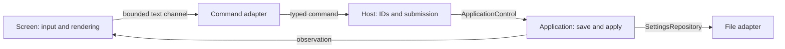

# Terminal commands

This driving adapter turns command text into typed `ApplicationCommand` values.
It owns parsing and candidate-file reading. It depends on application contracts and
the protocol's complete settings document, with no output, device, or repository
dependency. The host assigns request IDs, submits commands and reports acceptance;
the application owns validation, saving, applying, and operation completion.

Run `prysm-tui <settings.json>`. Press `:` to edit a command, Enter to submit, or
Escape to cancel. The preview continues. Ctrl-C exits through coordinated shutdown.

| Command | Result |
| --- | --- |
| `on` | Request processed lighting |
| `off` | Request Off; an already accepted save remains owned, but cannot restart lighting |
| `load /path/to/candidate.json` | Submit a full settings replacement |

Prepare a separate candidate file by copying the current settings file and editing
it. Loading does **not** switch the repository path: the application saves the
replacement to the file passed at host startup. It is a full replacement, not a
patch; omitted fields use the documented defaults/unconfigured values. Capture and
output fields must match the selected composition. The shared representation also
preserves correction coefficients and calibration profiles.

Paths are literal, relative to the host's working directory, and may include spaces.
Shell quoting and `~` expansion are not supported. Files must be regular files of at
most 1 MiB. Only one load is prepared at a time; On/Off still pass through while
reading. Input commands are bounded to 4096 bytes with 16 queued commands. A full
queue retains the draft for explicit retry. Candidate reads time out after five
seconds; no writes occur in this adapter.

The saved revision is captured before reading. An intervening save produces a
conflict rather than overwriting the newer settings. Invalid JSON/settings and
submission failures appear in diagnostics. `Queued` is only local input admission;
`accepted` identifies an application operation; `complete` confirms that operation
succeeded. Saved/configured/applied revisions remain separately visible because
hardware application can fail after persistence succeeds. After an interrupting Off,
the replacement reports interruption while its saved value remains available for
the next On.

The host polls this stream only after initialization and drops it on shutdown.
Closing input drops unsubmitted preparation. Already accepted saves are retained by
the application and file owner. There is no extra command service task or socket.
