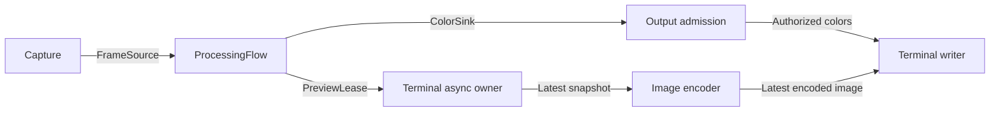

# Terminal output

`prysm-output-terminal` implements `OutputControl` and `ColorSink`. It displays
processed colors around the four screen edges using Ratatui and Crossterm, with
application/capture status, frame lineage, processing revisions and six recent
diagnostics. It replaces WLED in this composition; it does not observe or mirror
physical LED delivery.

Use [the terminal configuration](../../assemblies/examples/terminal.json), selecting
your capture device, then run from the repository root:

```sh
cargo run --manifest-path v1/Cargo.toml -p prysm-assemblies \
  --features headless --bin prysm-headless -- /path/to/terminal.json --terminal --start
```

Without `--start` the host stays idle. Stdout must be an interactive terminal.
Ctrl-C and SIGTERM use the normal host shutdown path. There is no raw mode or
keyboard-input worker. On Unix, the screen temporarily suppresses input echo and
the input-overflow bell so scroll-generated arrow keys and typing cannot corrupt
the dashboard or interrupt an image payload. Each redraw discards unused input to
keep the input queue from filling. Signal handling stays enabled; restoration
discards unused input and restores the original terminal
settings. The dashboard separates current host status from the last
application snapshot, labels diagnostic severity and shows newest events first.
Below 72 columns or 22 rows it switches to a compact layout, prioritizing host
status and the latest diagnostic; very small terminals omit the LED preview.
Diagnostics retain six bounded messages, with as many visible as space allows.
Resizing is handled by Ratatui. Large LED counts are sampled into the available cells, preserving the
screen orientation and converting linear colors with the existing sRGB conversion.

## Ownership and transitions

Construction is inert. The returned `owner` owns a joined terminal thread and,
when preview is active, a joined image encoder;
`control` and `colors` go to the application and flow. Optional `diagnostics`
accepts presentation updates only. The host retains `shutdown`, which immediately
and permanently closes admission. No public handle writes to the terminal.

| Input | Behavior |
| --- | --- |
| Configure | Validate LED counts and require no unfinished session; draw configured output |
| Hold | Fence the epoch, discard obsolete candidates and draw the supplied colors |
| Admit | Admit exactly the requested epoch; draw its newest candidate or held colors |
| Offer | Nonblocking; retain one newest eligible candidate |
| Finish Off | Seal the session, draw black and clear frame metadata before acknowledging |
| Native | Unsupported; capabilities report `native_mode: false` |
| Diagnostics / resize | Redraw the current display; never recover colors from a sealed session |
| Shutdown | Fence all new work, finish any owned draw, reject queued commands, restore styling/cursor/screen and join |

The [shared admission rules](../../crates/output/src/lib.rs) are also used by WLED.
The [mailbox](src/mailbox.rs) owns inputs, notifications, worker registration and
atomic observations. The [worker](src/worker.rs) serializes all controls and draws;
successful control replies follow the draw/flush. Frames, diagnostics and resizing
redraw at most ten times per second; control transitions are immediate. The
[screen](src/screen.rs) owns terminal restoration; [UI](src/ui.rs) is pure layout. Diagnostics are
bounded and control characters are removed before rendering. The assembly forwards
application observation updates and translates host events into `HostDiagnostic`
facts. The terminal adapter owns their wording, severity, and panel placement;
no presentation types or terminal dependencies enter the application contracts.

Blocking terminal writes happen on the retained worker, not the host executor.
Keep the owner future alive through shutdown. If it is cancelled, its Drop fallback
requests shutdown and joins synchronously. Failed restoration is `RecoveryRequired`,
including restoration after a partially failed terminal acquisition. Tests use a
gated display and Ratatui's `TestBackend`; no capture hardware is needed.


## Live video preview

The terminal assembly calls `owner.with_preview(&flow.preview).await` before running
owners. This subscribes through the existing `PreviewSource` contract; it cannot
start capture. The async terminal owner forwards one latest snapshot into its mailbox.
A separate retained encoder samples the processed viewport and uses `ratatui-image`
to prepare images. Only the terminal writer emits escape sequences. No HTTP service,
second capture consumer, or video queue is involved.



The center shows source pixels cropped to the processor's viewport, then center-cropped
to fill the whole area inside the LEDs without letterboxing. The status caption sits
on the outer border. Brightness,
correction and smoothing apply to the LED colors, not the source image. Image and
output delivery are independent: `paired` means the displayed image and admitted
colors have the same frame stamp and settings revision; `latest source` means they
differ. Held, off, old-epoch or over-one-second-old imagery is labelled `stale`.
The displayed age measures time since preview receipt, **not capture latency**.
Preview colors never replace the authoritative output perimeter, including after Off.

Images refresh at up to ten frames per second. Work is bounded to a latest source,
one in-flight conversion, one pending conversion and one completed result plus the
currently displayed image. Sampling is capped at 640×360 pixels independently of display size. WezTerm/iTerm2
scale that bounded PNG to the requested cell area; larger Kitty/Sixel images fall
back to half blocks when native scaling would exceed the encoding budget. The
cell count must fit Ratatui's 16-bit buffer limit;
resize or font changes invalidate obsolete results without restarting the encoder. RGB24, BGR24 and YUYV are supported. MJPEG or
encoding failure disables preview without failing lighting.

Direct iTerm2/WezTerm and Kitty/Ghostty sessions use native images when terminal
pixel geometry is available through the window-size API. Unknown geometry, other
terminals and multiplexers use Unicode half blocks. This deliberately avoids the
library's input-query helper, which can leave a detached reader after a timeout.
Each redraw uses synchronized output so supported terminals, including WezTerm,
present image erasure and replacement together. The end marker is attempted even
on draw failure and retried during restoration. No input queries
or `tmux` configuration commands are needed. Native
Kitty rendering reuses one owned image ID and deletes it during screen restoration.
PNG encoding is enabled for iTerm2; image default features and Chafa are disabled.

On preview failure/closure the lease is dropped and the encoder is signalled to stop.
Its handle remains retained until screen restoration joins it. Shutdown drops preview
demand before waiting for the screen writer. Tiny layouts temporarily omit video.
Hardware image quality and throughput still need validation in a real graphics terminal.

The Unix PTY input regression exercises scrolling/typing, Ctrl-C, SIGTERM and exact
input-mode restoration without capture hardware (omit `--start`):

```sh
python3 v1/adapters/output-terminal/tests/check_input.py \
  v1/target/debug/prysm-headless v1/assemblies/examples/terminal.json --terminal
```
