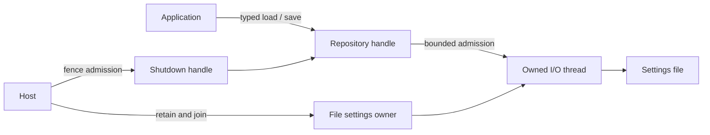

# File settings adapter

`prysm-settings-file` implements `SettingsRepository<Settings<C, O>>`. The application
sees typed values and domain errors. File encoding, paths, temporary files, threading and
shutdown controls stay in this crate. The full settings document is shared with
command adapters through `prysm-protocol`. Adapter-owned `C` and `O` need Serde only at
this composition boundary; no serialization dependency is added to the domain.



`FileSettings::new(path)` returns `repository`, `owner`, and `shutdown`. It creates
one worker thread; retain its owner immediately. `owner.run(shutdown_future)` waits
asynchronously for completion and joins that thread. Do not abort this owner as a
shutdown strategy. Dropping it fences admission and joins synchronously as a last
resort, which can block the executor if filesystem I/O is stuck.

The queue holds one waiting request in addition to the executing request. A full
queue returns `Conflict`. Shutdown admission and enqueue share a mutex, with no
lock held across I/O or an await. `shutdown.request()` drops the queue sender under
that lock: new requests fail, accepted requests drain. Losing a caller only drops
its reply receiver. Serialization also runs on the owned thread.

To read the implementation, start with `lib.rs` for the public handles and owner.
`admission.rs` owns acceptance and shutdown under one lock. `worker.rs` receives a
request, loads or saves it, retains failures, and replies. `disk.rs` makes the
rename boundary explicit; `format.rs` encodes/decodes the shared `SettingsDocument` with file-specific errors.

## Disk format

The JSON document has `capture`, `output`, `processing`, `profiles`, and
`active_profile`. Capture/output use the selected adapters' representations. Omitted
capture/output/profile selection mean unconfigured; omitted processing/profiles use
the existing defaults. Unknown document fields and malformed or invalid data fail
load. Only an absent file returns `None`; loading never creates a file.

```json
{
  "capture": null,
  "output": null,
  "processing": { "brightness_percent": 80 },
  "profiles": [],
  "active_profile": null
}
```

The saved document contains the full processing configuration and profiles.
Correction stores validated numerical coefficients (`gains`, `tone`, `intensity`,
`hue`) losslessly, including floating-point round trips. Profile identifiers are
nonzero JSON integers. Aggregate validation uses the domain's existing validator;
concrete capture/output validation stays with their ports during application load
and replacement acceptance.

The executable selects the output adapter: `prysm-headless` uses WLED, and
`prysm-tui` uses terminal output. The settings file's `output` is that adapter's
settings object, without an adapter tag. No migration, revision envelope, external
edit monitoring or adapter-type switching is implemented.

## Commit and failure boundary

Saving first encodes/validates the complete candidate, then writes a unique temporary
file in the destination directory, syncs that file, atomically replaces the
destination, and syncs the directory. The parent directory must already exist.
Temporary files use restrictive permissions; successful replacement retains those
permissions rather than copying permissions from an older settings file.

| Outcome | Meaning |
| --- | --- |
| Success | File replacement and the documented sync calls completed |
| Ordinary error before rename | Destination remains unchanged; the temporary file is dropped/cleaned up |
| Error after rename | `RecoveryRequired`: disk may contain the new value; no rollback is claimed |
| Worker panic | `RecoveryRequired`: commit outcome cannot be certified |

Uncertainty latches the error, closes admission, and rejects queued requests without
performing further writes. The owner returns that error even if its caller vanished.
Ordinary failures allow later requests, but the latest operation failure is retained
for the final owner result, even after a successful retry. Sending a reply is not
proof that the application observed it. This bounded diagnostic retention deliberately
means host shutdown may report an earlier, already-handled settings failure.

The save implementation targets local Unix filesystems (macOS/Linux/webOS), with
atomic rename and file/directory `sync_all`; non-Unix writes are rejected before
mutation. These are OS/filesystem guarantees, not a promise against every storage
controller or power-loss failure. See Rust's [rename](https://doc.rust-lang.org/std/fs/fn.rename.html)
and [sync_all](https://doc.rust-lang.org/std/fs/struct.File.html#method.sync_all) contracts.
A single process owns a settings path. Cross-process writers and network filesystems
are outside the supported protocol. Temporary cleanup is best effort if the OS
rejects removal, and a process crash can leave an unused temporary file.

## Host ordering and tests

Launch/retain the repository owner before application initialization. During normal
shutdown, close the repository after the application joins. During terminal shutdown,
fence repository admission before aborting the application; stop hardware independently
and retain/join the worker even if a commit is stalled. A deadline reports outstanding
work; it never detaches the thread.

Tests use real temporary files and private commit checkpoints for missing/malformed
files, full round trips, precommit preservation, post-rename uncertainty, queue
bounds, cancelled waiters and shutdown. Host tests exercise real file loading and
application replacement, plus application abort during gated serialization with
independent hardware shutdown and retained late errors. No filesystem framework or
production fault-injection interface is introduced.
