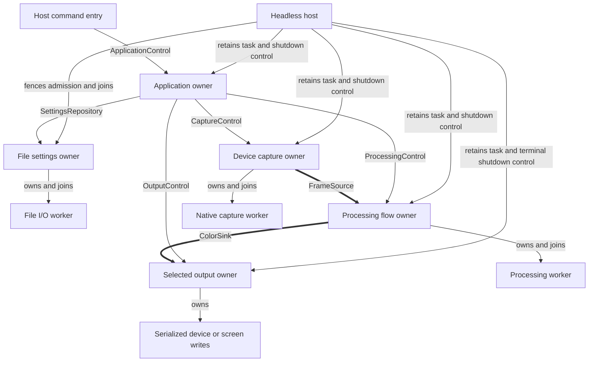

# Headless host ownership and failure transitions

Implemented by the headless assembly. The first host
composes video device capture, the passive processing flow, WLED or terminal output and the
application. Terminal output optionally consumes the flow's diagnostic preview lease;
preview failure is contained by that adapter and does not terminate lighting.
HTTP, browser preview serving, remote/TV capture and automatic restart are
outside this step. See the [architecture plan](../../docs/plans/prysm-v1-architecture.md)
and [application transitions](../crates/application/TRANSITIONS.md).

## Ownership



The host owns composition lifetime. The application owns lighting sessions and
their ordering. Each adapter owns its resources and truthful cleanup results.
The host never reads a mailbox, joins an adapter's inner worker directly, assigns
session epochs, or implements another lighting lifecycle. Snapshots are reports,
not recovery instructions.

Keep implementation in the assembly: `server/runtime.rs` constructs the concrete graph;
a private `server/host.rs` drives one explicit `select!` loop. `server/lifecycle.rs`
owns the phases, deadlines and failure retention; `server/owners.rs` retains the
five task handles and shutdown controls (memory-only test repositories need no owner). Tests live beside the host loop.
Use named task slots, not a task registry, generic supervisor or state-machine
dependency. Completed tasks are consumed once and removed from the select loop.
Retain the initiating failure and subsequent cleanup failures separately; a later
successful join cannot erase the original failure.

## Startup

1. Validate host configuration and create one instance identity. Device adapters,
   processor and application are inert at construction. The file repository starts
   its I/O thread immediately: retain its returned owner and shutdown control before
   transferring the repository handle into the application.
2. Launch the file settings, output, capture and flow owners, retaining each handle immediately.
   Launch the application last. Watch owner exits throughout startup.
3. Await an application observation response as the initialization handshake,
   while still selecting owner exits and process shutdown. It proves settings
   loading and component observation setup completed, not hardware readiness.
4. Open command entry only after initialization. Initial intent is Off. Any
   Processed request, including a future explicit launch option, uses the
   application port. The host does not start capture directly.

Failure after any launch cleans up every launched owner. No shared fail-fast
`try_join!`, detached task or assumption that spawning means ready.

## Failure transitions

These are host phases; capture availability and lighting session phases remain
inside their existing owners. A deadline is a diagnostic, not another phase or
permission to discard ownership.

| Phase | Event | Action | Next phase |
| --- | --- | --- | --- |
| Starting | Initialization succeeds | Enable command entry; remain Off | Running |
| Starting | Validation/initialization fails, startup deadline expires, or required owner exits | Retain cause; close entry; clean up whatever was launched | Terminal stop |
| Starting / Running | Process shutdown requested | Close entry; signal application shutdown; keep dependencies alive | Coordinated stop |
| Running | Capture temporarily waits | Application holds black and reconciles later epochs | Running |
| Running | Session operation fails; owners remain alive | Application owns cleanup and reports the failed operation; host does not retry | Running |
| Running | Session cleanup is blocked or recovery is required | Keep ownership and report failure; application forbids Start until its obligations are discharged; no host reconstruction | Running |
| Starting / Running / Coordinated stop | Capture, flow, output or settings task exits unexpectedly, including `Ok` or panic | Record exit; component observations also tell the application; terminate this composition without waiting for cleanup through a dead port | Terminal stop |
| Running | Application task exits, including unexpected `Ok` | Record exit; take over owner shutdown without consulting its last session snapshot | Terminal stop |
| Coordinated stop | Application joins successfully | Session cleanup and accepted saves are complete; close settings admission and join its owner, shut down flow before closing capture's frame endpoint, then close capture/output and join all | Coordinated stop |
| Coordinated stop | Application returns an error, or cleanup deadline expires | Retain failure/overdue diagnostic; take over terminal shutdown | Terminal stop |
| Terminal stop | Another owner exits | Record its result; continue independent cleanup; never restart it | Terminal stop |
| Coordinated stop / Terminal stop | All launched tasks have joined | Return the accumulated result; incomplete cleanup remains a failure | Stopped |
| Terminal stop | Cleanup deadline expires | Report pending owners and unconfirmed cleanup; retain handles and continue waiting | Terminal stop |
| Either stop phase | Repeated shutdown request | Idempotent; do not reset deadlines or abort device owners | Same phase |

An optional portal or preview task, when introduced, reports its own failure and
leaves lighting running. Do not add either task to this first host just to exercise
that policy. An observation gap requests a new snapshot; it is not owner death.
The host uses task completion as lifetime evidence and does not duplicate the
application's component subscriptions.

## Coordinated shutdown

```mermaid
sequenceDiagram
    participant H as Host
    participant A as Application
    participant O as Output
    participant C as Capture
    participant F as Flow
    participant S as File settings
    H->>H: Close command entry
    H->>A: Request shutdown
    A->>O: Hold black; close epoch admission
    A->>C: Stop; await release and racing open
    A->>F: Session barrier
    A->>O: Finish Off
    Note over A,S: Accepted saves settle before application completion
    A-->>H: Owner completion
    H->>S: Fence requests, drain and join
    H->>F: Shutdown and join
    H->>C: Shutdown and join
    H->>O: Shutdown and join
```

This is the existing application protocol, including its blocked cleanup states.
The host requests it once and keeps polling every owner. It does not issue a second
set of session controls alongside it. If flow is overdue after the application
has finished, the shutdown deadline takes the host into terminal stop so other
owners still receive shutdown requests.

## Terminal shutdown

Coordinator failure can occur after a device accepts work but before the
application publishes it. WLED observations also omit held/finishing session
identity. Therefore retained `EmergencyControls` plus a last snapshot cannot
reliably supply `hold(epoch)`, `stop(session)` and `barrier(session)` arguments.
The existing known-session cancellation test proves those ports survive caller
loss; it does not establish an arbitrary-crash recovery protocol.

Terminal shutdown permanently retires the composition:

1. Close command entry and synchronously request terminal WLED shutdown. This
   permanently fences new output work without awaiting a network operation. Fence file
   repository admission synchronously as well; accepted I/O remains owned.
2. Request cancellation of the application task if still alive, without awaiting
   its join yet. This is deliberate only
   for the coordinator: its accepted device and file work remains owned by the retained
   adapters. It retires the command issuer instead of asking it to clean up
   through ports that are closing. Adapter shutdown fences also reject commands
   racing with cancellation.
3. Signal capture and flow shutdown without awaiting either one's completion
   first. Capture owns cancellation of racing opens and native release; flow owns
   dropping pending frames and joining in-flight processing. The output owner
   independently settles its current write and attempts Off.
4. Join the coordinator and observe every remaining owner to completion. One stalled owner must not
   prevent shutdown requests or observation of the others. Preserve errors and
   unconfirmed cleanup; never abort capture, flow, output or settings as a timeout strategy.

Output may finish Off before capture releases in this terminal path. The permanent
fence makes that safe: no later frame or command can reopen output. This differs
from a reusable session Stop, which requires capture release and the processing
barrier before final output. Neither path claims control of packets already in
the network or physical confirmation from WLED.

### Adapter shutdown boundary

Capture and flow already support owner-scoped shutdown without session IDs.
The terminal output has the same irreversible shutdown capability, retaining its
current draw through restoration and thread join. Its diagnostics are updated
through a mailbox; the host never writes over the active screen. Host events carry
settings-free application snapshots, so the supervisor is independent of the
selected output's settings type. A separate host shutdown status remains visible
while the last application snapshot is retained during cleanup.
WLED supplies a concrete terminal shutdown handle retained by the host. Its
idempotent synchronous `request()` latches shutdown inside the adapter, rejects
new/queued configure/admit/hold/finish commands, discards pending colors, disables
refresh and wakes the owner. An already executing write remains owned; after it
settles, shutdown takes priority over any next ordinary write and attempts Off
unless the transport outcome is uncertain. Every continuation of an in-flight
multi-write command must check the latch before starting another ordinary write.
Owner completion, not `request()` returning, reports the shutdown result.

The latch must serialize with admission so a racing command cannot reopen it.
Authorization of each ordinary write uses that same synchronization: a write
authorized before the terminal request counts as in flight and remains owned;
none may be authorized after it. A separate boolean check followed by a write
would leave a race. This is private adapter state, not a generic permit framework.
Observations stay available while cleanup is pending. The existing shutdown
future uses the same terminal path and is polled independently of the writer,
including while HTTP is pending. Each HTTP request is authorized separately. This capability belongs
to the concrete adapter lifecycle, not `OutputControl` or a generic scheduler.
The host sees no mailbox or transport internals. Retained session control clones
may remain useful to other assemblies but are not the terminal recovery authority.

Task completion and cleanup success are separate facts. An owner error or panic
may leave release or remote output state unconfirmed even after every task joins.
If an owner never finishes, the host remains in terminal stop and reports that
fact. External process termination is an operational escape, not clean shutdown;
no in-process design contains process abort or arbitrary native memory corruption.

## Verification boundaries

- Host tests cover required-owner exit during startup, initialization timeout,
  and shutdown before initialization; no command entry opens early.
- Host tests verify ordered joins and real idle owners. Existing application and
  capture integration tests cover active capture and racing Start cleanup.
- Host tests cover unexpected successful owner exits, coordinator panic after
  command acceptance, and stalled application/flow cleanup. Terminal cleanup needs
  no session snapshot and cancels the coordinator before joining the remaining owners.
- With real WLED owner and gated transport, terminal request during a stalled
  write fences offers and queued admissions immediately; no refresh or next
  ordinary write starts after the current write settles; Off cannot overtake it.
- Gate native release and processing completion independently: neither prevents
  the other owner's shutdown request; failures remain failures after all joins.
- Expire deadlines and send repeated shutdown requests: no task detaches, no
  restart occurs, results are consumed once, and a late completion is still joined.

Use existing public ports and owner tests with controlled gates. Physical capture
release and WLED behavior still need hardware qualification; mocks cannot prove them.

The file owner retains the latest operation error even if delivery to the application
reply channel succeeded: delivery does not prove observation before cancellation.
Uncertain commits fence future writes and retire the owner. Normal errors permit
retry but remain in the final owner result. See the [file adapter guarantees](../adapters/settings-file/README.md).
