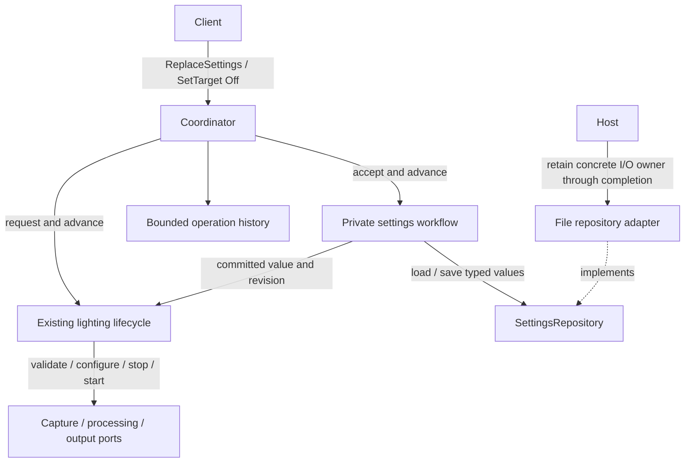
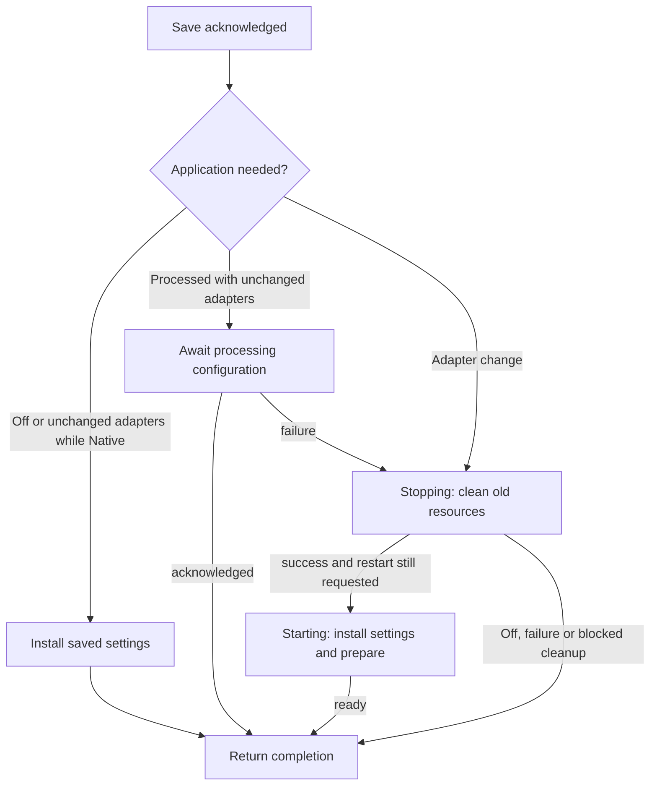

# Typed settings replacement and persistence

The application workflow is implemented and exercised with gated repositories and
device ports. Concrete file persistence and its host-owned I/O worker remain the
next implementation step. This extends the [lighting lifecycle](TRANSITIONS.md) and follows the
[architecture plan](../../../docs/plans/prysm-v1-architecture.md): validate,
persist atomically, then apply. Storage and hardware do not form one transaction.

## Ownership



- `settings.rs` owns the last confirmed saved value/revision, the candidate,
  retained persistence call and replacement outcome. It is private application
  state driven by the existing task, with no task or mailbox of its own.
- `session::Lifecycle` owns the settings bound to its current resources, all
  device calls, processing reconfiguration and cleanup. A new saved value cannot
  overwrite the old output address or capture settings before their cleanup.
- The coordinator routes commands and completions between those modules. It
  neither inspects lifecycle phases nor writes individual settings fields.
  Lifecycle exposes semantic readiness/validation/replacement outcomes; it
  does not expose pending device futures or its model.
- `operations.rs` records full typed request identity and results. It does not
  schedule work or decide which operation to interrupt.
- The repository adapter owns serialization, paths, atomic file replacement and
  any blocking worker. Application and contract crates acquire no filesystem,
  JSON, HTTP or terminal dependencies. The host chooses the repository and path.

The saved value and the resource-bound value are deliberately distinct facts,
not two independently editable copies of application state. Snapshots publish
the saved value; lifecycle transitions alone replace the resource-bound value.

## Reading the implementation

Read `settings.rs` for save ordering, then `session/settings.rs` for the three
application choices. Restart continues through the existing phases in
`session/model.rs`; `session/devices.rs` holds the staged value separately from
the settings bound to the old resources.



`Starting` records whether readiness completes settings application. Cleanup
records what follows Stop: idle, restart, or complete interrupted settings. Off
removes restart intent while retaining cleanup obligations. Blocked cleanup emits
its settings result once; an explicit Off retry only retries resource cleanup.
A live processing update retains its own call because Stop may run alongside it;
the processing barrier waits for its acknowledgment.

Lifecycle methods return `Progress` directly. It carries the lighting outcome and,
when applicable, the settings completion. The coordinator records those results;
it does not poll a completion slot or issue follow-up lifecycle commands. A single
event can complete both Off and an interrupted replacement.

## Revision and completion meanings

| Value / result | Meaning |
| --- | --- |
| `Accepted` | The validated request is owned; completion is queried/observed separately |
| `settings`, `saved_revision` | Revision zero is the loaded/default startup baseline; later revisions identify acknowledged repository commits |
| `configured_revision` | Last revision acknowledged by the processing worker |
| `applied_revision` | Last revision used to process a frame; not LED delivery confirmation |
| Replacement `Succeeded` while Processed | Save succeeded and processing configuration, or replacement session readiness, was acknowledged; no first frame is required |
| Replacement `Succeeded` while Off / Native | Save succeeded and any required old-device cleanup/new idle-mode acknowledgment completed; inactive processing may retain older revisions |
| Replacement `Failed` after a successful save | New settings remain saved; the operation/session explains why application did not complete |

Revisions start at zero after loading under a fresh `InstanceId`, matching the
current contract. They increase with each acknowledged save within that instance.
No persisted revision envelope is needed for this milestone: requests already
carry the expected instance in their operation ID. Check revision exhaustion
before accepting work; never wrap. A fresh replacement request commits and
advances the revision even if the supplied value is identical. Only retrying the
same retained request ID suppresses a repeated save.

On startup, a missing file means the existing unconfigured defaults at revision
zero, without automatically creating a file. Apply the same aggregate, numeric,
profile and supplied-adapter validation used for replacements to loaded values;
the startup target is Off, so incomplete setup is allowed. Invalid/unreadable
stored data fails initialization rather than silently replacing it with defaults.
Loading never starts capture; initial intent remains Off.

## Acceptance rules

Apply these checks before allocating a pending operation or starting I/O:

1. Check the instance and retained request ID first. Same ID and same complete
   command, including `expected` and the typed payload, returns the existing
   acceptance/result without revalidating its now-old expected revision. Same
   ID with different content conflicts. Expired IDs retain the existing bounded
   history semantics; no durable deduplication is promised.
2. Reject new replacements during shutdown, repository uncertainty, calibration,
   another replacement, or a lighting transition. A cleanup-blocked lifecycle
   rejects with `CleanupPending`. Stable Off, stable Native, and an active
   Processed session (including waiting for frames) can accept replacements.
3. Require `expected == saved_revision`, and reserve its checked successor.
4. Validate aggregate/profile relationships and every supplied capture/output
   value through the respective port's side-effect-free validation. Validate
   processing/profile numbers and reject non-finite persisted values; do not
   silently rewrite the submitted payload. Check unique profile IDs and a valid
   active-profile reference. Preserve existing documented finite-value clamping.
5. Validate compatibility with current intent: Processed needs capture and
   output settings; Native needs output settings and native-mode capability.
   Incomplete setup remains valid while Off. To remove required settings while
   running, request Off first.

Typed equality is needed for deduplication and capture/output change detection.
Add the required `PartialEq` bounds/derives to settings values and application
wiring; do not compare debug strings, JSON, hashes or vendor enum variants.
Validation remains an adapter/domain responsibility, not a persistence codec's
substitute for domain rules.

## Replacement transitions

These phases describe settings work only; they do not duplicate session phases.
`Interrupted` retains the outstanding save or application completion and its
cause. It forbids further settings-driven preparation/restart.

| Phase | Event | Action / published result | Next |
| --- | --- | --- | --- |
| Ready | Valid replacement accepted | Retain candidate, next revision and operation ID; begin one save; keep current lighting unchanged | Saving |
| Ready | Validation/revision/availability check fails | Reject before acceptance; no save or device calls | Ready |
| Saving | Save succeeds | Publish new saved value/revision, then request application through Lifecycle | Applying |
| Saving | Save fails with previous value confirmed intact | Fail replacement; keep old saved value, revision and lighting | Ready |
| Saving | Commit/durability outcome is uncertain | Fail with `RecoveryRequired`; retain last confirmed snapshot, request Off and retire this composition; no further settings writes | Unavailable |
| Applying | Required acknowledgments succeed | Complete replacement successfully | Ready |
| Applying | Configuration/start fails | Keep saved value; Lifecycle requests Off and retains cleanup obligations; keep replacement pending until cleanup completes or reports blocked | Applying |
| Applying | Cleanup completes after failure | Publish failed replacement and lifecycle diagnostic; desired target is Off | Ready |
| Applying | Cleanup becomes blocked | Fail replacement with cleanup failure; keep lifecycle resources and forbid replacement/Start until cleanup is resolved | Ready; lifecycle blocked |
| Saving / Applying | Off, host shutdown, or component failure | Latch interruption; begin/continue Lifecycle cleanup toward Off without waiting for storage; retain already-issued work | Interrupted |
| Interrupted | Save succeeds late | Publish saved value/revision; do not start settings application or revive old intent | Interrupted |
| Interrupted | Save fails | Preserve previous confirmed value, or retire on uncertainty; retain persistence error in replacement result | Interrupted / Unavailable |
| Interrupted | Save and any already-issued application work settle | Finish replacement as interrupted, or with a more specific save/application failure; never report cancellation of a committed save | Ready, or closing |
| Any pending phase | Observe / query operation / client disconnect | Continue serving observations and lookups; accepted work stays owned | Same |

An interrupted apply still leaves its session cleanup with Lifecycle. Its failure
to clean up remains visible even if the replacement's own retained work has
settled. Settings never implements a second hold/stop/barrier/finish sequence.
No automatic storage retry, rollback save, or hardware restart after failure.

## Applying a confirmed save

Change classification compares the candidate's capture/output values with the
values bound to the lifecycle, not merely the previous saved snapshot.

| Runtime situation | Application of new value |
| --- | --- |
| Stable Off, no cleanup obligation | Install new value/revision for future Start; do not open/configure hardware |
| Processed; capture/output unchanged | Stage the complete effective processing config and new revision at a frame boundary; keep session, epoch, admission and processing history |
| Processed; capture or output changed | Clean up the old session to Off using its old bound settings; only after confirmed cleanup install new settings and start a fresh session toward Processed |
| Stable Native; capture/output unchanged | Install processing/profile settings for a later Processed request; preserve current Native output |
| Stable Native; capture or output changed | Finish the old output Off before installing/configuring the new settings and applying Native |

Every active Processed replacement with unchanged adapters stages its new
revision, including edits to inactive profiles. This keeps one predictable
application path instead of adding metadata-only revision exceptions. Active
profile correction is resolved by the same domain rule used on Start.

A live processing update is a Lifecycle-owned call. It must settle before the
old session's barrier; Off can close admission and request capture stop while
that call is pending. A late configuration acknowledgment cannot restart capture
or admit an epoch. Capture availability continues to be observed/reconciled
during saving and application, using existing epoch fences.

For an adapter change, a successful save is not permission to reconfigure a
device with unresolved old resources. The old session must finish Off, including
an idle Native obligation. If cleanup fails, preserve the new saved settings,
keep the old resource binding, and require explicit cleanup/recovery. After
cleanup succeeds, a later explicit target request uses the latest saved value;
an interrupted replacement cannot become a delayed automatic restart.

## Off, shutdown and operation ownership

During Saving, Applying and Interrupted, reject new Processed, Native and
replacement commands as conflicting until retained replacement work settles,
even if Off has already completed. The first Off interrupting a replacement is accepted even when its
adapter-change cleanup has already put Lifecycle in Stopping: cancel the planned
restart and attach the Off operation to that existing cleanup. Do not call the
ordinary stopping-state request guard, launch a second cleanup sequence, or drop
pending calls. This is an explicit extension to the current transition table,
which otherwise rejects new requests while Stopping. A duplicate retained request
still deduplicates first; a second distinct Off while one is pending may conflict.

The operation registry must support **one replacement plus one lighting operation**
while Off interrupts settings work. Keep its existing bound of 64 entries, evict
only completed entries and finish by operation ID. Each workflow owns its own ID;
do not retain the current single `active` slot or let a save completion finish an
unrelated Off request. There is no queue of future replacements.

Off completes on acknowledged lighting cleanup; it need not wait for storage.
The replacement stays pending until its issued work settles. Shutdown waits for
both normal lifecycle cleanup and retained settings work before reporting
application owner completion. If stop is ordered before an unissued apply step,
that step never starts; if a device call was already issued, its acknowledgment
remains owned. Existing failures are not overwritten by a generic interruption.

```mermaid
sequenceDiagram
    participant C as Client
    participant A as Application
    participant R as Repository
    participant L as Lifecycle
    C->>A: ReplaceSettings(expected r)
    A-->>C: Accepted replacement
    A->>R: Save candidate
    C->>A: Off
    A-->>C: Accepted Off
    A->>L: Stop using old resource binding
    L-->>A: Cleanup acknowledged
    A-->>C: Off succeeded
    R-->>A: Commit acknowledged
    A->>A: Publish saved revision r+1; no restart
    A-->>C: Replacement interrupted; save remains visible
```

## Repository guarantees and host integration

The typed `load`/`save` port distinguishes confirmed failure from uncertain commit.
The application handles these outcomes; concrete disk persistence remains deferred:

| Save outcome | Required meaning |
| --- | --- |
| `Ok(())` | Atomic replacement and the adapter's documented durability steps completed |
| Ordinary error | Previous stored value is confirmed intact; candidate was not committed |
| `RecoveryRequired` | Commit or durability cannot be confirmed; disk may contain old or new value; further writes are blocked until repository recovery/restart |

A file adapter writes a temporary file in the same directory, syncs its contents,
atomically renames it over the destination and syncs the directory where supported.
For example, directory-sync failure after rename cannot truthfully be an ordinary
"old file preserved" error. Clean up precommit temporary files; never delete or
rewrite the destination to conceal a failed acknowledgment. Define durability
per supported platform. This milestone assumes one owning process per settings
file; external edits and cross-process coordination are outside the protocol.

The current host may abort the application during terminal shutdown. That is
safe only if a started repository write survives in a separately retained
**concrete repository owner**, just as device work survives caller loss. The
file adapter returns a typed repository handle and an owner; the host retains
and joins that owner, closes new writes on terminal shutdown, lets an authorized
commit finish, and preserves its errors even if the awaiting application is gone.
Launch this owner before application initialization can call `load`. During normal
shutdown stop it after application completion; during terminal shutdown fence it
alongside the device owners and join it independently.
Use one bounded write slot/retained worker as needed for blocking filesystem I/O,
not a task per save or a generic storage service framework.

This is a required host ownership change when adding the file adapter. It is
not satisfied by dropping a `spawn_blocking` join handle, timing out the save,
or assuming aborting the coordinator aborts a filesystem operation. A stuck
repository owner is reported and retained like other resource owners; deadlines
are not successful cleanup. Ordinary test repositories need no extra owner.

## Acceptance tests for implementation

Use public application ports with gated repositories and the existing gated
device fixtures/real flow. Do not test a second handwritten transition model.

1. Invalid candidate, stale revision, conflicting mutation and wrong instance:
   no accepted operation, no save and no device work.
2. Same retained ID/payload retries before and after commit perform one save;
   changed payload/expected under that ID conflicts. Revision overflow rejects.
3. Delayed/failed save leaves current lighting and all revisions unchanged;
   observations remain responsive. Acknowledged save is published before apply.
4. Live processing/profile replacement keeps session and epoch; configured
   revision advances on acknowledgment and applied revision only on a new frame.
5. Capture/output change uses old settings through hold/stop/barrier/Off and
   changes the binding only after cleanup; cover Native output address changes.
6. Save succeeds but apply/cleanup fails: saved settings remain new, revisions
   remain truthful, resources remain old where necessary, and no automatic restart
   occurs. Explicit Off then Start uses the latest saved value.
7. Off/shutdown during save and live processing/restart work: cleanup progresses,
   no late continuation relights output, operation results stay associated with
   the correct IDs, and all accepted I/O remains owned after client disconnect.
8. Missing/invalid file, precommit failure, post-rename uncertainty and restart:
   no silent defaults or false rollback claim; uncertain storage retires the
   composition and preserves the last confirmed snapshot as such.
9. Host abort during a gated file commit: hardware shutdown proceeds independently,
   the repository rejects new writes, and host completion waits for the retained
   commit/worker and reports its outcome. No orphaned blocking task remains.

Implementation order: application workflow and revision semantics against gated
repositories; then concrete file persistence plus host ownership; then expose
replacement through a host command adapter. HTTP, calibration implementation,
file migration, hot adapter-type switching and general transaction abstractions
remain outside this step.
