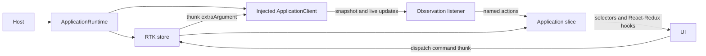

# Frontend state and explicit wiring

Each frontend host creates an `ApplicationRuntime` with one injected
`ApplicationClient` and one Redux Toolkit store. RTK replaces the old custom store;
there is no second snapshot cache. The Rust coordinator remains authoritative for
settings, lighting and operation completion. RTK Query is not used.

## Read these pieces together

| File                                                                                                        | Responsibility                                                                                       |
| ----------------------------------------------------------------------------------------------------------- | ---------------------------------------------------------------------------------------------------- |
| [Client port](packages/application-client/index.ts)                                                         | Generated payload types and transport-independent methods; no Redux/React dependency                 |
| [Slice](packages/application-state/slice.ts)                                                                | Pure state transitions, sequence/instance checks and selectors                                       |
| [Commands](packages/application-state/commands.ts)                                                          | Typed thunks, operation IDs and submission/error handling                                            |
| [Observation listener](packages/application-state/observation.ts)                                           | Acquire the atomic snapshot/stream, feed actions, close on cancellation or failure                   |
| [Runtime assembly](packages/application-state/index.ts)                                                     | Create the store, inject the client into middleware, register the listener, count observation leases |
| [React Provider](packages/application-react/provider.tsx) and [hooks](packages/application-react/index.tsx) | Bind a host's store to React and release its observation lease on unmount                            |
| [Server host](hosts/server/web-portal/main.tsx) and [TV host](hosts/webos/tv-ui/app.tsx)                    | Select HTTP/Luna/fixture clients and mount the Provider                                              |



Hosts construct the runtime explicitly:

```tsx
const application = createApplicationRuntime(client);

<ApplicationProvider application={application}>
  <WebPortal
    application={application}
    captureSettings={ServerCaptureSettings}
    outputSettings={WledOutputSettings}
  />
</ApplicationProvider>;
```

The `ServerWebPortal` and TV host components already mount their Provider.
Stores are never module-level shared singletons inside libraries. Multiple
providers may share a runtime: its final lease release ends observation only.
A host without React can acquire/release the same lease through `connect()`.

## Commands are separate from observed state

```ts
const accepted = await application.store.dispatch(
  application.commands.setTarget('processed'),
);
const result = await application.store.dispatch(
  application.commands.checkOperation(accepted.operation),
);
```

Submission emits `commandSubmitted`, then `commandAccepted` or `commandFailed`.
Acceptance does not change the observed lighting target. Only received snapshots
can do that. `operationReceived` records the coordinator's separate result.
Unknown outcomes preserve their operation ID and are never automatically replayed.
The returned promise preserves the original typed error for the caller.

The slice keeps feedback for the latest submitted command, not an operation
history. Delayed earlier replies cannot overwrite it. The coordinator owns
retained operation results; callers may explicitly query any known operation ID.
The current wire projection has snapshots but no operation events, so completion
queries are explicit rather than an implied background polling service.

## Observation lifetime

The first lease dispatches `observationRequested`. The listener acquires an
atomic initial snapshot/subscription and dispatches `observationConnected` followed
by `snapshotReceived` actions. The slice rejects gaps and changed instances by
clearing the snapshot and entering `resync_required`; the listener closes that
stream. Explicit resync notices do the same. Automatic reconnect remains deferred.

Every connection has a local generation. Late responses from released connections
cannot replace a newer connection's state. The listener's cancellation signal is
passed to the transport, and acquired observations are closed once even when
acquisition completes after release. Transport `close()` must end pending reads.

The final lease release dispatches `observationReleased`. It neither commands
lighting off nor cancels submitted application commands. UI unmount and command
ownership remain independent.

## What stays out of Redux

Form drafts and focus remain local to React. Clients, connection handles, abort
signals, frames, preview resources and playback objects are not state or action
payloads. Calibration presentation and private credentials stay on the dedicated
client/presenter path, outside Redux and its DevTools history.

RTK's default serializability/immutability checks remain enabled in development.
Adapter settings supplied through this frontend contract must be serializable
wire values; the Rust domain can retain its own richer representations.

## Maintainer guidance

RTK lives in `@prysm/application-state`; React-Redux lives in
`@prysm/application-react`. The workspace's installed Intent can discover the
skills shipped with RTK. Run these commands from `v1/frontend`:

```sh
npm exec --no -- intent list
npm exec --no -- intent load @reduxjs/toolkit#model-redux-state/build-slices-and-selectors
npm exec --no -- intent load @reduxjs/toolkit#orchestrate-side-effects/handle-side-effects
```

The applicable guidance covers ownership, pure reducers, named events, injected
side effects and per-host store lifetime. RTK Query remains deferred by the project
decision even where general library guidance recommends it for ordinary caches.
