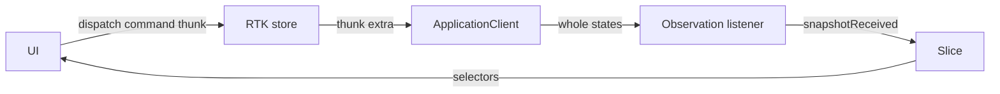

# Frontend state and explicit wiring

Each frontend host creates an `ApplicationRuntime` with one injected
`ApplicationClient` and one Redux Toolkit store. The Rust engine is
authoritative; the store holds the latest state it sent and feedback for the
latest command. RTK Query is not used.

| File | Responsibility |
| --- | --- |
| [Client port](packages/application-client/index.ts) | Generated wire types, `observe`/`setTarget`/`replaceSettings`, `ApplicationError` |
| [HTTP client](packages/application-client/http.ts) | Fetch transport and SSE decoding for the [portal API](../surfaces/web-portal/HTTP-CONTRACT.md) |
| [Slice](packages/application-state/slice.ts) | Connection status, latest state, latest command |
| [Commands](packages/application-state/commands.ts) | Typed thunks; section replacement against the observed revision |
| [Observation listener](packages/application-state/observation.ts) | Stream lifetime and reconnect |
| [Runtime assembly](packages/application-state/index.ts) | Store, injected client, listener, observation leases |
| [Provider](packages/application-react/provider.tsx) and [hooks](packages/application-react/index.tsx) | React binding; the Provider holds an observation lease |



## Commands

```ts
await application.store.dispatch(application.commands.setTarget('processed'));
const revision = await application.store.dispatch(
  application.commands.configureOutput(snapshot.revision, wled),
);
```

A command resolves when the engine has finished it and rejects with the
server's `Failure` (`invalid` with `field`, `stale_revision` with `current`,
`faulted`, `adapter`, ...). The slice records `commandSubmitted`, then
`commandSucceeded` or `commandFailed`, for the latest command only; a late reply
to an earlier command cannot overwrite it. Observed state changes only when the
stream delivers a new state.

`configureCapture`/`configureOutput`/`configureProcessing` copy the observed
settings, replace one section and send `expected`. If the observed revision is
not `expected`, the command fails locally with `stale_revision` and nothing is
sent. The portal's forms pass the current revision after checking that their own
section has not changed since the draft started, so saving one section never
conflicts with another; see [saving settings](README.md#saving-settings).

## Observation

The first lease dispatches `observationRequested`; the listener opens the
stream and dispatches `snapshotReceived` for the initial and every later state.
Each state is complete, so there are no cursors or resynchronization. On loss
the listener reconnects with backoff (250 ms up to 5 s); `forbidden` (the portal
refuses this page's origin) and the final lease release stop it. Every connection has a generation, so a stream
acquired after release is closed without touching newer state. Releasing
observation never commands lighting.

## Outside Redux

Form drafts, field errors, focus, clients and abort signals stay out of the
store; each form shows the result of its own commands. The HTTP
client holds only the portal's base URL; the portal needs no credentials.
