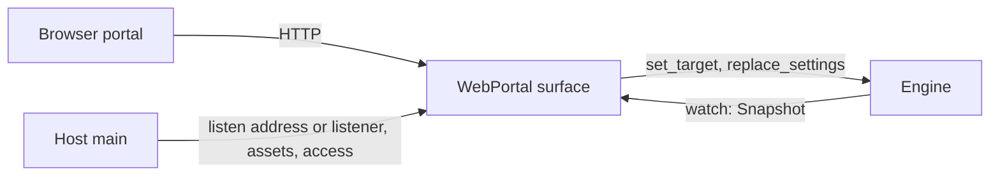

# Portal HTTP contract

The web portal is a [`Surface`](../../crates/runtime/src/surface.rs) of the
[simplified runtime](../../../docs/plans/prysm-v1-simplified-runtime.md). It
serves the host's frontend bundle and a small JSON API over plain HTTP/1.1 on
any address, typically the LAN, without authentication.
Every API call maps to one `EngineHandle` call; the portal keeps no state of its
own beyond connection limits.



## Host wiring

```rust,ignore
let portal = WebPortal::new(listen, ASSETS, Access::SameOrigin)?;
Prysm::builder(store).source(..).output(..).surface(portal).run(shutdown).await
```

- `WebPortal::new(SocketAddr, &'static [FrontendAsset], Access)` binds when
  the surface starts; a bind failure is a surface failure and lighting continues.
- `WebPortal::from_listener(std::net::TcpListener, ..)` takes a bound listener,
  so bind errors surface before the host starts and the port is known.
- `Access` says which browser pages besides the portal's own may use the API:
  `SameOrigin` (the default), `Origins(vec!["http://192.168.1.30:3000".into()])`
  or `AnyOrigin`. See [Access](#access).
- Both validate at construction and return `Error::Invalid` with field
  `portal.access` (an entry that is not `scheme://host[:port]`, including `null`
  and `*`, which need `AnyOrigin`) or `portal.assets` (not absolute, under
  `/api/`, `.`/`..` segments, `?#%\`, duplicates or an invalid content type).
  Any listen address is accepted.
- `FrontendAsset { path, content_type, bytes }` lists are generated by
  `npm run build` as `dist/<host>/web-portal/assets.rs` for `include!`.

## Routes

API routes need no credentials; the origin policy in [Access](#access) applies
to every `/api/` request. Revisions are JSON numbers. Wire types are generated from [prysm-protocol](../../crates/protocol/src/lib.rs)
into `@prysm/contracts/application`.

| Method and path | Body | Success |
| --- | --- | --- |
| `GET /` and exact asset paths | — | `200` asset; `/` serves `/index.html`. Unknown paths `404`; API paths never fall back to HTML. |
| `GET /api/v1/state` | — | `200 State` |
| `GET /api/v1/state/stream` | — | `200 text/event-stream`: `data: <State>` now, then after every change |
| `PUT /api/v1/target` | `TargetRequest { target }` | `204` once the engine has applied the target |
| `PUT /api/v1/settings` | `SettingsRequest { expected, settings }` | `200 SettingsReplaced { revision }` once saved |

`State` is `{ target, session, settings, revision, failure, surface_failures }`.
`session` is `{ "state": "stopped" | "running" | "native" }` or
`{ "state": "faulted", "phase": "running" | "closing_source" | "idling_output" | "finishing" }`.
`settings` is the settings file format: `{ capture?: { kind, ... }, output?: { kind, ... }, processing: { ... } }`.
`failure` is the last lighting failure or `null`.

Settings replacement is whole-document and optimistic: send the `revision` you
edited from as `expected`. The engine validates, persists, then applies. A
successful reply means saved; an apply failure afterwards appears in
`State.failure`. A conflict is never retried automatically.
Revisions start from a random value each time the process starts (below
2^52, so they stay exact JSON numbers) and count up by one per replacement, so a
page holding a revision from before a restart gets `409` instead of
overwriting newer settings.

The stream sends whole states, not deltas, so there are no cursors, gaps or
resynchronization: a slow reader skips intermediate states, and a reconnecting
client simply takes the first event. Idle streams carry a `:` comment every 15
seconds. Streams end when the portal shuts down or the engine stops.

Preview is not served: the engine's preview slot holds raw frames and colors,
and encoding them for the browser is separate work.

## Failures

Every non-2xx API response has a `Failure` body: `{ kind, message, field?, current? }`.
Source chains stay in the process; `message` is what the user can act on.

| Status | `kind` | When |
| --- | --- | --- |
| 400 | `bad_request` | Malformed JSON, unknown fields or wrong value types |
| 403 | `forbidden` | An `Origin` that is neither the portal's own nor allowed (`origin denied`) |
| 404 | `not_found` | Unknown route or asset |
| 405 | `method_not_allowed` | Known API path, wrong method |
| 408 | `bad_request` | Body not received within 5 s |
| 409 | `stale_revision` | `expected` is not current; `current` is the revision to reload |
| 413 | `payload_too_large` | Body over 1 MiB |
| 415 | `unsupported_media_type` | Command without `Content-Type: application/json` |
| 422 | `invalid` | Settings rejected by processing or adapter validation (`field`, e.g. `output.address`), an unknown adapter `kind` (`capture.kind`), undecodable adapter fields, or `Processed` without capture/output configured |
| 429 | `busy` | More than 8 open state streams |
| 500 | `internal` | A panic or unexpected runtime failure |
| 502 | `adapter` | A device or adapter failed to open, write or idle |
| 503 | `faulted` | The engine is faulted; only a restart recovers |
| 503 | `unavailable` | The engine has stopped |
| 504 | `timeout` | The command took over 15 s; its outcome shows in the state |

A client that loses a command reply cannot know whether it ran; it reads the
state rather than resubmitting blindly. The engine finishes a received command
even if the client disconnects.

## Access

Anyone who can reach the listen address can read the state and control the
lights, like the TV's current embedded portal. There is no token, password or
TLS. What the portal does refuse is a *web page from another site* using the
visitor's browser to reach it.

The policy applies to every `/api/` request (commands, state and the stream);
assets are served to anyone. `Host` is not checked and forwarded headers are
ignored.

| Request | `Access` | Result |
| --- | --- | --- |
| No `Origin` header (curl, native apps, same-origin `GET` in most browsers) | any | Served |
| `Origin` is `http://` + `Host` (the portal's own pages, by IP or name; `:80` may be omitted) | any | Served, no CORS headers |
| `Origin` in the list (exact, case-insensitive) | `Origins(..)` | Served with CORS; `OPTIONS` is a preflight |
| Any other `Origin`, including `null` | `AnyOrigin` | Served with CORS; `OPTIONS` is a preflight |
| Any other `Origin`, a repeated or non-ASCII `Origin` | otherwise | `403 forbidden`, `origin denied`, the engine is not called |

CORS responses echo the request's `Origin` in `Access-Control-Allow-Origin`. A
preflight (`OPTIONS` from an allowed cross origin) answers `204` with
`Access-Control-Allow-Methods: GET, PUT`, `Access-Control-Allow-Headers:
content-type`, `Access-Control-Max-Age: 600` and, when asked by Chromium's
Private Network Access, `Access-Control-Allow-Private-Network: true`. No
credentials are involved, so `Access-Control-Allow-Credentials` is never sent.
Every API response carries `Vary: origin`.

Extra origins exist for a TV UI served from its own app origin that drives a
remote headless portal (the capture-only webOS composition). A packaged webOS
app may load from `file://`, which browsers send as `Origin: null`; `null` is
also what any sandboxed frame on any site sends, so allowing it is no stronger
than `AnyOrigin`. `Origins` therefore rejects `null`, and a host that needs it
chooses `AnyOrigin` explicitly, accepting that any web page the user opens on
that network can then drive the lights.

What this protects against:

- A foreign web page sending commands through the user's browser (CSRF):
  browsers attach `Origin` to cross-site `PUT`, CORS and preflight requests, and
  JSON bodies with `Content-Type: application/json` cannot be sent cross-site
  without a preflight.
- A foreign page reading state: without CORS headers the browser withholds the
  response, and a foreign `Origin` is refused before the engine runs.

What it does not protect against:

- Anyone on the network (or anything that can route to the address) with a
  non-browser client: there is no authentication. Bind to `127.0.0.1` to keep
  the portal on the machine.
- DNS rebinding: a page on `evil.example` whose name is re-pointed at the
  portal's address becomes same-origin with it (`Origin` and `Host` both read
  `evil.example:PORT`), so it can drive the lights while the page stays open.
  Refusing it would need a `Host` allowlist, which needs configuration for every
  LAN name and address, so the portal does not check `Host`.
- Eavesdropping or tampering on the network: HTTP is plaintext.

## Limits

- Every response (assets, API, failures, preflights, the stream) carries
  `Cache-Control: no-store`, `X-Content-Type-Options: nosniff`,
  `Referrer-Policy: no-referrer` and
  `Content-Security-Policy: default-src 'self'; frame-ancestors 'none'`: pages
  load only the bundle's own scripts, styles, images and API (no inline code,
  `data:` or `blob:` URLs, so a bundle that needs them must change the policy
  here first), and no other site may frame the portal (clickjacking). A
  cross-origin TV UI is unaffected: CSP applies to the documents the portal
  serves, not to pages that call its API.
- 64 concurrent connections (the listener stops accepting at the limit), 8 state
  streams, 1 MiB bodies, 5 s to read headers and bodies, 5 s per stalled socket
  write (slow or vanished readers are disconnected), 15 s per engine command.

## Lifetime

| State | Event | Action |
| --- | --- | --- |
| Constructed | Surface starts | Bind (or adopt the listener); bind failure ends the surface with `Error::Adapter`. |
| Serving | Request fails validation | Respond without calling the engine. |
| Serving | Client disconnects | Drop its connection; a command already sent to the engine still completes. |
| Serving | Listener fails (not a per-connection error) | Stop serving; the runtime records a surface failure; lighting continues. |
| Serving | Host shutdown | Close the listener at once, end streams, let open requests finish for up to 5 s, then abort the rest. |

Connection tasks are owned by the surface and joined or aborted before `run`
returns; nothing is detached.

## Tests

[`tests/http.rs`](tests/http.rs) runs the portal on loopback against an engine
with `prysm-runtime`'s fake adapters: construction validation, foreign origins
refused before the engine runs (commands, stream, preflight), same-origin and
origin-less requests, CORS for listed and any origins, asset serving, security headers on every kind of response, state read, set target, adapter failure (502),
missing settings (422), settings replace success/stale/invalid/undecodable,
media type and size limits, stream delivery, the stream limit, a faulted engine
(503) and prompt listener shutdown.
